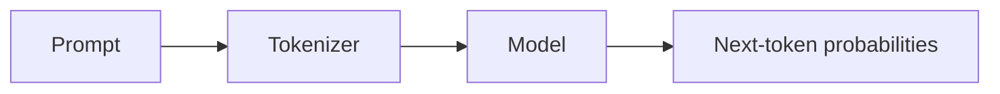

# Writing course content

Read `CURRICULUM.md` for slugs. Look at `content/modules/01-model-foundations/01-how-networks-learn/` as the reference.

## Files

```
content/modules/NN-<module>/module.json
  { "title": "How LLMs Work", "summary": "One sentence.", "icon": "network", "cover": "<sim id or omit>" }

content/modules/NN-<module>/NN-<lesson>/lesson.json
  {
    "title": "...", "summary": "One or two sentences.",
    "objectives": ["After this lesson you can ...", "..."],      // 3-5 items
    "prerequisites": "Markdown: what you should know first, linking /learn/<module>/<lesson>.",
    "sims": ["sim-id"], "labs": ["lab-slug"],
    "sources": [ { "title": "Attention Is All You Need", "authors": "Vaswani et al.", "year": 2017, "note": "Section 3.2: scaled dot-product attention" } ]
  }

content/modules/NN-<module>/NN-<lesson>/NN-<topic>.md
  ---
  title: A model is a function with knobs
  minutes: 6
  ---
  (markdown body; do NOT repeat the title as a heading)

content/interview/NN-<module>.json
  { "module": "<module-slug>", "sections": [
      { "slug": "<lesson-slug>", "title": "Tokenization", "lesson": "<lesson-slug>",
        "questions": [ { "level": "junior|mid|senior", "q": "...", "a": "markdown answer, 80-200 words, may use $math$" } ] } ] }

content/glossary/NN-<module>.json
  [ { "term": "KV cache", "slug": "kv-cache", "def": "One or two plain sentences.", "lesson": "<module>/<lesson>" } ]
```

`icon` must be one of: network, layers, cpu, sliders, chart, database, workflow, shield, route, rocket, sigma, flask, target, zap, boxes.

## Every topic follows the same arc (the house style)

1. **Intuition first** (2–4 short paragraphs). Concrete everyday framing, then the precise idea. Bold each new term once.
2. **The maths, fully worked.** Every topic has at least one equation in KaTeX (`$...$` inline, `$$...$$` display) AND a
   worked example with real numbers that the reader can check with a calculator. Define every symbol. Derive, don't
   just state, when the derivation is short. Keep notation consistent across the course (d_model = $d$, sequence length
   $n$, vocabulary $V$, batch $B$, layers $L$, heads $h$, head dim $d_h$).
3. **See it.** At least one visual per topic: an embedded ```sim (from the catalogue, ideally with starting params that
   illustrate the point), a ```mermaid diagram, a ```steps walkthrough, or a table. Prefer a sim when one fits. After a
   sim, tell the reader exactly what to try ("Set temperature to 0.2, then 1.5, and watch the entropy").
4. **In practice.** What engineers actually do / the numbers they see in production / a common mistake.
5. **Quick check.** 1–2 ```quiz blocks per topic. Questions test understanding or a calculation, never trivia.
   Plausible wrong options. `explain` says why the right answer is right AND why the tempting one is wrong.
6. Link onward when useful: ```lab cards at the end of the topic where the lesson's practice fits.

Length: 500–1100 words per topic. Short paragraphs. No filler, no "In this topic we will". No emojis.
Write originally: explain in your own words. Do not copy text from any website or book. Cite books/papers in
`lesson.json` sources only when you are sure they exist (classic papers, well-known books); never invent a URL.

## Directive blocks (fenced code blocks)

````
```callout-before
Before you start
No machine learning background is needed...
```
```` 
Kinds: `callout-before`, `callout-note`, `callout-tip`, `callout-warn`, `callout-math`, `callout-key`.
First line is the title, the rest is markdown.

````
```quiz
{"q": "A layer has 4 inputs and 3 outputs. How many parameters, including biases?", "options": ["12", "15", "7", "16"], "answer": 1, "explain": "4×3 weights + 3 biases = 15. Forgetting the biases gives 12."}
```
````
Strict JSON on one or more lines. `answer` is the 0-based index. Markdown and `$math$` allowed inside strings (escape
backslashes: `"$\\sqrt{d}$"`).

````
```sim
sampling
{"temperature": 0.3, "topP": 1}
```
````
Line 1: sim id from the catalogue. Optional line 2: JSON starting params (only keys the sim defines; if unsure omit it).

````
```steps
One neuron, step by step
Multiply each input by its weight: $0.5 \times 2 = 1.0$ ...
---
Add the bias ...
---
Apply the activation ...
```
````
Line 1 title; steps separated by a line containing only `---`. 3–6 steps.

````

````
Keep diagrams small (≤ 10 nodes). Quote labels with special characters: `A["Q·Kᵀ / √d"]`.

````
```lab
fit-the-kv-cache
```
````

Code samples: ```python (preferred) or ```ts, short and runnable, numpy/standard library only unless the point is a
library (e.g. tiktoken, transformers). Tables: GitHub markdown.

## Predict first, and the course map

Open the first topic of every lesson with a prediction, after any `callout-before`/`callout-tip` and before the first
paragraph. The learner commits to an answer, then the topic settles it (see docs/REDESIGN.md for the evidence).

````
```predict
{"q": "Doubling d_k without the 1/sqrt(d_k) scale makes the softmax...", "options": ["flatter", "sharper", "unchanged"], "answer": 1, "reveal": "Sharper: the variance of q·k grows with d_k. The next section shows why."}
```
````
Same JSON rules as `quiz`. `answer` is optional for open predictions that a simulation below settles; `reveal` is short.

Every new lesson also needs an entry in `content/map.json` under `lessons` (`"module/lesson": ["module/lesson", ...]`,
its soft prerequisites) and every new module an entry under `modules` (`col`, `row`, `requires`, optional `practice` /
`branch`). `npm test` fails if a lesson is missing, a prerequisite does not exist, there is a cycle, or a lesson points at a
later lesson of its own module. The last quick checks of a lesson's prerequisites are reused as "From earlier" recall
items, so prerequisites should be the lessons whose ideas the new lesson actually uses.

## Code drills and capstones

Code lessons (the `practice` list in `content/map.json`) get one or two drills each. They need no code runner: ordering
code teaches about as much as writing it, in less time, and spotting a planted bug trains the eye that shape-correct but
wrong ML code needs.

````
```parsons
{"title": "Order one training step", "lines": ["optimizer.zero_grad()", "logits, loss = model(x, y)", "loss.backward()", "clip_grad_norm_(model.parameters(), 1.0)", "optimizer.step()"], "explain": "Gradients accumulate, so zero them first; clip after backward and before the step."}
```
```bughunt
{"q": "This head runs and every shape is right, but it can see the future. Click the buggy line.", "code": "scores = q @ k.transpose(-2, -1) / d_h ** 0.5
weights = scores.softmax(dim=-1)
weights = weights.masked_fill(mask == 0, 0.0)
out = weights @ v", "bug": 3, "explain": "The mask must be applied to the scores (with -inf) before softmax; masking after softmax leaves rows that no longer sum to 1."}
```
````
`parsons`: `lines` in the correct order, 3–12 distinct lines, indentation kept as leading spaces (the page shuffles them).
`bughunt`: `bug` is the 1-based line number of the one planted bug; the code should run and look plausible. `npm test`
checks both.

**Capstones** are labs with `capstone: true`, built from `run` steps: the learner runs exact commands (laptop or Colab)
and pastes a number the code prints, checked within `tolerance` against a reference run. Only use values you have
measured yourself under a fixed seed, or values that are deterministic by construction (parameter counts, file sizes,
step counts); give losses a 5–10% tolerance because they move with hardware and library versions.

## Interview questions
Per lesson: ~6–12 questions, mixed levels (≈ 25% junior, 45% mid, 30% senior). Senior questions are design /
trade-off / debugging scenarios. Answers are self-contained, specific, with numbers where they help.

## Glossary
Per module: 10–20 terms, the ones a reader would look up. Slugs are kebab-case and unique across the course.
