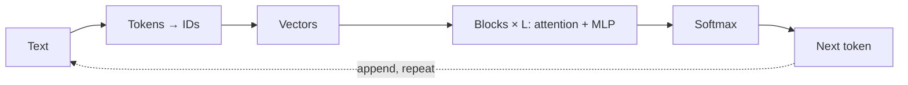

Inside, an LLM is a **transformer**: a pipeline that turns text into numbers, mixes them, and turns them back into a guess for the next token. Text becomes **tokens**, tokens become **IDs**, IDs become **vectors** (lists of numbers). Then a stack of **blocks** refines those vectors: **attention** lets each token gather information from earlier tokens, and an **MLP** reworks each token on its own.

```sim
transformer-flow
{"sentence": "cat", "layers": 2, "stage": "text"}
```

**Try this:** press Play and follow the glowing dot down the pipeline. Then change "Blocks shown" to 4 and watch the parameter count grow.

The last step is **softmax**, which turns raw scores $z_i$ into probabilities that add up to 1:

$$p_i = \frac{e^{z_i}}{\sum_j e^{z_j}}$$

With scores $4.1$ for " mat" and $3.2$ for " floor", " mat" is $e^{0.9} \approx 2.5$ times as likely as " floor". A bigger score always means a bigger probability.



Every later lesson in this module opens up one of these boxes.

```quiz
{"q": "Two candidate tokens have scores 5.0 and 4.0. After softmax, how do their probabilities compare?", "options": ["The first is 1.25× as likely (5 ÷ 4)", "The first is about 2.7× as likely ($e^{1}$)", "They are equal: softmax ignores small differences", "The first gets 100% and the second 0%"], "answer": 1, "explain": "The ratio of softmax probabilities is $e^{z_1 - z_2} = e^{1} \\approx 2.72$: only the gap between scores matters. Dividing the scores (5 ÷ 4) is the tempting mistake, but softmax uses exponentials, not ratios of scores."}
```
