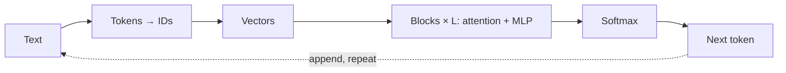

Inside, an LLM is a **transformer**: a pipeline that turns text into numbers, mixes them, and turns them back into a guess for the next token. Text becomes **tokens**, tokens become **IDs**, IDs become **vectors** (lists of numbers). Then a stack of **blocks** refines those vectors: **attention** lets each token gather information from earlier tokens, and an **MLP** reworks each token on its own.

## In everyday life

Imagine a class playing a word game. The teacher says half a sentence and the class must vote on the next word. Each student is handed a roll number for one word piece, then a note describing it. Next, every student listens to those who spoke before them and rewrites their own note. Then each thinks alone and tidies the note. After a few rounds, the last note decides the vote.

That is a **transformer**, the design inside an LLM. A **token** is a piece of text, an **ID** is its roll number, and a **vector** is the note: a list of numbers. **Attention** is the listening step, where each token gathers clues from earlier tokens. The **MLP** is the thinking-alone step, a small network that reworks one token by itself. One listening step plus one thinking step is a **block**, and the model stacks many blocks. At the end, **softmax** turns the last note's raw scores into probabilities that add up to one.

Unlike real students, these notes are just numbers, rewritten by arithmetic.

**Where you meet it.** When a chat or translation app answers you, this pipeline runs again for every new token it writes. Without attention, a word like "it" could not find which earlier noun it refers to. Attention lets the model pull that clue from the earlier words.

```scene
title: A class that votes on the next word
step: ✂️ The teacher's sentence is cut into word pieces, each given a roll number | tokens and IDs
step: 📝 Each roll number is swapped for a note of numbers describing it | vectors
step: 👂 Each student listens to earlier speakers and updates their note | attention
step: 💭 Each student thinks alone to refine the note | MLP
step: 🔁 The listen-and-think rounds repeat, and the notes get richer | stack of blocks
step: 🗳 The last note becomes a vote over possible next words | softmax and the next token
takeaway: A transformer turns text into numbers, refines them in repeated blocks, then votes on the next token.
```

```sim
transformer-flow
{"sentence": "cat", "layers": 2, "stage": "text"}
```

**Try this:** press Play and follow the glowing dot down the pipeline. Then change "Blocks shown" to 4 and watch the parameter count grow.

The last step is **softmax**, which turns raw scores $z_i$ into probabilities that add up to 1:

$$p_i = \frac{e^{z_i}}{\sum_j e^{z_j}}$$

With scores $4.1$ for " mat" and $3.2$ for " floor", " mat" is $e^{0.9} \approx 2.5$ times as likely as " floor". A bigger score always means a bigger probability.



Every later lesson in this module opens up one of these boxes.

```quiz
{"q": "Two candidate tokens have scores 5.0 and 4.0. After softmax, how do their probabilities compare?", "options": ["The first is 1.25× as likely (5 ÷ 4)", "The first is about 2.7× as likely ($e^{1}$)", "They are equal: softmax ignores small differences", "The first gets 100% and the second 0%"], "answer": 1, "explain": "The ratio of softmax probabilities is $e^{z_1 - z_2} = e^{1} \\approx 2.72$: only the gap between scores matters. Dividing the scores (5 ÷ 4) is the tempting mistake, but softmax uses exponentials, not ratios of scores."}
```
