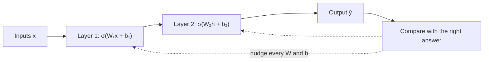

```callout-before
Before you start
No machine-learning background is needed. If you can multiply and add, and you know that a function takes numbers in and gives a number out, you have everything this lesson uses.
```

Picture a mixing desk in a recording studio. Sound goes in, sound comes out, and in between sit hundreds of knobs. Turn them one way and the vocals are buried; turn them another and the mix is perfect. Nobody calculates the right setting from first principles. An engineer listens, hears what is wrong, and nudges knobs until it sounds right.

A neural network is the same idea with numbers. Numbers go in (pixels, or the IDs of words), numbers come out (a label, or the probability of each possible next word), and in between sits a long list of adjustable numbers called **parameters**. **Training** is the search for parameter values that make the outputs right. A small network has a few dozen parameters. GPT-style language models have billions. The principle does not change.

## The smallest piece: one neuron

A **neuron** takes several inputs, multiplies each one by its own **weight**, adds them up together with one extra number called the **bias**, and passes the total through an **activation function** that bends it:

$$
z = w_1 x_1 + w_2 x_2 + \dots + w_k x_k + b = \sum_{i=1}^{k} w_i x_i + b, \qquad y = \sigma(z)
$$

Here $x_i$ are the inputs, $w_i$ the weights, $b$ the bias, $z$ the **weighted sum** (also called the pre-activation), and $\sigma$ the activation. The weights and the bias are the knobs: they are the neuron's parameters.

```steps
One neuron, by hand
Take two inputs $x_1 = 1.0$ and $x_2 = -0.5$, weights $w_1 = 1.2$ and $w_2 = 0.8$, and bias $b = 0.1$.
---
Multiply each input by its weight: $w_1 x_1 = 1.2 \times 1.0 = 1.2$ and $w_2 x_2 = 0.8 \times (-0.5) = -0.4$.
---
Add them and the bias: $z = 1.2 - 0.4 + 0.1 = 0.9$.
---
Apply the activation. With **ReLU**, $\sigma(z) = \max(0, z)$, so $y = \max(0, 0.9) = 0.9$. Had $z$ been $-0.3$, the output would be exactly $0$: the neuron would be "off".
```

Now play with it. The simulation starts at exactly the numbers above.

```sim
neuron
{"x1": 1, "x2": -0.5, "w1": 1.2, "w2": 0.8, "b": 0.1, "act": "relu"}
```

Try three things. First, drag the bias down until the output hits zero: the bias is a **threshold** that decides how large the weighted sum must be before the neuron fires. Second, make $w_2$ negative and large: input $x_2$ now pushes the output down instead of up. Third, switch the activation to *None (linear)* and watch the output curve become a straight line.

## Why the bend matters

Without an activation, a neuron is a straight line (a plane, in more dimensions). Stack two linear layers and you still get a straight line, because a linear function of a linear function is linear:

$$
W_2 (W_1 x + b_1) + b_2 = \underbrace{(W_2 W_1)}_{W} x + \underbrace{(W_2 b_1 + b_2)}_{b}
$$

However many layers you add, the whole network collapses into one layer. The non-linear bend $\sigma$ is what lets depth build curved, complicated functions out of simple pieces. You will see this concretely in the XOR topic later in this lesson, where a straight line provably cannot solve the problem and one hidden layer can.

## From neurons to layers to models

A **layer** is many neurons reading the same inputs, each with its own weights. If a layer takes $k$ inputs and has $m$ neurons, its weights form a $m \times k$ matrix $W$ and its biases a vector $b$ of length $m$, so the whole layer is one matrix multiplication:

$$
\mathbf{y} = \sigma(W\mathbf{x} + \mathbf{b}), \qquad \text{parameters} = m \cdot k + m
$$

For example, a layer from 4 inputs to 3 neurons has $3 \times 4 = 12$ weights and $3$ biases: **15 parameters**. A network is layers chained together, each layer's output feeding the next.

| Model | Parameters | What that number is |
|---|---|---|
| 2 → 4 → 1 network (later in this lesson) | 17 | $2\cdot4+4$ in layer 1, $4\cdot1+1$ in layer 2 |
| A small image classifier | ~1 million | mostly convolution filters |
| GPT-2 small (2019) | 124 million | embeddings, attention and MLP weights |
| A 7B open-weight LLM | ~7 billion | the same kinds of matrices, much larger |

The jump from 17 to 7 billion is a change of scale, not of kind. Every one of those numbers is a knob, and every one is set by the procedure this lesson builds: measure how wrong the model is, work out which way each knob should turn, turn it a little, repeat.



## In practice

Engineers rarely talk about individual neurons; they talk about **layers** and **parameter counts**, because the parameter count decides how much memory a model needs. Each parameter stored in 16-bit precision takes 2 bytes, so a 7-billion-parameter model needs about $7 \times 10^9 \times 2 = 14 \times 10^9$ bytes, roughly **14 GB**, just to hold its weights. You will use this one-line calculation constantly when choosing GPUs in the inference module.

```quiz
{"q": "A layer maps 4 inputs to 3 outputs. How many parameters does it have, including biases?", "options": ["12", "15", "7", "16"], "answer": 1, "explain": "Each of the 3 neurons has 4 weights (3 × 4 = 12) plus one bias (3), so 15. Answering 12 forgets the biases; 7 adds the sizes instead of multiplying them."}
```

```quiz
{"q": "You remove every activation function from a 10-layer network. What can it now represent?", "options": ["The same functions as before, just trained more slowly", "Only linear functions: it is equivalent to a single layer", "Nothing: the output is always zero", "Only functions with exactly 10 bends"], "answer": 1, "explain": "A composition of linear maps is linear: $W_{10}\\cdots W_1 x$ is one matrix times $x$. Depth only adds expressive power because the activations bend the function between layers."}
```
