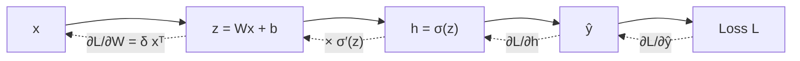

Gradient descent needs the slope of the loss with respect to every parameter. For a neuron that feeds straight into the loss, that slope is easy. But in a network, a first-layer weight affects the loss only indirectly: it changes a hidden neuron, which changes the output, which changes the loss. **Backpropagation** is the bookkeeping method that computes all of these slopes in one backward sweep, at a cost of roughly two forward passes.

Think of a factory line where a defect is found at the end. To fix it, you ask the last station how much its work contributed, then that station asks the one before it, and so on back to the start. Each station only needs two things: the blame passed back to it, and how sensitive its own output is to its inputs. That is the **chain rule**.

## The chain rule in one line

If $L$ depends on $u$, and $u$ depends on $w$, then a small nudge to $w$ changes $u$, which changes $L$:

$$
\frac{\partial L}{\partial w} = \frac{\partial L}{\partial u} \cdot \frac{\partial u}{\partial w}
$$

For a longer chain, multiply all the local slopes along the path. When a variable feeds into several places, add the contributions from each path. Backprop just applies this rule starting at the loss and walking backwards, reusing each intermediate result so nothing is computed twice.

## A 2-layer network, fully worked

One input $x$, two hidden ReLU neurons, one linear output. The forward pass is:

$$
z_1 = w_1 x + b_1,\quad z_2 = w_2 x + b_2,\quad h_j = \max(0, z_j),\quad \hat y = v_1 h_1 + v_2 h_2 + c,\quad L = \tfrac12(\hat y - y)^2
$$

$w_j, b_j$ are the hidden weights and biases, $v_j, c$ the output weights and bias, $h_j$ the hidden activations. The $\tfrac12$ in the loss only makes the derivative tidier. Parameters: $w_1 = 0.5,\ b_1 = 0,\ w_2 = -1,\ b_2 = 0.5,\ v_1 = 2,\ v_2 = 1,\ c = 0.5$. Example: $x = 2$, target $y = 3$.

```steps
Forward, then backward
**Forward.** $z_1 = 0.5 \cdot 2 + 0 = 1$, so $h_1 = 1$. $\;z_2 = -1 \cdot 2 + 0.5 = -1.5$, so $h_2 = 0$. Output $\hat y = 2 \cdot 1 + 1 \cdot 0 + 0.5 = 2.5$. Loss $L = \tfrac12(2.5 - 3)^2 = 0.125$.
---
**Output error.** $\frac{\partial L}{\partial \hat y} = \hat y - y = -0.5$. Call this $\delta$. Every gradient below is $\delta$ times a chain of local slopes.
---
**Output layer.** $\hat y = v_1 h_1 + v_2 h_2 + c$, so $\frac{\partial \hat y}{\partial v_1} = h_1$. Hence $\frac{\partial L}{\partial v_1} = \delta h_1 = -0.5$, $\;\frac{\partial L}{\partial v_2} = \delta h_2 = 0$, $\;\frac{\partial L}{\partial c} = \delta = -0.5$.
---
**Pass blame to the hidden layer.** $\frac{\partial L}{\partial h_1} = \delta v_1 = -1$ and $\frac{\partial L}{\partial h_2} = \delta v_2 = -0.5$. Through ReLU, whose slope is 1 when $z > 0$ and 0 otherwise: $\frac{\partial L}{\partial z_1} = -1 \times 1 = -1$, $\;\frac{\partial L}{\partial z_2} = -0.5 \times 0 = 0$.
---
**Hidden weights.** $\frac{\partial z_j}{\partial w_j} = x = 2$, so $\frac{\partial L}{\partial w_1} = -1 \times 2 = -2$ and $\frac{\partial L}{\partial b_1} = -1$. Neuron 2 gets zero for both: it was off, so nudging it changes nothing.
---
**Update** with $\eta = 0.05$: $w_1 = 0.6$, $b_1 = 0.05$, $v_1 = 2.025$, $c = 0.525$; the rest stay. New forward pass: $z_1 = 1.25$, $\hat y = 2.025 \times 1.25 + 0.525 = 3.05625$, loss $\approx 0.0016$. Down from $0.125$ in one step.
```

Two things to notice. First, the gradient for $w_1$ is the product of the output error $\delta$, the next layer's weight $v_1$, the activation's slope, and the input $x$. Deeper networks just have longer products. Second, neuron 2 received no gradient at all because its ReLU was off. A neuron that is off for every training example never learns again: a **dead ReLU**.

Try $\eta = 0.1$ instead: the new output is $3.625$ and the loss *rises* to $0.195$. Every parameter took a step that was right on its own, but together they overshot. That is the learning-rate limit from the previous topic, now in several dimensions.

## Watch it happen, neuron by neuron

Step one example through a tiny network. Press **Next step** to go Forward → Loss → Backward → Update: the activations light up going forwards, then the gradients flow back along the same connections, and every weight moves a little.

```sim
backprop-flow
```

Try this: on **Backward**, look at which connection has the biggest gradient: that weight changes most. Then press **Apply & next round** a few times and watch the loss curve fall.

## The general pattern

For a layer $\mathbf{h}_{\text{out}} = \sigma(W \mathbf{h}_{\text{in}} + \mathbf{b})$ with pre-activation $\mathbf{z}$, backprop receives $\frac{\partial L}{\partial \mathbf{h}_{\text{out}}}$ from above and computes, using $\odot$ for element-wise multiplication:

$$
\boldsymbol{\delta} = \frac{\partial L}{\partial \mathbf{h}_{\text{out}}} \odot \sigma'(\mathbf{z}), \qquad \frac{\partial L}{\partial W} = \boldsymbol{\delta}\, \mathbf{h}_{\text{in}}^{\top}, \qquad \frac{\partial L}{\partial \mathbf{b}} = \boldsymbol{\delta}, \qquad \frac{\partial L}{\partial \mathbf{h}_{\text{in}}} = W^{\top} \boldsymbol{\delta}
$$

The last term is what gets passed down to the layer below. Each layer is a matrix multiply on the way forward and two on the way back, which is why one training step costs about three times a forward pass.



## In practice

- **You never write backprop by hand in real work.** PyTorch and JAX record the forward operations and apply the chain rule automatically (**autodiff**). Calling `loss.backward()` runs exactly the steps above for every parameter.
- **Check gradients numerically when debugging.** Nudge a parameter by $\epsilon = 10^{-6}$, rerun the forward pass, and compare $(L(w+\epsilon) - L(w))/\epsilon$ to the backprop value. For $w_1$ above this gives $-2.00$, matching.
- **Products of many slopes can vanish or explode.** If each layer multiplies the gradient by 0.5, after 20 layers it is $0.5^{20} \approx 10^{-6}$. Transformers avoid this with residual connections and normalisation, covered in the transformer-block lesson.
- **Backprop needs the forward activations**, so memory grows with batch size, sequence length and depth. That is the "activations" line in every training-memory budget.

```quiz
{"q": "In the worked network, suppose $v_1$ had been $-2$ instead of $2$ (everything else the same, so $\\delta$ is now $\\hat y - y$ with $\\hat y = -1.5$). What is $\\partial L/\\partial w_1$?", "options": ["$-2$", "$18$", "$-18$", "$9$"], "answer": 1, "explain": "Now $\\hat y = -2 + 0.5 = -1.5$, so $\\delta = -4.5$. Then $\\partial L/\\partial h_1 = \\delta v_1 = 9$, ReLU slope 1, times $x = 2$ gives 18. Answering $-18$ forgets that the negative $v_1$ flips the sign; 9 forgets the factor $x$."}
```

```quiz
{"q": "A hidden ReLU neuron has $z < 0$ for every example in the training set. What happens to its incoming weights during training?", "options": ["They grow until the neuron turns on", "They receive zero gradient and stop changing", "They are reset to random values", "They receive the largest gradients in the layer"], "answer": 1, "explain": "ReLU's slope is 0 for $z < 0$, so the chain-rule product for its weights is 0 on every example: a dead neuron. Nothing pushes it back on, which is why variants such as leaky ReLU or GELU keep a small slope for negative inputs."}
```

```lab
train-a-tiny-network
```
