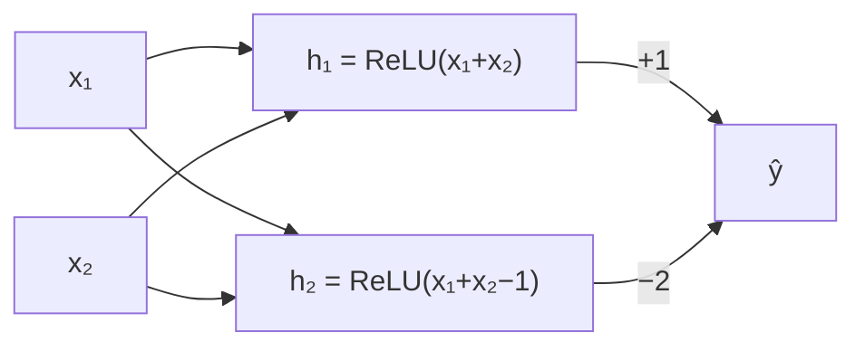

A light at the bottom of a staircase is wired to two switches, one upstairs and one downstairs. Flip either switch and the light changes. The light is on when exactly one switch is up. This rule is called **XOR** (exclusive or), and it is the smallest problem that a single neuron cannot solve, no matter how long you train it.

The reason is geometric. A single neuron computes $w_1 x_1 + w_2 x_2 + b$ and says "on" when that is positive. The boundary between "on" and "off" is the line $w_1 x_1 + w_2 x_2 + b = 0$. A problem a single straight line can separate is called **linearly separable**. XOR is not.

| $x_1$ | $x_2$ | XOR |
|---|---|---|
| 0 | 0 | 0 |
| 0 | 1 | 1 |
| 1 | 0 | 1 |
| 1 | 1 | 0 |

Plot the four points: the two "on" points sit on one diagonal and the two "off" points on the other. Any line that puts both "on" points on one side puts at least one "off" point there too.

## A short proof

Suppose a single neuron did classify XOR, outputting "on" when $z = w_1 x_1 + w_2 x_2 + b > 0$. The four rows require:

$$
\underbrace{b \le 0}_{(0,0)}, \qquad \underbrace{w_2 + b > 0}_{(0,1)}, \qquad \underbrace{w_1 + b > 0}_{(1,0)}, \qquad \underbrace{w_1 + w_2 + b \le 0}_{(1,1)}
$$

Add the two middle inequalities: $w_1 + w_2 + 2b > 0$, so $w_1 + w_2 + b > -b$. The first inequality says $-b \ge 0$, so $w_1 + w_2 + b > 0$. That contradicts the last one. No weights exist, so no amount of gradient descent can find them.

## One hidden layer solves it

Add two hidden ReLU neurons. Here is a solution with hand-picked weights that you can check line by line:

$$
h_1 = \max(0,\ x_1 + x_2), \qquad h_2 = \max(0,\ x_1 + x_2 - 1), \qquad \hat y = h_1 - 2h_2
$$

| $x_1, x_2$ | $h_1$ | $h_2$ | $\hat y = h_1 - 2h_2$ |
|---|---|---|---|
| 0, 0 | 0 | 0 | 0 |
| 0, 1 | 1 | 0 | 1 |
| 1, 0 | 1 | 0 | 1 |
| 1, 1 | 2 | 1 | 0 |

$h_1$ counts how many switches are up; $h_2$ only turns on when both are. The output subtracts twice the "both" detector. The hidden layer has **re-represented** the input: in the $(h_1, h_2)$ coordinates, the points $(0,0)$, $(1,0)$, $(1,0)$, $(2,1)$ are separable by a line, and the output neuron draws it.

This network has $2 \times 2 + 2 = 6$ parameters in the hidden layer and $2 + 1 = 3$ in the output: 9 in total. The ReLU bend is essential. Without it, the topic-one argument applies: two linear layers collapse into one, and one neuron cannot do XOR.



## See it learn

Hand-picking weights does not scale. The sim trains a small network with the hidden activation of your choice from random starting weights using exactly the gradient descent and backprop from the previous topics. The background colour is the network's output over the whole input square, so you can watch the **decision boundary** bend.

```sim
xor-training
{"hidden": 4, "act": "tanh", "lr": 0.5, "epochs": 1000, "seed": 1, "data": "points4"}
```

Try, in order:

1. **Hidden units = 1.** One hidden unit gives a single bend, and the network cannot separate the diagonals. Accuracy stays stuck below 100%.
2. **Hidden units = 2.** The minimum that can work. Change the **seed** a few times: some starts solve it quickly, others stall. Small networks are fragile.
3. **Hidden units = 4 or 8.** More units solve it more reliably and in fewer epochs. Extra capacity makes the optimisation easier, not just the representation richer, a pattern that repeats all the way up to LLMs.
4. **Learning rate 0.05 versus 3.** Too small and the loss curve is still falling at the end; too big and it becomes jagged.
5. **Data = noisy cloud.** With 100 noisy points, watch the boundary: large networks with many epochs can start bending around individual noisy points. That is overfitting, the subject of the next topic.

The "Parameters" readout follows the rule from topic one: with $H$ hidden units, $2H + H$ in the first layer and $H + 1$ in the output, so $4H + 1$. For $H = 4$ that is 17.

## In practice

- **Hidden layers learn features.** Nobody told the network "count the switches"; gradient descent invented $h_1$ and $h_2$ (or something equivalent) because they reduce the loss. In an LLM the same thing happens at enormous scale: intermediate layers end up representing things like syntax, topic or whether a statement is negated, without anyone specifying them.
- **Width and depth trade off.** A single hidden layer can in principle approximate any reasonable function given enough units (the **universal approximation** result), but depth reuses features and is far more parameter-efficient in practice. Transformers are deep stacks of the same block.
- **Activation choice matters at the margins.** ReLU, tanh and sigmoid all solve XOR. Modern LLMs mostly use smooth ReLU-like functions such as GELU or SiLU in their feed-forward layers.

```quiz
{"q": "Using $h_1 = \\max(0, x_1+x_2)$, $h_2 = \\max(0, x_1+x_2-1)$ and $\\hat y = h_1 - 2h_2$, what does the network output for the input $(2, 0)$, outside the training set?", "options": ["0", "1", "2", "-2"], "answer": 0, "explain": "$h_1 = 2$, $h_2 = \\max(0, 1) = 1$, so $\\hat y = 2 - 2 = 0$. The network only ever sees $x_1 + x_2$, and the sum 2 looks like the (1,1) case. Off the training points it does whatever its formula says, not what XOR 'means'."}
```

```quiz
{"q": "Why can't you solve XOR by stacking two layers that have no activation function?", "options": ["Two layers have too few parameters", "Two linear layers compose to a single linear function, which cannot separate XOR", "Gradient descent cannot train two layers", "XOR needs at least three layers"], "answer": 1, "explain": "$W_2(W_1 x + b_1) + b_2 = Wx + b$: still one line, and the proof shows no line works. The 2-2-1 ReLU network has only 9 parameters and solves it, so parameter count is not the issue; the non-linearity is."}
```

```lab
train-a-tiny-network
```
