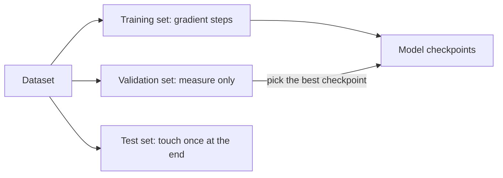

A student preparing for an exam can work through the practice questions once, or ten times. Ten passes help, up to a point. After that the student starts memorising the exact answers to those particular questions, including the typo in question 7, and does worse on fresh questions. Training a network has the same three ingredients: how much data is looked at per step, how many passes are made over it, and how to tell learning from memorising.

## Batches: estimating the gradient cheaply

The true loss is the average over all $N$ training examples, so its exact gradient needs all $N$ of them. Instead, each training step samples a **mini-batch** of $B$ examples and uses their average gradient:

$$
\mathbf{g}_{\text{batch}} = \frac{1}{B} \sum_{i \in \text{batch}} \nabla \ell_i(\mathbf{w}), \qquad \mathbf{w} \leftarrow \mathbf{w} - \eta\, \mathbf{g}_{\text{batch}}
$$

where $\ell_i$ is the loss on example $i$. This is **stochastic gradient descent** (SGD): stochastic because the batch is random. The batch gradient is an unbiased but noisy estimate. Its noise, measured as a standard deviation, shrinks like $1/\sqrt{B}$: going from $B = 32$ to $B = 128$ makes each step's gradient about twice as accurate ($1/\sqrt{32} \approx 0.177$ versus $1/\sqrt{128} \approx 0.088$) but costs four times as much compute per step. Bigger batches are not free accuracy; they also fit GPUs well, which is why batch size is usually set by hardware first.

## Epochs and steps

One **epoch** is one full pass through the training set. The bookkeeping is simple:

$$
\text{steps per epoch} = \frac{N}{B}, \qquad \text{total steps} = \frac{N}{B} \times \text{epochs}
$$

With $N = 50{,}000$ images, $B = 100$ and 10 epochs: $500$ steps per epoch and $5{,}000$ steps in total.

Language models count in tokens rather than examples. If a run processes 4 million tokens per step and trains on 2 trillion tokens, it takes $2 \times 10^{12} / (4 \times 10^6) = 500{,}000$ steps. Llama 2 was trained on about 2 trillion tokens with batches of about 4 million tokens, which is roughly this calculation. Large pretraining runs typically see most of their data about **once**: there is so much text that repeating it is not needed, and repetition is where memorising starts.

## Overfitting: low training loss, high test loss

A model **overfits** when it fits the training data better and better while getting worse on data it has not seen. To detect it, hold back a **validation set** that is never used for gradient steps, and evaluate the loss on it regularly.

| Epoch | Training loss | Validation loss | Reading |
|---|---|---|---|
| 1 | 1.20 | 1.25 | learning general patterns |
| 5 | 0.60 | 0.70 | still improving on both |
| 10 | 0.35 | 0.62 | best validation loss so far |
| 20 | 0.10 | 0.80 | memorising: the gap widens |
| 40 | 0.02 | 1.10 | badly overfit |

The **generalisation gap** is validation loss minus training loss. When the validation loss turns upward while training loss keeps falling, further training is hurting. Keeping the checkpoint with the lowest validation loss (epoch 10 here) is called **early stopping**.

Why does it happen? Capacity. A model with as many parameters as data points can fit them exactly. Five points can always be fitted perfectly by a degree-4 polynomial, which has 5 coefficients, giving a training loss of 0, but the curve will wiggle wildly between the points and predict nonsense elsewhere. A straight line through the same points fits worse but generalises better if the true relationship is roughly linear.



## See it

```sim
xor-training
{"hidden": 8, "act": "tanh", "lr": 0.5, "epochs": 3000, "seed": 1, "data": "cloud"}
```

The noisy cloud has 100 points with some labels effectively on the "wrong" side. With 8 hidden units and 3,000 epochs, look at the boundary: does it make small islands around stray points? Now drop to 2 hidden units, or to 300 epochs. The boundary becomes smoother and ignores the stray points. Lower training accuracy here is not a failure; the smoother boundary is the better guess about where new points will fall.

## In practice

- **Regularisation** is the toolbox against overfitting: more data (the strongest), **weight decay** (a penalty pulling weights towards 0, standard in LLM training through the AdamW optimiser), **dropout** (randomly switching off units during training), and early stopping.
- **Fine-tuning overfits fast.** Pretraining sees enormous data once. Fine-tuning a big model on a few thousand examples for several epochs can memorise them in a few hundred steps. Watching validation loss is mandatory there, as module 02 shows.
- **Leakage makes overfitting invisible.** If validation examples (or near-duplicates) are also in training, validation loss looks great and the real-world performance does not. For LLMs this is benchmark **contamination**: test questions that appeared somewhere in the web crawl.
- **Shuffle every epoch.** Feeding data in a fixed order lets the model pick up order artefacts and makes batches correlated, which makes the gradient noise worse than the $1/\sqrt{B}$ estimate.

```quiz
{"q": "You have 120,000 examples, batch size 64, and train for 3 epochs. How many gradient steps is that?", "options": ["1,875", "5,625", "360,000", "7,680,000"], "answer": 1, "explain": "$120{,}000 / 64 = 1{,}875$ steps per epoch, times 3 epochs $= 5{,}625$. 1,875 is one epoch; 360,000 multiplies examples by epochs without dividing by the batch size."}
```

```quiz
{"q": "Training loss keeps falling while validation loss has risen for the last 8 evaluations. Which action is most appropriate?", "options": ["Increase the learning rate", "Keep training: validation loss will come back down", "Stop and use the checkpoint with the lowest validation loss, then consider more data or regularisation", "Add the validation set to the training set"], "answer": 2, "explain": "A widening gap is the signature of overfitting, so early stopping at the best checkpoint is the safe move, and more data or weight decay attack the cause. Merging validation into training only hides the problem because you lose your measurement."}
```
