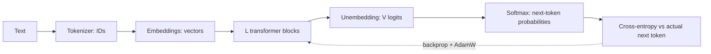

Everything in this lesson so far used toy networks: 17 parameters, four XOR points. It is fair to ask what any of it has to do with a model that writes essays. The honest answer is: almost everything. A large language model is a parameterised function, trained with cross-entropy, by mini-batch gradient descent, with gradients from backpropagation. What changes is the shape of the function, what goes in and comes out, and the scale.

## The task: classify the next token

Text is first split into **tokens** (pieces of words, the next lesson) and each token gets an integer ID from a vocabulary of size $V$. The model reads a sequence of IDs $t_1, \dots, t_n$ and, at each position, outputs a probability for every possible next token. It is a classifier with $V$ classes, run once per position:

$$
p_\theta(t_{i+1} \mid t_1, \dots, t_i) = \text{softmax}(\mathbf{z}_i), \qquad \mathcal{L} = -\frac{1}{n-1} \sum_{i=1}^{n-1} \ln p_\theta(t_{i+1} \mid t_1, \dots, t_i)
$$

Here $\theta$ (theta) stands for all the parameters, $\mathbf{z}_i$ is the vector of $V$ logits at position $i$, and the loss is the average cross-entropy over the positions that have a next token. No human labels are needed: the "right answer" at each position is simply the token that actually came next in the text. This is called **self-supervised** learning, and it is why models can train on trillions of tokens.

## A worked example

Take the six-token text *the cat sat on the mat*. It yields five predictions: after *the* predict *cat*, after *the cat* predict *sat*, and so on. Suppose a partially trained model assigns these probabilities to the correct next tokens:

| Context | Correct next | $p$ | $-\ln p$ |
|---|---|---|---|
| the | cat | 0.4 | 0.916 |
| the cat | sat | 0.1 | 2.303 |
| the cat sat | on | 0.6 | 0.511 |
| the cat sat on | the | 0.3 | 1.204 |
| the cat sat on the | mat | 0.8 | 0.223 |

Average loss: $(0.916 + 2.303 + 0.511 + 1.204 + 0.223)/5 = 5.157/5 \approx 1.03$. Its exponential, the **perplexity**, is $e^{1.03} \approx 2.8$: on average the model is as uncertain as if it were choosing between about 2.8 equally likely tokens. An untrained model with GPT-2's vocabulary would score about $\ln 50{,}257 \approx 10.8$, a perplexity of 50,257. Training is the journey between those two numbers, averaged over billions of positions.

One sequence of $n$ tokens gives $n - 1$ training signals at once, all computed in a single forward pass. That parallelism is a large part of why transformers train efficiently.

## What is the same, what is different

| Idea from this lesson | In an LLM |
|---|---|
| Parameters, $W\mathbf{x} + \mathbf{b}$ | Billions of them, mostly in big matrix multiplies |
| Activation function | GELU or SiLU inside each feed-forward block |
| Cross-entropy loss | Over $V \approx$ 32,000 to 128,000+ tokens, at every position |
| Gradient descent, learning rate | AdamW with warm-up and decay; peak $\eta$ around $10^{-4}$ |
| Backpropagation | Autodiff through dozens of transformer blocks |
| Hidden layers learn features | Layers build representations of syntax, meaning, facts |
| Mini-batches, epochs | Millions of tokens per step; usually about one pass over the data |
| Overfitting | Watched on held-out text; a bigger worry when fine-tuning |

The genuinely new pieces are how tokens become vectors (**embeddings**), how each position reads the others (**attention**), and how those are stacked into **transformer blocks**. Those are the next four lessons.



## The cost of scale

A useful rule of thumb: a forward pass costs about $2N$ floating-point operations (FLOPs) per token for a model with $N$ parameters (one multiply and one add per parameter), and training, which adds the backward pass, costs about $6N$ per token. So training on $D$ tokens costs

$$
C \approx 6 N D \ \text{FLOPs}
$$

For a GPT-2-small-sized model ($N = 124 \times 10^6$) on $D = 10^{10}$ tokens: $6 \times 1.24 \times 10^8 \times 10^{10} \approx 7.4 \times 10^{18}$ FLOPs. For Llama-2-7B ($N \approx 6.74 \times 10^9$, $D \approx 2 \times 10^{12}$): $6 \times 6.74 \times 10^9 \times 2 \times 10^{12} \approx 8.1 \times 10^{22}$ FLOPs, about ten thousand times more. The algorithm is identical; the bill is not. Module 02 turns this formula into compute budgets.

## See it

The same machinery works at every scale, so play once more with the smallest version of it and connect the readouts to the table above.

```sim
xor-training
{"hidden": 4, "act": "tanh", "lr": 0.5, "epochs": 1000, "seed": 1, "data": "points4"}
```

The loss curve here is the same kind of curve LLM teams watch for weeks: a steep early drop, then a long slow tail. Raise the learning rate until the curve becomes jagged; that is what a "loss spike" looks like in a big run. Then note the parameter count (17) and compare it with 124 million and 7 billion.

## In practice

- **The training loss of an LLM is directly interpretable**: it is the average $-\ln p$ of the actual next token. Small differences matter; going from 2.0 to 1.9 is a meaningful improvement at scale.
- **Inference uses only the forward pass.** Generating text means computing the next-token distribution, picking a token (the sampling lesson), appending it, and repeating. No gradients, no updates: the model does not learn from your conversation.
- **The objective explains the behaviour.** A model trained to make the actual next token likely will produce plausible continuations, true or not. The final lesson of this module, on hallucination, starts from exactly this loss.

```quiz
{"q": "A training batch contains 8 sequences of 1,024 tokens each. How many next-token predictions contribute to the loss (each sequence predicts every token after the first)?", "options": ["8", "1,024", "8,184", "8,192"], "answer": 2, "explain": "Each sequence gives $1{,}024 - 1 = 1{,}023$ predictions, and $8 \\times 1{,}023 = 8{,}184$. 8,192 forgets that the first token has no preceding context to predict it from; 8 treats each sequence as one example."}
```

```quiz
{"q": "Using $C \\approx 6ND$, roughly how many FLOPs does training a 1-billion-parameter model on 20 billion tokens take?", "options": ["$1.2 \\times 10^{20}$", "$4 \\times 10^{19}$", "$2 \\times 10^{19}$", "$1.2 \\times 10^{21}$"], "answer": 0, "explain": "$6 \\times 10^9 \\times 2 \\times 10^{10} = 1.2 \\times 10^{20}$. $4 \\times 10^{19}$ uses $2ND$, which is the cost of forward passes only, without backpropagation."}
```

```lab
train-a-tiny-network
```
