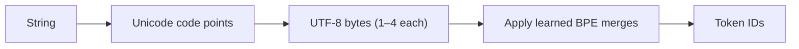

Computers store text as **bytes**, numbers from 0 to 255. There are far more than 256 characters in the world's writing systems, so a standard called **Unicode** gives every character a number (its **code point**, written like U+00E9 for *é*), and an encoding called **UTF-8** turns each code point into one to four bytes. Common English letters take one byte; accented Latin letters take two; most Indian scripts, Chinese and Japanese characters take three; emoji take four.

Modern tokenizers work on these bytes, not on characters. **Byte-level BPE** starts its vocabulary with all 256 byte values and learns merges on top. This guarantees that any string, in any language, including emoji and binary junk, can be encoded: in the worst case, one token per byte. It also means the cost of a language depends on two things: how many bytes its characters take, and how many merges the tokenizer learned for that language, which depends on how much of it was in the tokenizer's training text.

## UTF-8 in one table

| Code point range | Bytes | Examples |
|---|---|---|
| U+0000 to U+007F | 1 | *a*, *Z*, *7*, space, *{* |
| U+0080 to U+07FF | 2 | *é* (U+00E9), *ß*, Greek, Cyrillic, Arabic, Hebrew |
| U+0800 to U+FFFF | 3 | Devanagari *न* (U+0928), Chinese *中* (U+4E2D), most of Japanese and Korean |
| U+10000 to U+10FFFF | 4 | emoji such as 😀 (U+1F600) |

So the number of bytes in a text is

$$
Y = \sum_{\text{characters } c} \text{bytes}(c), \qquad 1 \le \text{bytes}(c) \le 4
$$

and with byte-level BPE the token count lies between $Y / (\text{longest token in bytes})$ and $Y$ itself.

## Worked example: one greeting, two scripts

The English word *hello* is 5 characters and 5 bytes. In virtually every LLM tokenizer it is a single token, because it is extremely common in training text.

The Hindi greeting *नमस्ते* looks like 3 or 4 letters on screen, but it is 6 Unicode code points (न, म, स, the virama ्, त, and the vowel sign े). Each is 3 bytes, so the word is $6 \times 3 = 18$ bytes. A tokenizer with no Devanagari merges at all would spend 18 tokens on it. Real tokenizers have learned some Devanagari merges, so the actual count is lower, but typically still several times the single token for *hello*.

Scale that up with the averages used in the token-cost sim below: about 1.3 tokens per word for English prose and about 2.6 for Hindi. A 1,000-word answer costs about $1{,}000 \times 1.3 = 1{,}300$ tokens in English and $1{,}000 \times 2.6 = 2{,}600$ in Hindi. At a price of \$15 per million output tokens, that is $1{,}300 \times 15 / 10^6 = \$0.0195$ versus $2{,}600 \times 15/10^6 = \$0.039$: twice the price, twice the generation time and half the effective context window, for the same content.



## See it

```sim
token-cost
{"language": "hindi", "inputWords": 600, "outputWords": 250}
```

Note the input and output token counts with Hindi selected, then switch the language to English prose, then to Source code and JSON. The words are the same; only the tokens per word change, and the cost per request moves with them. Raise the requests per day to 100,000 to see how a 2× tokenization gap becomes a real monthly bill.

## In practice

- **Language matters for budgets.** If your product serves several languages, measure token counts per language and set context limits and price estimates per language, not from English averages. Research on this has found the same content can need several times more tokens in some languages than in English.
- **Newer tokenizers narrow the gap.** Tokenizers with larger vocabularies trained on more multilingual text learn more merges for non-English scripts. Moving from a 32,000-token vocabulary to one of about 128,000 (as Llama 3 did relative to Llama 2) is partly motivated by this.
- **A token is not always a whole character.** A 4-byte emoji may be split into several byte-tokens, and a streaming API can deliver a token that is half a character. If you decode tokens one at a time and print them, you can get garbled output. Buffer bytes until they form complete UTF-8 characters, or use the library's streaming decoder.
- **Normalise text consistently.** The same visible character can have more than one Unicode representation (an accented letter as one code point, or a letter plus a combining accent). They tokenize differently, which matters for caching and exact-match comparisons.

```quiz
{"q": "A string contains 10 ASCII letters, 4 Chinese characters and 2 emoji. How many UTF-8 bytes is it?", "options": ["16", "30", "26", "32"], "answer": 1, "explain": "$10 \\times 1 + 4 \\times 3 + 2 \\times 4 = 10 + 12 + 8 = 30$ bytes. 16 counts characters, not bytes. 26 treats the emoji as 2 bytes each, which is a UTF-16 habit, not UTF-8."}
```

```quiz
{"q": "Why can a byte-level BPE tokenizer encode any input string without an unknown token?", "options": ["It contains all 256 byte values as base tokens, and every string is a sequence of bytes", "It stores every Unicode character as its own token", "It replaces unsupported characters with spaces", "It falls back to a separate character-level model"], "answer": 0, "explain": "Every UTF-8 string is made of bytes, and all 256 byte values are in the base vocabulary, so the worst case is one token per byte. Listing every Unicode character (well over 100,000 assigned code points) would bloat the vocabulary, which is exactly what byte-level BPE avoids."}
```
