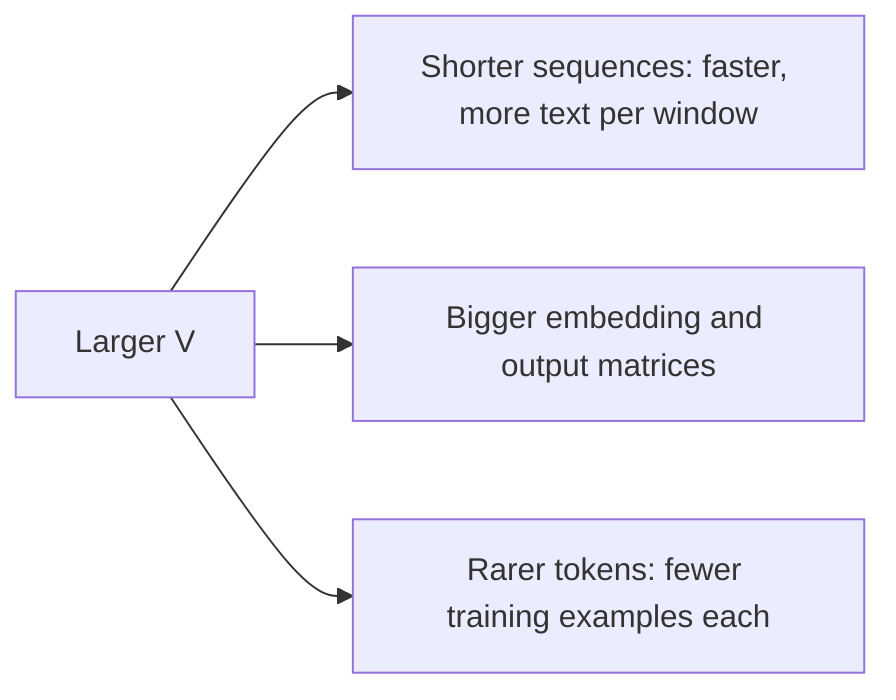

How many tokens should a vocabulary have? Real models span a wide range: GPT-2 used 50,257, Llama 2 used 32,000, and Llama 3 moved to about 128,000. Each choice is a trade between three costs. A bigger vocabulary makes sequences shorter (good for speed and context), makes the embedding and output layers bigger (more parameters and compute per token), and spreads the training data across more tokens, so rare ones are seen less often and learned less well.

An everyday comparison is a phrasebook. A tiny one forces you to spell everything out; a giant one has a ready phrase for everything but is heavy, and the obscure phrases in it were never checked properly. The right size depends on how much you travel and where.

## Where the vocabulary lives in the model

Every token ID needs a learned vector of size $d$ at the input (the **embedding matrix**, shape $V \times d$) and a row in the output layer that turns the final hidden state into $V$ logits (the **unembedding**, also $V \times d$). Some models **tie** the two, using one matrix for both:

$$
P_{\text{vocab}} = \begin{cases} V d & \text{tied} \\ 2 V d & \text{untied} \end{cases}, \qquad \text{FLOPs for the output logits per token} \approx 2 V d
$$

The second formula counts one multiply and one add for each of the $V \times d$ weights in the final projection, which runs for every generated token.

## Worked numbers for three real models

| Model | $V$ | $d$ | Tied? | Vocabulary parameters | Share of model |
|---|---|---|---|---|---|
| GPT-2 small | 50,257 | 768 | yes | $50{,}257 \times 768 = 38.6$M | about 31% of 124M |
| Llama-2-7B | 32,000 | 4,096 | no | $2 \times 32{,}000 \times 4{,}096 = 262$M | about 3.9% of 6.74B |
| Llama-3-8B | 128,256 | 4,096 | no | $2 \times 128{,}256 \times 4{,}096 = 1.05$B | about 13% of 8.0B |

Check the Llama-3 row: $128{,}256 \times 4{,}096 = 525{,}336{,}576$ per matrix, doubled for untied input and output gives $1{,}050{,}673{,}152$. Quadrupling the vocabulary from Llama 2 to Llama 3, at the same $d$, added roughly 790 million parameters, which is a large part of why the "8B" model is bigger than the "7B" one.

For a small model the vocabulary dominates: almost a third of GPT-2 small is its embedding table. For a large model it becomes a modest fraction, which is one reason larger models can afford larger vocabularies.

The compute side: Llama-3-8B's output projection costs about $2 \times 128{,}256 \times 4{,}096 \approx 1.05 \times 10^9$ FLOPs per token. The whole forward pass is about $2N \approx 2 \times 8.0 \times 10^9 = 1.6 \times 10^{10}$ FLOPs, so the output layer is about 6.5% of the work. In exchange, if the bigger vocabulary cuts the token count of typical text by 10–15%, every other layer runs 10–15% fewer times for the same text.

## The data side

A training run of $D$ tokens gives each vocabulary entry on average $D / V$ occurrences. With $D = 2 \times 10^{12}$ and $V = 128{,}256$, that average is about 15.6 million, which sounds like plenty. But token frequencies follow a steep long tail (a few tokens like *the* and *,* are extremely common, most are rare), so the rarest tokens may appear only a handful of times. Their embeddings stay close to random, and when such a token turns up in a prompt the model can behave strangely, which is the "glitch token" story in the quirks topic.



## See it

```sim
bpe-tokenizer
{"merges": 100, "pretokenize": true}
```

The vocabulary-size readout is base characters plus merges. Step merges from 100 down to 20 and up to 300, and record tokens and vocabulary size each time. Compute "tokens saved per new vocabulary entry" between settings; it falls steeply. In a real model each of those extra entries also costs $d$ (or $2d$) parameters, so the late merges are the ones that cost more than they save.

## In practice

- **Typical modern sizes are 32,000 to about 256,000.** Multilingual and code-heavy models lean larger, because they need merges for many scripts and for common code patterns.
- **Pad the vocabulary for hardware.** Implementations often round $V$ up to a multiple of 64 or 128 so the matrix multiplies run efficiently on GPUs; the extra rows are never used as real tokens.
- **Changing the vocabulary means retraining.** Adding a few special tokens to a trained model (for a chat format or tool calls) is common and needs new embedding rows that must be learned in fine-tuning; replacing the tokenizer wholesale effectively needs a new model.
- **Remember the output softmax for small models.** For a model with $d = 768$, a 250,000-token vocabulary would put about 192M parameters in each vocabulary matrix, more than GPT-2 small in total. Small, fast models usually keep vocabularies modest.

```quiz
{"q": "A model has $d = 2{,}048$ and an untied vocabulary of 64,000 tokens. How many parameters are in its embedding and output matrices together?", "options": ["131 million", "262 million", "65.5 million", "4.2 million"], "answer": 1, "explain": "Each matrix is $64{,}000 \\times 2{,}048 = 131{,}072{,}000$; untied means two of them, about 262 million. 131 million is the tied answer; 4.2 million is $2{,}048^2$, which has nothing to do with the vocabulary."}
```

```quiz
{"q": "Why can a 70B-parameter model afford a larger vocabulary more easily than a 125M-parameter one?", "options": ["Larger models do not need embedding matrices", "The vocabulary matrices grow with $V \\cdot d$, which is a small fraction of a large model's parameters but a large fraction of a small model's", "Larger models train on fewer tokens", "Vocabulary size has no effect on compute"], "answer": 1, "explain": "Vocabulary parameters scale as $Vd$ while the transformer blocks scale roughly as $12Ld^2$, so the blocks dominate in big models. In GPT-2 small the embedding table alone is about 31% of the model. Vocabulary size does affect compute, through the $2Vd$ output projection per token."}
```
