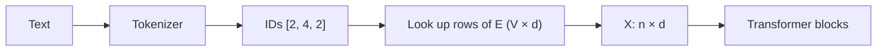

```callout-before
Before you start
You need the idea of a token ID from the tokenization lesson: text is split into pieces and each piece is replaced by an integer between $0$ and $V-1$, where $V$ is the vocabulary size.
```

A token ID is a name tag, not a quantity. Token 464 is not "bigger" than token 12 in any useful sense, and the average of tokens 100 and 200 means nothing. If you fed raw IDs into a network as numbers, it would waste its capacity trying to make sense of an ordering that does not exist.

So the first layer of every language model replaces each ID with a list of $d$ real numbers, called an **embedding** (or embedding vector). The list is looked up in a big table, the **embedding matrix**, with one row per token in the vocabulary. The rows are parameters: they start random and are adjusted by gradient descent like every other weight. After training, the row for "cat" holds whatever $d$ numbers turned out to be most useful for predicting text that contains "cat".

## The lookup, written as maths

Call the embedding matrix $E$, of shape $V \times d$: $V$ rows (one per token) and $d$ columns (the **embedding dimension**, the same $d$ as the model width). Embedding token $t$ means taking row $t$:

$$
\mathbf{x} = E[t,:] \in \mathbb{R}^{d}
$$

The same thing can be written as a matrix product with a **one-hot** vector $\mathbf{e}_t$, a length-$V$ vector that is $1$ at position $t$ and $0$ everywhere else:

$$
\mathbf{x} = \mathbf{e}_t^{\top} E
$$

Multiplying by a one-hot vector selects one row, so the two forms are identical. Libraries implement the first form (an index, no multiplication), but the second explains why training works: the embedding layer is an ordinary linear layer whose input happens to be one-hot, so gradients flow into it exactly as they would into any weight matrix, and only the selected row receives a non-zero gradient.

```steps
Embedding a three-token prompt
Take a toy vocabulary of $V = 5$ tokens and width $d = 3$. The table $E$ holds $5 \times 3 = 15$ numbers. Row 2 is $(0.8, 0.6, 0.1)$ and row 4 is $(0.1, 0.2, 0.9)$.
---
The prompt tokenises to IDs $[2, 4, 2]$, so sequence length $n = 3$.
---
Look up each ID: position 1 gets $(0.8, 0.6, 0.1)$, position 2 gets $(0.1, 0.2, 0.9)$, position 3 gets $(0.8, 0.6, 0.1)$ again.
---
Stack them into a matrix $X$ of shape $n \times d = 3 \times 3$. This matrix, one row per position, is what flows into the first transformer block. Both copies of token 2 are identical so far: nothing yet tells the model that they sit at different positions or in different contexts. Attention and positional information fix that later.
```

## How big is the table?

The embedding matrix has $V \cdot d$ parameters. Two real models:

| Model | $V$ | $d$ | $V \cdot d$ | Share of all parameters |
|---|---|---|---|---|
| GPT-2 small | 50,257 | 768 | 38,597,376 | about 31% of 124M |
| Llama-2-7B | 32,000 | 4,096 | 131,072,000 | about 2% of 6.74B (about 4% counting its separate output matrix) |

Check the first row: $50{,}257 \times 768 = 38{,}597{,}376$. In a small model the embedding table is a big slice of the budget; in a large one it is minor, because the transformer blocks grow with $d^2$ while the table grows only with $d$. You will reproduce both totals in the transformer-block lesson.



## See it

```sim
embedding-space
```

The simulation places a handful of toy word vectors in 2-D or 3-D. For now, click a few words and read off their coordinates: each word is nothing more than its row of numbers. Notice that related words already sit near each other. The next topic makes "near" precise.

## In practice

- **The table is often shared with the output layer.** The last step of a language model turns a $d$-vector back into $V$ scores, which needs another $d \times V$ matrix. Some models (GPT-2 among them) reuse $E$ for this, called **weight tying**; others, such as Llama 2, keep a separate matrix. That one design choice changes the parameter count by $V \cdot d$.
- **Rare tokens have poor embeddings.** A row only receives gradient when its token appears in a batch. Tokens seen a handful of times in training (odd byte sequences, strings scraped from broken web pages) can end up with nearly untrained vectors, one source of strange behaviour on unusual inputs.
- **Vocabulary size is a cost lever.** Doubling $V$ doubles the table and the output layer. Newer models use larger vocabularies than GPT-2 to tokenise more languages efficiently, and accept the extra parameters.

```quiz
{"q": "A model has vocabulary $V = 32{,}000$ and width $d = 2{,}048$, with tied input and output embeddings. How many parameters are in its embedding table?", "options": ["65,536,000", "131,072,000", "34,048", "2,048"], "answer": 0, "explain": "$V \\cdot d = 32{,}000 \\times 2{,}048 = 65{,}536{,}000$. Because the weights are tied, the output layer reuses this table and adds nothing. 131,072,000 would be the total with an untied output matrix (two tables); 34,048 adds the sizes instead of multiplying them."}
```

```quiz
{"q": "Why can the embedding layer be trained with ordinary backpropagation even though it is a table lookup?", "options": ["Because the lookup equals a one-hot vector times the matrix $E$, which is a linear layer", "Because embeddings are not trained; they are fixed random vectors", "Because the tokenizer computes a gradient for each token", "Because each row is set to the token's ID divided by $V$"], "answer": 0, "explain": "$\\mathbf{e}_t^{\\top} E$ picks out row $t$, so the gradient of the loss with respect to $E$ is non-zero only in that row and flows like any linear layer's. Embeddings are learned, not fixed, and the tokenizer has no gradients at all."}
```
