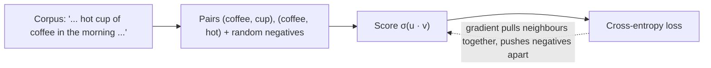

You can guess a lot about a stranger from the company they keep. Linguists turned this into a working principle, the **distributional hypothesis**: words that appear in similar contexts tend to have similar meanings. "Coffee" and "tea" both show up near "cup", "hot", "drink" and "morning"; "coffee" and "carburettor" share almost nothing.

Embeddings are learned by turning that principle into a loss function. Nobody labels "coffee" and "tea" as related. The model is simply asked to predict context, and the gradient pushes the vectors of interchangeable words toward each other because that makes the predictions better. There are two routes to the same effect: a dedicated objective (word2vec, the classic method), or end-to-end training of a whole language model, where the embedding table is just the first layer.

## A dedicated objective: skip-gram with negative sampling

The **skip-gram** model gives each word two vectors: $\mathbf{v}_w$ when it is the centre word and $\mathbf{u}_c$ when it is a context word. It scores how likely context word $c$ is to appear near $w$ with a dot product squashed by the sigmoid $\sigma(z) = 1/(1 + e^{-z})$:

$$
P(\text{$c$ is a real neighbour of $w$}) = \sigma(\mathbf{u}_c \cdot \mathbf{v}_w)
$$

For each real (word, context) pair it also draws a few random **negative** words $n$ and asks the model to say "not a neighbour", $\sigma(-\mathbf{u}_n \cdot \mathbf{v}_w)$. The loss for one example is the cross-entropy of those yes/no predictions:

$$
\mathcal{L} = -\log \sigma(\mathbf{u}_c \cdot \mathbf{v}_w) - \sum_{n} \log \sigma(-\mathbf{u}_n \cdot \mathbf{v}_w)
$$

Minimising $\mathcal{L}$ raises the dot product with real neighbours and lowers it with random words. Words with the same neighbours get pulled toward the same context vectors, and therefore toward each other.

## One gradient step, by hand

The derivative of $-\log\sigma(s)$ with respect to $s$ is $-(1 - \sigma(s))$. With $s = \mathbf{u}_c \cdot \mathbf{v}_w$, the chain rule gives the gradient for the centre vector: $\partial \mathcal{L} / \partial \mathbf{v}_w = -(1 - \sigma(s))\,\mathbf{u}_c$.

```steps
Pulling a word toward its neighbour
Centre vector $\mathbf{v}_w = (1, 0.5)$, context vector $\mathbf{u}_c = (1, 2)$, learning rate $\eta = 0.1$.
---
Score: $s = 1 \cdot 1 + 0.5 \cdot 2 = 2.0$. Probability $\sigma(2.0) \approx 0.881$. Loss $-\ln 0.881 \approx 0.127$.
---
Gradient: $-(1 - 0.881) \times (1, 2) = (-0.119, -0.238)$.
---
Update $\mathbf{v}_w \leftarrow \mathbf{v}_w - \eta \cdot \text{gradient} = (1 + 0.0119,\ 0.5 + 0.0238) = (1.0119, 0.5238)$.
---
New score: $1.0119 + 2 \times 0.5238 \approx 2.060$, probability $\approx 0.887$. The centre vector moved a little *toward* $\mathbf{u}_c$. A negative word $\mathbf{u}_n = (2, -1)$ scores $1.5$, so its loss $-\ln\sigma(-1.5) \approx 1.70$ is large, and its gradient pushes $\mathbf{v}_w$ *away* from it.
```

Repeat that over billions of word pairs and the geometry of the previous topics appears.



## Inside a language model

An LLM does not use a separate objective. Its embedding table $E$ is the first layer, and the loss is the next-token cross-entropy at the very end of the network. Backpropagation carries the gradient all the way back to the rows of $E$ for the tokens in the batch. Two consequences follow directly from the maths of the lookup ($\mathbf{x} = \mathbf{e}_t^\top E$):

1. **Only rows that appear get updated.** The gradient for every other row is exactly zero in that step. A token seen a billion times is shaped a billion times; a token seen ten times barely moves from its random start.
2. **The embedding learns whatever helps prediction**, not "meaning" in a dictionary sense. Spelling, part of speech, typical position and topic all get packed into the same vector if they help.

## See it

```sim
embedding-space
```

Look at a cluster of related words and imagine each one starting at a random point. Training is what moved them into that cluster. Compare the neighbours of a very common word with those of a rare one: in real models, common words have tight, sensible neighbourhoods and rare words have noisy ones.

## In practice

- You almost never train word vectors from scratch today. You either use the token embeddings inside a pretrained LLM implicitly, or call a dedicated **embedding model** (next topic) for search.
- When fine-tuning a model on a new vocabulary (new special tokens, for example), the new rows start untrained. A common practice is to initialise them as the average of existing rows so they begin somewhere sensible rather than at random.

```quiz
{"q": "In one training step the batch contains tokens 5, 17 and 5 again. Which rows of the embedding matrix receive a non-zero gradient?", "options": ["Only rows 5 and 17", "Every row, because softmax touches the whole vocabulary", "Only row 5, because it appears twice", "Rows 0 to 17"], "answer": 0, "explain": "The input lookup is a one-hot product, so the input-embedding gradient is non-zero only in the selected rows (row 5 accumulates two contributions). The softmax at the output touches every vocabulary entry, but that is the output matrix; it only reaches the input table directly if the weights are tied."}
```

```quiz
{"q": "Skip-gram scores a pair with $\\sigma(\\mathbf{u}_c \\cdot \\mathbf{v}_w)$. The current score is $s = 0$. What is the loss $-\\ln\\sigma(s)$ for this real pair?", "options": ["$\\ln 2 \\approx 0.693$", "0", "1", "$\\infty$"], "answer": 0, "explain": "$\\sigma(0) = 0.5$, and $-\\ln 0.5 = \\ln 2 \\approx 0.693$: the model is undecided, so it pays the 'coin flip' loss. Zero loss would need $\\sigma(s) = 1$, which happens only as $s \\to \\infty$."}
```
