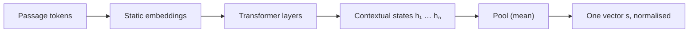

"She sat on the river **bank**." "He opened an account at the **bank**." Same token, same row of the embedding table, completely different meaning. A single fixed vector per token, a **static embedding**, has to be a compromise between every sense the token ever has.

Transformers solve this by not stopping at the table. The vector for "bank" enters the first layer as its static embedding and is then repeatedly updated by attention, which mixes in information from the surrounding tokens. After a few layers the vector at that position is a **contextual embedding** (also called a **hidden state**): a description of "bank, in this sentence". In the first sentence it has drifted toward water and slopes; in the second, toward money.

## Where the vectors live

Write $\mathbf{h}_i^{(\ell)}$ for the vector at position $i$ after layer $\ell$, with $\mathbf{h}_i^{(0)} = E[t_i,:]$ the static embedding of token $t_i$. Each transformer block adds an update that depends on the whole context:

$$
\mathbf{h}_i^{(\ell)} = \mathbf{h}_i^{(\ell-1)} + f_\ell\big(\mathbf{h}_1^{(\ell-1)}, \dots, \mathbf{h}_n^{(\ell-1)}\big)_i
$$

Here $f_\ell$ is layer $\ell$'s attention and feed-forward computation and $n$ is the sequence length. Two copies of "bank" start with identical $\mathbf{h}^{(0)}$ and diverge as soon as their contexts differ. You will build $f_\ell$ piece by piece in the next two lessons.

```steps
Bank, before and after context
Toy 2-D space with directions water $= (0.1, 1.0)$ and money $= (1.0, 0.2)$. The static embedding of "bank" is $(0.6, 0.6)$: cosine $0.774$ with water and $0.832$ with money. It is undecided.
---
After a few layers in "river bank", the hidden state is $(0.2, 0.9)$: cosine $0.993$ with water and $0.404$ with money.
---
After a few layers in "bank account", the hidden state is $(0.9, 0.3)$: cosine $0.409$ with water and $0.992$ with money.
---
The two contextual vectors for the same token now have cosine $0.514$ with each other. The static table could never separate them; context did.
```

## From token vectors to a sentence vector

Search needs one vector per *text*, not per token. An **embedding model** is a transformer trained so that a single pooled vector represents the meaning of a whole passage. The simplest pooling is the mean of the final hidden states:

$$
\mathbf{s} = \frac{1}{n} \sum_{i=1}^{n} \mathbf{h}_i^{(L)}
$$

where $L$ is the last layer. With three final states $(0.9, 0.1, 0.4)$, $(0.3, 0.7, 0.2)$ and $(0.6, 0.4, 0.9)$, the mean is $(1.8/3,\ 1.2/3,\ 1.5/3) = (0.6, 0.4, 0.5)$. Other models use the vector of a special token, or the last token's state.

Pooling alone is not enough. A model trained only for next-token prediction gives sentence vectors that are mediocre for similarity search. Embedding models are further trained with a **contrastive** objective: pairs that should match (a question and the passage that answers it) are pulled together by cosine similarity, and non-matching pairs in the same batch are pushed apart. It is the skip-gram idea from the previous topic, lifted from words to whole passages.

| Kind | One vector per | Depends on context? | Typical use |
|---|---|---|---|
| Static token embedding (row of $E$) | token type | no | first layer of every LLM |
| Hidden state $\mathbf{h}_i^{(\ell)}$ | token position | yes | inside the model; interpretability |
| Sentence embedding $\mathbf{s}$ | passage | yes | semantic search, RAG, clustering |



## See it

```sim
embedding-space
```

The toy space is static: each word has one fixed point. Find a word with two senses and look at its neighbours. You will usually see neighbours from both senses mixed together, the compromise that contextual embeddings remove.

## In practice

- **Use the same embedding model for queries and documents.** Vectors from two different models live in unrelated spaces; their cosine similarity is meaningless even if the dimensions match.
- **Re-embed when you change models.** Upgrading the embedding model means recomputing every stored vector, which is a real cost for a large index. Plan for it.
- **Mind the input limit.** Embedding models have a maximum input length; text beyond it is usually truncated silently, which is one reason long documents are split into chunks before embedding (covered in the RAG module).

```quiz
{"q": "Why does the token 'bank' get different vectors in 'river bank' and 'bank account' inside a transformer, when it has one row in the embedding table?", "options": ["Attention layers add context-dependent updates to each position's vector", "The tokenizer assigns a different ID to each sense", "The embedding table has one row per sense", "Positional encodings differ between the two sentences"], "answer": 0, "explain": "Both start from the same static row; each layer adds an update computed from the surrounding tokens, so the hidden states diverge. The tokenizer knows nothing about senses. Positional information differs only by position, not by meaning, so it cannot separate senses on its own."}
```

```quiz
{"q": "Four final hidden states are $(1, 0)$, $(0, 1)$, $(1, 1)$ and $(2, 0)$. What is their mean-pooled sentence vector?", "options": ["$(1, 0.5)$", "$(4, 2)$", "$(0.5, 0.5)$", "$(1, 1)$"], "answer": 0, "explain": "Sum the components: $(1+0+1+2,\\ 0+1+1+0) = (4, 2)$, then divide by $n = 4$: $(1, 0.5)$. $(4, 2)$ is the sum before dividing."}
```
