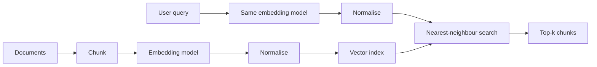

Once you can turn any passage into a vector, a whole family of features becomes simple: find the documents closest to a question, group support tickets by topic, spot near-duplicate pages, recommend similar items. All of them reduce to storing many vectors and comparing a new one against them.

The engineering questions are therefore about numbers: how many bytes the vectors take, how many operations a search costs, and what you lose when you shrink them. This topic gives you the formulas; the retrieval module builds the indexes that make search fast.

## Storage

An index of $N$ vectors, each of dimension $d$, stored at $b$ bytes per number, needs

$$
\text{memory} = N \cdot d \cdot b \ \text{bytes}
$$

before any index overhead. Here $b = 4$ for 32-bit floats, $2$ for 16-bit floats and $1$ for 8-bit integers.

```steps
Sizing an index for a million chunks
You split a document collection into $N = 1{,}000{,}000$ chunks and embed each with a model that outputs $d = 1{,}536$ numbers.
---
At float32 ($b = 4$): $10^6 \times 1{,}536 \times 4 = 6.144 \times 10^9$ bytes, about **6.1 GB**.
---
At float16 ($b = 2$): about **3.1 GB**. At int8 ($b = 1$): about **1.5 GB**, a 4× saving over float32.
---
A model with $d = 768$ halves every figure: about 3.1 GB at float32. Dimension and precision multiply, so both are levers.
```

## Search cost

Exact (brute-force) search compares the query with every stored vector. Each comparison is a dot product of length $d$, which costs $d$ multiplications and $d$ additions, so one query costs about

$$
\text{FLOPs per query} \approx 2 \cdot N \cdot d
$$

For the index above: $2 \times 10^6 \times 1{,}536 \approx 3.1 \times 10^9$ floating-point operations. A modern CPU core manages very roughly tens of billions of simple operations per second with vector instructions, so a single exact search takes on the order of a tenth of a second, and the 6 GB of vectors must be streamed from memory every time. That is fine for a prototype and too slow for thousands of queries per second, which is why approximate indexes exist.

| Choice | Effect on memory | Effect on quality | Effect on speed |
|---|---|---|---|
| Smaller $d$ (a smaller model, or truncating vectors from a model trained to allow it) | linear saving | usually a small drop | linear speed-up |
| float16 instead of float32 | 2× smaller | negligible for search | faster (less memory traffic) |
| int8 or binary quantisation | 4× to 32× smaller | noticeable drop; often recovered by re-scoring top results at full precision | much faster |
| Approximate index (IVF, HNSW) | adds overhead | small recall loss | orders of magnitude faster |

## See it

```sim
embedding-space
```

Pick a query word and watch its nearest neighbours highlight. That highlighting is exactly brute-force search: the simulation computes the cosine to every point and sorts. With ten words that is instant; multiply the point count by $10^5$ and the dimension by a few hundred and you have the cost estimated above.



## Common mistakes

- **Mixing models.** Query vectors from model A compared with document vectors from model B give scores that look plausible and mean nothing. Store the model name and version next to every vector.
- **Forgetting to normalise.** If your index uses dot product and the vectors are not unit length, ranking is biased toward long vectors. Normalise once at write time ($\mathbf{v} / \|\mathbf{v}\|$) and at query time.
- **Trusting a universal threshold.** "Similar if cosine > 0.8" is not portable between models or domains. Calibrate on labelled pairs from your own data.
- **Embedding the wrong thing.** A question and the passage that answers it may not be close for a model that was not trained on question–passage pairs. Some embedding models expect a prefix or instruction on queries; read the model card.

```quiz
{"q": "You store 20 million vectors of dimension 1,024 at float16. Ignoring index overhead, how much memory do they need?", "options": ["About 41 GB", "About 82 GB", "About 20 GB", "About 4 GB"], "answer": 0, "explain": "$N \\cdot d \\cdot b = 2 \\times 10^7 \\times 1{,}024 \\times 2 = 4.096 \\times 10^{10}$ bytes, about 41 GB. 82 GB is the float32 figure ($b = 4$); 20 GB is the int8 figure."}
```

```quiz
{"q": "Brute-force search over $N = 500{,}000$ vectors of dimension $d = 768$ costs roughly how many floating-point operations per query?", "options": ["About $7.7 \\times 10^8$", "About $3.8 \\times 10^8$", "About $5 \\times 10^5$", "About $3 \\times 10^{11}$"], "answer": 0, "explain": "$2 \\cdot N \\cdot d = 2 \\times 5 \\times 10^5 \\times 768 = 7.68 \\times 10^8$. Each dot product needs $d$ multiplies and $d$ adds, so the factor 2 matters; $3.8 \\times 10^8$ counts only the multiplications."}
```
