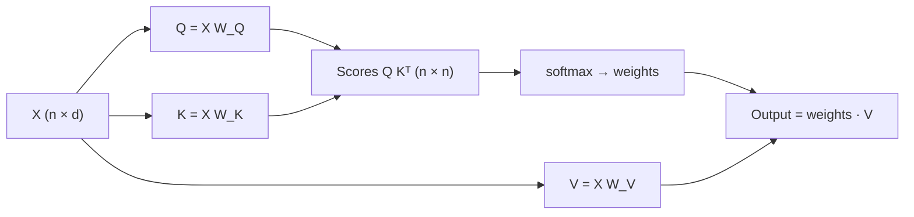

Think of a library catalogue. You walk in with a **query** ("books about sailing"). Every book has a **key**, the label on its catalogue card ("sailing, navigation, 1950s"). You compare your query with every key, and the books whose keys match best are the ones whose **value**, the content inside, you actually read. The label you search by and the content you take away are different things.

Attention uses exactly this split. From each token's vector it computes three different vectors:

- a **query** $\mathbf{q}_i$: what position $i$ is looking for,
- a **key** $\mathbf{k}_j$: what position $j$ advertises about itself,
- a **value** $\mathbf{v}_j$: what position $j$ hands over if it is chosen.

The score between positions is the dot product of a query with a key, and the output is a weighted average of values. Why three vectors instead of using the token vector for everything? Because "what I am looking for" and "what I am" are different questions. The word "it" is looking for a noun; it is not itself a good match for other words looking for a noun.

## Three learned projections

All three come from the same input by multiplying with three learned weight matrices. Stack the $n$ token vectors as the rows of $X$ (shape $n \times d$). Then

$$
Q = X W_Q, \qquad K = X W_K, \qquad V = X W_V
$$

with $W_Q, W_K \in \mathbb{R}^{d \times d_k}$ and $W_V \in \mathbb{R}^{d \times d_v}$. Row $i$ of $Q$ is $\mathbf{q}_i$, and so on. Here $d$ is the model width, $d_k$ is the query/key dimension and $d_v$ is the value dimension; in standard transformers $d_k = d_v = d_h$, the head dimension. The matrices are the parameters; gradient descent decides what "looking for" and "advertising" mean.

The score matrix is every query dotted with every key, which is one matrix product:

$$
S = Q K^{\top} \in \mathbb{R}^{n \times n}, \qquad S_{ij} = \mathbf{q}_i \cdot \mathbf{k}_j
$$

```steps
Projections for two tokens, by hand
Two tokens with $d = 2$: $\mathbf{x}_1 = (1, 2)$ and $\mathbf{x}_2 = (0, 1)$. Weights: $W_Q = \begin{pmatrix}1 & 0\\ 1 & 1\end{pmatrix}$, $W_K = \begin{pmatrix}0 & 1\\ 1 & 0\end{pmatrix}$, $W_V = \begin{pmatrix}2 & 0\\ 0 & 1\end{pmatrix}$.
---
Queries (row vector times matrix): $\mathbf{q}_1 = (1\cdot1 + 2\cdot1,\ 1\cdot0 + 2\cdot1) = (3, 2)$; $\mathbf{q}_2 = (1, 1)$.
---
Keys: $W_K$ swaps the two coordinates, so $\mathbf{k}_1 = (2, 1)$ and $\mathbf{k}_2 = (1, 0)$. Values: $W_V$ doubles the first coordinate, so $\mathbf{v}_1 = (2, 2)$ and $\mathbf{v}_2 = (0, 1)$.
---
Scores for token 1: $\mathbf{q}_1\cdot\mathbf{k}_1 = 6 + 2 = 8$ and $\mathbf{q}_1\cdot\mathbf{k}_2 = 3 + 0 = 3$. Token 1 will attend mostly to itself. For token 2: $\mathbf{q}_2\cdot\mathbf{k}_1 = 3$ and $\mathbf{q}_2\cdot\mathbf{k}_2 = 1$, so it also prefers token 1. Note $S$ is not symmetric in general: $S_{12} = 3$ happens to equal $S_{21} = 3$ here, but $W_Q \ne W_K$ means "$i$ looks for $j$" and "$j$ looks for $i$" are different questions.
```



## Counting the parameters

Each projection is a $d \times d_h$ matrix. With $h$ heads and $h \cdot d_h = d$ (the usual choice), the three projections across all heads are three $d \times d$ matrices, and an **output projection** $W_O$ (another $d \times d$) mixes the heads back together. So one attention layer has

$$
4d^2 \ \text{weights (plus biases, if the model uses them).}
$$

For GPT-2 small, $d = 768$: $4 \times 768^2 = 2{,}359{,}296$ weights per layer, plus $4 \times 768 = 3{,}072$ biases, giving $2{,}362{,}368$. Across 12 layers that is about 28M of its 124M parameters.

## See it

```sim
attention-heatmap
```

The heatmap shows the result of $\text{softmax}(QK^\top/\sqrt{d_k})$: cell $(i, j)$ is how much row $i$'s query matches column $j$'s key. Switch between head presets and notice the pattern changes completely even though the sentence (and so $X$) is the same: each head has its own $W_Q$ and $W_K$.

## In practice

- **Q, K and V are often computed by one fused matrix** of shape $d \times 3d$ for speed; GPT-2's checkpoints store it that way. It is the same maths.
- **Keys and values are what get cached.** During generation, past tokens' $K$ and $V$ never change, so servers store them (the KV cache, lesson 7) instead of recomputing. Queries are only needed for the newest token.
- **Some models share keys and values across heads** (multi-query and grouped-query attention) to shrink that cache; the query projections stay per head.

```quiz
{"q": "With $\\mathbf{q} = (2, -1)$ and keys $\\mathbf{k}_1 = (1, 1)$, $\\mathbf{k}_2 = (0, -3)$, which key gets the higher raw score?", "options": ["$\\mathbf{k}_2$, score 3 vs 1", "$\\mathbf{k}_1$, score 1 vs 3", "They tie", "$\\mathbf{k}_1$, because it is closer in Euclidean distance"], "answer": 0, "explain": "$\\mathbf{q}\\cdot\\mathbf{k}_1 = 2 - 1 = 1$; $\\mathbf{q}\\cdot\\mathbf{k}_2 = 0 + 3 = 3$. Attention uses the dot product, not distance, and $\\mathbf{k}_2$ is both aligned with $\\mathbf{q}$'s negative second component and longer."}
```

```quiz
{"q": "A model has $d = 1{,}024$ and no biases. How many weights does one attention layer have, counting $W_Q, W_K, W_V$ and $W_O$?", "options": ["4,194,304", "3,145,728", "1,048,576", "16,777,216"], "answer": 0, "explain": "$4d^2 = 4 \\times 1{,}024^2 = 4 \\times 1{,}048{,}576 = 4{,}194{,}304$. Leaving out $W_O$ gives 3,145,728; the number of heads does not change the total because $h \\cdot d_h = d$."}
```
