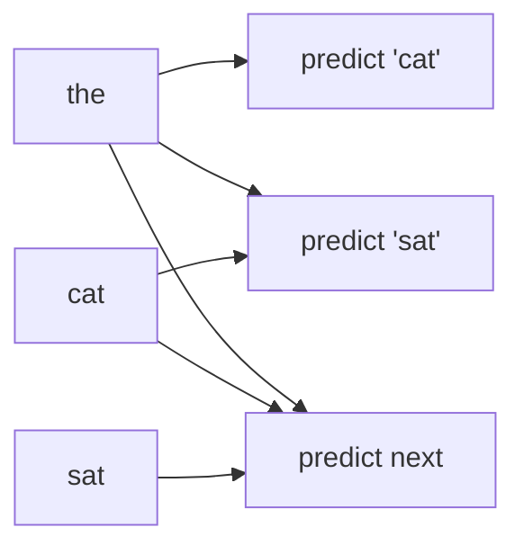

A language model is trained to predict the next token. If, while predicting the word after "the cat", position 2 could attend to position 3 and read "sat", the task would be trivial: copy the answer. The model would score perfectly in training and be useless at generation time, when the future does not exist yet.

The fix is a **causal mask** (also called a look-ahead mask): each position may attend to itself and to earlier positions, never to later ones. With that rule in place, the prediction at every position depends only on the past, exactly as it will when the model generates text one token at a time. Models built this way are called **decoder-only** or **autoregressive** transformers; GPT-2, Llama and most chat models are of this kind.

## The mask as maths

Add a mask matrix $M$ to the scaled scores before the softmax:

$$
\text{Attention}(Q, K, V) = \text{softmax}\!\left(\frac{QK^{\top}}{\sqrt{d_k}} + M\right) V, \qquad M_{ij} = \begin{cases} 0 & j \le i \\ -\infty & j > i \end{cases}
$$

Here $i$ is the query (row) position and $j$ the key (column) position. Since $e^{-\infty} = 0$, a future position gets weight exactly zero, and softmax re-normalises the remaining weights so each row still sums to 1. In code, $-\infty$ is usually a very large negative number or the masked scores are set directly to $-\infty$ before the softmax.

For $n = 3$ the allowed pattern is lower-triangular:

| query ↓ / key → | the | cat | sat |
|---|---|---|---|
| the | ✓ | masked | masked |
| cat | ✓ | ✓ | masked |
| sat | ✓ | ✓ | ✓ |

## The worked example, masked

Reuse the scaled scores from the worked example, $\begin{pmatrix}1&0&1\\0&1&0\\1&1&1\end{pmatrix}$, and values "the" $(1,0)$, "cat" $(0,1)$, "sat" $(1,1)$.

```steps
Applying the causal mask
**Row "the".** Only its own key is allowed: scores $(1, -\infty, -\infty)$, weights $(1, 0, 0)$. Output $= (1, 0)$. The first token can only see itself. Without the mask it was $(0.845, 0.578)$, because it had peeked at "sat".
---
**Row "cat".** Allowed scores $(0, 1)$: $e^0 = 1$, $e^1 \approx 2.718$, total $3.718$. Weights $\approx (0.269, 0.731, 0)$. Output $= 0.269(1,0) + 0.731(0,1) = (0.269, 0.731)$.
---
**Row "sat".** Nothing is masked for the last position, so its weights stay $(1/3, 1/3, 1/3)$ and its output stays $(0.667, 0.667)$.
---
**Check.** Each row sums to 1, the upper triangle of the weight matrix is all zeros, and the last row is unchanged. Those three facts are the quickest test that a mask is implemented correctly.
```

## Why this makes training efficient

The mask is what lets one forward pass train on every position at once. A sequence of $n$ tokens yields $n$ predictions in parallel: position 1 predicts token 2, position 2 predicts token 3, and so on, each seeing only what it is allowed to. A 2,048-token training sequence therefore supplies 2,048 next-token losses (minus edge effects) from a single pass, instead of 2,048 separate passes.



It also explains the **KV cache**. Because position $i$ never looks at anything after $i$, the keys and values of earlier positions do not change when new tokens arrive. A server can store them and only compute the newest token's row of attention at each generation step.

## See it

```sim
attention-heatmap
```

Toggle the causal mask on. The upper-right triangle goes dark and every row re-normalises over what is left. Compare the first row with the mask off and on: masked, it is a single cell, the first token attending to itself. Then look at the last row, which is identical either way.

## In practice

- **Encoders do not mask.** Models used for classification and embeddings (BERT-style) let every token see every other, because they are not generating left to right. Embedding models in the previous lesson are often of this kind.
- **Padding needs its own mask.** When sequences of different lengths share a batch, padding positions must also be masked out as keys, or real tokens will attend to junk. A missing padding mask is a classic bug that shows up as outputs changing with batch composition.
- **Off-by-one errors are common.** Masking the diagonal too ($j \ge i$ instead of $j > i$) means a token cannot see itself, and the first row has nothing to attend to at all.

```quiz
{"q": "With a causal mask, scaled scores for the third position are $(0, 0, \\ln 2, 5)$ over keys 1-4. What are its attention weights?", "options": ["$(0.25, 0.25, 0.5, 0)$", "$(0.007, 0.007, 0.013, 0.974)$", "$(1/3, 1/3, 1/3, 0)$", "$(0, 0, 1, 0)$"], "answer": 0, "explain": "Key 4 is in the future for position 3, so its score becomes $-\\infty$ and its weight 0, whatever the raw score was. The rest: $e^0, e^0, e^{\\ln 2} = 1, 1, 2$, total 4, so $(0.25, 0.25, 0.5)$. The second option is the unmasked softmax, dominated by the future key with score 5: exactly the leak the mask prevents."}
```

```quiz
{"q": "Why can a decoder-only model compute the training loss for all positions of a sequence in one forward pass?", "options": ["The causal mask ensures each position's output depends only on earlier tokens, so all next-token predictions are valid simultaneously", "Because the model ignores token order", "Because the loss is only computed on the last token", "Because attention weights are fixed during training"], "answer": 0, "explain": "Each position's prediction is computed exactly as it would be at generation time, from the past only, so all $n$ predictions can be scored at once. Without the mask, earlier positions would see the answers they are supposed to predict."}
```

```lab
attention-by-hand
```
