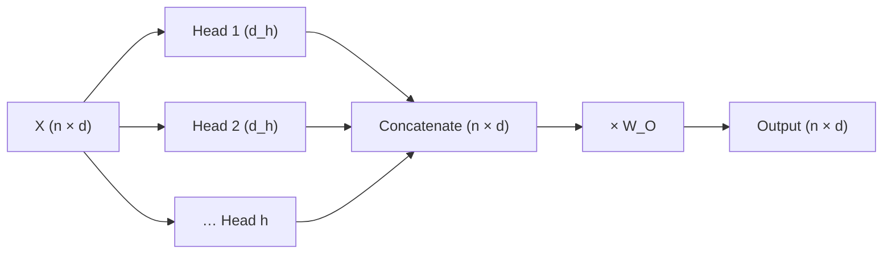

When you read a sentence you track several things at once: who did what, which adjective goes with which noun, what the pronoun refers to, where the clause ends. A single attention pattern can only express one weighting of the context per position. If "it" needs to look at its referent *and* at the verb that governs it, one softmax row has to compromise between the two.

**Multi-head attention** runs several attention operations side by side, each with its own query, key and value projections. Each one, a **head**, can learn to look for something different. Their outputs are concatenated and mixed by one more matrix. Researchers who inspect trained models find heads that attend to the previous token, heads that match brackets or quotes, and heads that copy a token seen earlier in the context; most heads are less tidy than that.

## The maths

With $h$ heads, each head works in a smaller space of dimension $d_h = d / h$. For head $i$:

$$
\text{head}_i = \text{softmax}\!\left(\frac{(X W_Q^{(i)})(X W_K^{(i)})^{\top}}{\sqrt{d_h}} + M\right) X W_V^{(i)}
$$

with $W_Q^{(i)}, W_K^{(i)}, W_V^{(i)} \in \mathbb{R}^{d \times d_h}$ and $M$ the causal mask. Each head's output is $n \times d_h$. Concatenating the $h$ outputs side by side gives $n \times (h \cdot d_h) = n \times d$, and an output projection $W_O \in \mathbb{R}^{d \times d}$ mixes them:

$$
\text{MultiHead}(X) = \big[\text{head}_1 \,\|\, \text{head}_2 \,\|\, \cdots \,\|\, \text{head}_h\big]\, W_O
$$

where $\|$ means concatenation. Because $h \cdot d_h = d$, the per-head matrices stacked together are exactly $d \times d$, so the parameter count is the same $4d^2$ as one big head. Multi-head attention costs no extra parameters; it splits the same budget into independent patterns.

## Two heads disagree, by hand

```steps
One query, two heads
Width $d = 4$, $h = 2$ heads, $d_h = 2$. Assume for simplicity that the projections just split the vectors: head 1 sees coordinates 1-2, head 2 sees coordinates 3-4. The query is $\mathbf{q} = (1, 0, 0, 1)$; keys are $\mathbf{k}_1 = (1, 0, 0, 0)$ and $\mathbf{k}_2 = (0, 0, 0, 1)$.
---
**One big head** ($d_k = 4$): scores $\mathbf{q}\cdot\mathbf{k}_1 = 1$ and $\mathbf{q}\cdot\mathbf{k}_2 = 1$. Equal, so weights $(0.5, 0.5)$: a blur.
---
**Head 1** uses $(1, 0)$ against $(1, 0)$ and $(0, 0)$: scores $1, 0$; divide by $\sqrt 2$: $0.707, 0$. Softmax: $e^{0.707} \approx 2.028$, so weights $\approx (0.670, 0.330)$. Head 1 prefers key 1.
---
**Head 2** uses $(0, 1)$ against $(0, 0)$ and $(0, 1)$: scores $0, 1$, scaled $0, 0.707$, weights $\approx (0.330, 0.670)$. Head 2 prefers key 2.
---
Concatenating both heads' outputs keeps both preferences, and $W_O$ learns how to combine them. The single head could only average them away.
```

## Real shapes

| Model | $d$ | $h$ | $d_h$ | KV heads |
|---|---|---|---|---|
| GPT-2 small | 768 | 12 | 64 | 12 (standard multi-head) |
| Llama-2-7B | 4,096 | 32 | 128 | 32 (standard multi-head) |
| Llama-3-8B | 4,096 | 32 | 128 | 8 (grouped-query attention) |

In **grouped-query attention (GQA)** several query heads share one key head and one value head. Llama-3-8B has 32 query heads but only $h_{kv} = 8$ key/value heads, so each K/V head serves 4 query heads. Its $W_K$ and $W_V$ shrink from $4096 \times 4096$ to $4096 \times (8 \times 128) = 4096 \times 1024$, and, more importantly, the KV cache shrinks by a factor of 4. **Multi-query attention (MQA)** is the extreme case, $h_{kv} = 1$.



## See it

```sim
attention-heatmap
```

Cycle through the head presets on the same sentence. Look for a head whose bright cells sit just left of the diagonal (attending to the previous token), and one whose bright cells link a word to a related word further back. Same input, same formula; different $W_Q$ and $W_K$.

## In practice

- **Heads are implemented as one reshape, not a loop.** $Q$ of shape $n \times d$ is reshaped to $h \times n \times d_h$ and all heads run as one batched matrix multiply.
- **Many heads are redundant.** Pruning studies have removed a sizable share of heads from trained models with little loss. That is part of why GQA, which shares keys and values, costs so little quality.
- **Head dimension is the knob for $\sqrt{d_h}$.** The scaling uses $d_h$, not $d$: for Llama-2-7B scores are divided by $\sqrt{128} \approx 11.3$.

```quiz
{"q": "A model has $d = 2{,}048$ and $h = 16$ heads. What is the head dimension, and how many weights do $W_Q, W_K, W_V, W_O$ have in total (no biases, standard multi-head)?", "options": ["$d_h = 128$; $4d^2 = 16{,}777{,}216$", "$d_h = 128$; $16 \\times 4d^2$", "$d_h = 32{,}768$; $4d^2$", "$d_h = 16$; $4 \\cdot d \\cdot d_h$"], "answer": 0, "explain": "$d_h = d/h = 2{,}048/16 = 128$. The heads partition the same $d \\times d$ matrices, so the total is $4 \\times 2{,}048^2 = 16{,}777{,}216$, independent of $h$. Multiplying by 16 is the common mistake of thinking each head has full-size matrices."}
```

```quiz
{"q": "Llama-3-8B has $d = 4{,}096$, 32 query heads, 8 KV heads and $d_h = 128$. How many weights are in its $W_K$ for one layer?", "options": ["4,194,304", "16,777,216", "1,048,576", "524,288"], "answer": 0, "explain": "$W_K$ maps $d$ to $h_{kv} \\cdot d_h = 8 \\times 128 = 1{,}024$, so it has $4{,}096 \\times 1{,}024 = 4{,}194{,}304$ weights. 16,777,216 is the full $d \\times d$ matrix of standard multi-head attention, four times larger."}
```

```lab
attention-by-hand
```
