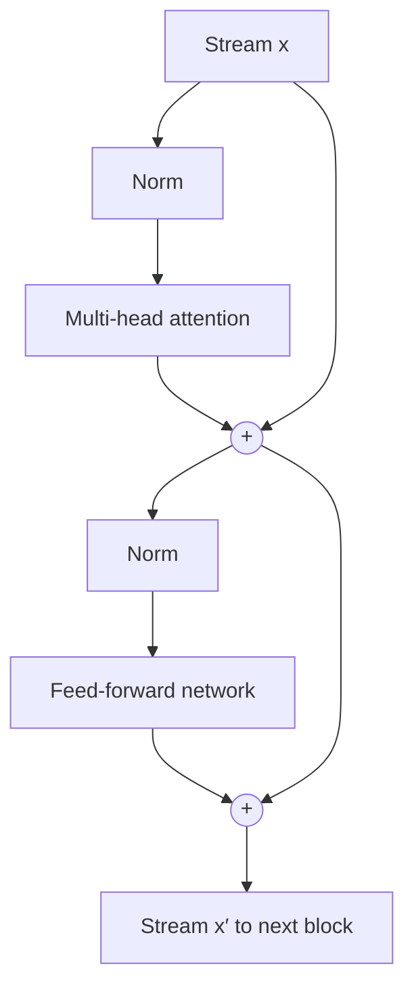

Think of a shared document passed down a line of editors. Nobody rewrites it from scratch. Each editor reads it, writes a few notes in the margin, and passes it on. At the end the document holds the original text plus every editor's contribution, and any editor can still see what the first one wrote.

A transformer works the same way. Each token starts as an embedding vector of length $d$. That vector is the **residual stream**: a running state that flows from the bottom of the model to the top. Every **transformer block** reads the stream, computes a correction, and *adds* it back. Nothing overwrites the stream; blocks only add to it.

A block has two sub-layers. **Attention** moves information *between* positions: it lets the token "sat" pull in something from "cat". The **feed-forward network** (FFN) then processes each position *on its own*. Each sub-layer reads a normalised copy of the stream and adds its output back through a **residual connection** (also called a skip connection).

## The equations

For one block in the **pre-norm** arrangement used by GPT-2, Llama and nearly every modern LLM:

$$
\mathbf{h} = \mathbf{x} + \text{Attn}\big(\text{Norm}_1(\mathbf{x})\big), \qquad \mathbf{x}' = \mathbf{h} + \text{FFN}\big(\text{Norm}_2(\mathbf{h})\big)
$$

Here $\mathbf{x} \in \mathbb{R}^{n \times d}$ is the stream entering the block ($n$ tokens, each a $d$-vector), $\text{Norm}$ is LayerNorm or RMSNorm (next topic), $\text{Attn}$ is multi-head attention, $\mathbf{h}$ is the stream halfway through, and $\mathbf{x}'$ is the stream leaving the block. Stack $L$ blocks and the final stream is the embedding plus $2L$ additive updates:

$$
\mathbf{x}_L = \mathbf{x}_0 + \sum_{\ell=1}^{L} \big(\mathbf{a}_\ell + \mathbf{f}_\ell\big)
$$

where $\mathbf{a}_\ell$ and $\mathbf{f}_\ell$ are the attention and FFN outputs of block $\ell$.



The straight arrows that bypass each sub-layer are the residual connections.

## A worked example

```steps
One token through one block
The token's stream vector is $\mathbf{x} = (1.0, -2.0, 0.5)$ (a toy $d = 3$).
---
Attention reads $\text{Norm}(\mathbf{x})$ and returns $\mathbf{a} = (0.2, 0.1, -0.4)$. Add it: $\mathbf{h} = (1.2, -1.9, 0.1)$.
---
The FFN reads $\text{Norm}(\mathbf{h})$ and returns $\mathbf{f} = (-0.3, 0.0, 0.6)$. Add it: $\mathbf{x}' = (0.9, -1.9, 0.7)$.
---
The second coordinate barely moved, from $-2.0$ to $-1.9$. Whatever it encoded survives for later blocks to read. A block changes only what it chooses to change.
```

## Why addition matters: gradients

Without residuals a deep network is a chain $y = f_L(\cdots f_1(x))$, and by the chain rule the gradient reaching layer 1 is a product of $L$ derivatives. Suppose each scalar derivative is $0.5$. With $L = 12$:

$$
0.5^{12} = \frac{1}{4096} \approx 0.000244
$$

The first layer gets about four ten-thousandths of the signal and barely learns. This is the **vanishing gradient** problem.

With a residual, each layer is $y = x + f(x)$, so its derivative is $1 + f'(x)$. Across $L$ layers the gradient is

$$
\prod_{\ell=1}^{L} \big(1 + f_\ell'\big) = 1 + \sum_\ell f_\ell' + \sum_{\ell < m} f_\ell' f_m' + \dots
$$

The leading $1$ is the path that skips every block. However deep the stack, that path carries the gradient straight from the loss to the embeddings, unchanged. That is why transformers with 32, 80 or more layers train at all.

## See it

```sim
transformer-params
```

The calculator splits a model into embeddings and $L$ identical blocks. Set the number of layers to 1, then 12, then 32. The per-block numbers stay fixed and only the total scales. A model is a stack of copies of the same block, all reading from and writing to the same $d$-wide stream.

## In practice

- **$d$ is the width of everything.** Every block reads and writes vectors of length $d$ (768 in GPT-2 small, 4,096 in Llama-2-7B), so $d$ is also the size of the embeddings and of every residual addition.
- **Post-norm versus pre-norm.** The original 2017 transformer normalised *after* the addition: $\text{Norm}(\mathbf{x} + \text{Attn}(\mathbf{x}))$. That puts a normalisation on the skip path, which weakens the clean identity path, and deep post-norm models needed careful learning-rate warmup. GPT-2 moved the norm to the input of each sub-layer, and almost everyone followed.
- **Interpretability.** Researchers often analyse the residual stream directly. They read intermediate states through the output layer to see what the model is "about to say" at each depth. That only works because every block writes into one shared space.

```quiz
{"q": "A stream vector is $(0.5, 1.0)$. Attention adds $(0.1, -0.3)$ and then the FFN adds $(-0.2, 0.4)$. What leaves the block?", "options": ["$(0.4, 1.1)$", "$(-0.1, 0.1)$", "$(0.6, 0.7)$", "$(0.1, 0.4)$"], "answer": 0, "explain": "Residuals add every update to the stream: $0.5 + 0.1 - 0.2 = 0.4$ and $1.0 - 0.3 + 0.4 = 1.1$. Answer $(-0.1, 0.1)$ drops the original vector, which is what a network without residual connections would pass on."}
```

```quiz
{"q": "Why does a 48-block transformer not suffer from vanishing gradients the way a 48-layer plain stack can?", "options": ["Each block's derivative is $1 + f'$, so the product always contains a path with factor exactly 1 from the loss to the input", "Attention gradients are always larger than 1", "Layer normalisation sets every gradient to 1", "Transformers use ReLU, which has derivative 1"], "answer": 0, "explain": "Expanding $\\prod(1 + f_\\ell')$ gives $1 + \\dots$: the identity path skips every block. Normalisation helps keep values in range, but it is not what guarantees the gradient path. Many transformers do not use ReLU at all."}
```
