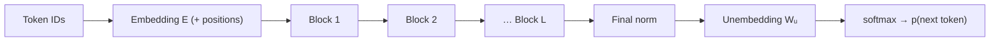

You now have every part of a block: normalise, attend, add; normalise, feed-forward, add. A full language model is that block copied $L$ times, with a way in at the bottom (token and position information) and a way out at the top (a probability for every token in the vocabulary). Nothing else is hidden. GPT-2, Llama and their relatives differ mainly in $d$, $L$, $V$, the FFN type, the norm and the position scheme. Those are exactly the settings you have just met.

The blocks share an architecture but **not weights**. Block 1 and block 12 have the same shapes and completely different numbers. Early blocks tend to handle local, surface-level patterns, while later ones build more abstract features. All of them read and write the same $d$-dimensional residual stream.

## The full forward pass

For a sequence of token IDs $t_1, \dots, t_n$:

$$
\mathbf{x}_0 = E[t_{1..n}] \;(+\,P), \qquad \mathbf{x}_\ell = \text{Block}_\ell(\mathbf{x}_{\ell-1}) \text{ for } \ell = 1..L, \qquad \mathbf{z} = \text{Norm}(\mathbf{x}_L)\, W_U^{\top}
$$

- $E \in \mathbb{R}^{V \times d}$ is the token embedding table, and $P$ the optional learned position table.
- $W_U \in \mathbb{R}^{V \times d}$ is the **unembedding** (output) matrix. It turns each final $d$-vector into $V$ **logits** $\mathbf{z}$, one score per vocabulary token.
- A softmax over the logits gives next-token probabilities (the sampling lesson picks up from here).

If $W_U = E$, the model uses **tied embeddings**: the same table reads tokens in and scores them out. GPT-2 ties them. Llama-2 does not, which is why its count included a second $V \cdot d = 131{,}072{,}000$.



## How much compute per token?

Every weight in a matrix multiply is used once per token, as one multiply and one add, so 2 FLOPs. Hence the most useful approximation in LLM engineering:

$$
\text{FLOPs per token (forward)} \approx 2N
$$

where $N$ is the parameter count. Strictly, the input embedding table should be left out, because a lookup does no arithmetic. For large models the difference is small, so engineers usually just use the headline $N$. For Llama-2-7B, with $N \approx 6.74 \times 10^9$:

$$
2 \times 6.74 \times 10^9 \approx 1.35 \times 10^{10} \text{ FLOPs per token}
$$

```steps
Compute for a 1,000-token prompt on Llama-2-7B
**Forward cost.** $1{,}000 \times 1.35 \times 10^{10} = 1.35 \times 10^{13}$ FLOPs, which is 13.5 TFLOPs.
---
**Time on hardware.** On a GPU that sustains 100 TFLOP/s on this workload, the prefill takes about $13.5 / 100 = 0.135$ s.
---
**Attention's extra term.** The $QK^\top$ and weighted-sum steps add about $4 \cdot L \cdot n \cdot d$ FLOPs per token that are not in $2N$. At $n = 4{,}096$: $4 \times 32 \times 4096 \times 4096 \approx 2.15 \times 10^{9}$, about 16% of $2N$. At $n = 1{,}000$ it is about 4%. It grows with context, which is why very long prompts cost more than $2N$ suggests.
---
**Training.** A backward pass costs about twice the forward, so training costs roughly $6N$ FLOPs per token. This is the $C \approx 6ND$ that scaling laws use.
```

## The output layer is a big matmul

The unembedding is often forgotten. In GPT-2 small, scoring 50,257 tokens from a 768-vector takes $768 \times 50{,}257 \approx 38.6$ million multiply-adds per token. That is as many weights as the whole token embedding table, and about as much work as five complete GPT-2 blocks (7.09M parameters each). Large vocabularies make the last layer expensive.

| Model | $d$ | $L$ | Heads | $V$ | Params | Forward FLOPs/token |
|---|---|---|---|---|---|---|
| GPT-2 small | 768 | 12 | 12 | 50,257 | 124M | $\approx 2.5 \times 10^8$ |
| Llama-2-7B | 4,096 | 32 | 32 | 32,000 | 6.74B | $\approx 1.35 \times 10^{10}$ |

## See it

```sim
transformer-params
```

Set up Llama-2-7B, then try two ways to double the parameter count: double $L$, or multiply $d$ by about 1.41. Both give similar totals. Deeper models run more sequential steps per token, while wider ones do bigger matrix multiplies that use the hardware better. Real model families scale both together.

## In practice

- **Decode speed is usually set by memory, not FLOPs.** Generating one token needs only $2N$ FLOPs, but it must read all $2N$ bytes of bf16 weights from GPU memory. On a GPU with about 2 TB/s of bandwidth, reading 13.5 GB takes about 7 ms. That puts the ceiling near 150 tokens/s for a single sequence, however fast the arithmetic units are. The inference module builds on this.
- **Depth costs latency.** The $L$ blocks run one after another, so each extra layer adds sequential work to every token. Width parallelises; depth does not.
- **Sanity-check checkpoints.** After loading a model, compare `sum(p.numel() for p in model.parameters())` with your hand count. A mismatch of exactly $V \cdot d$ almost always means tied weights are being counted once rather than twice, or the other way round.

```quiz
{"q": "Roughly how many FLOPs does a forward pass of GPT-2 small (124M parameters) take for a 500-token input, using $2N$ per token?", "options": ["About $1.2 \\times 10^{11}$", "About $6.2 \\times 10^{10}$", "About $2.5 \\times 10^{8}$", "About $3.7 \\times 10^{11}$"], "answer": 0, "explain": "$2 \\times 1.24 \\times 10^8 \\times 500 = 1.24 \\times 10^{11}$. $6.2 \\times 10^{10}$ forgets the factor of 2 (a multiply and an add). $3.7 \\times 10^{11}$ uses the $6N$ training rule, which includes the backward pass."}
```

```quiz
{"q": "Two models have identical blocks, but model A ties its output layer to its input embeddings and model B does not ($V = 32{,}000$, $d = 4{,}096$). How do their parameter counts differ?", "options": ["B has 131,072,000 more parameters", "A has 131,072,000 more parameters", "They are identical because the output layer has no parameters", "B has $2Vd = 262{,}144{,}000$ more"], "answer": 0, "explain": "Untied means a separate $V \\times d$ output matrix: $32{,}000 \\times 4{,}096 = 131{,}072{,}000$ extra parameters. Both models already have one embedding table, so the difference is one $Vd$, not two."}
```
