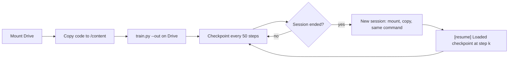

Google Colab gives you a Jupyter notebook running on a Google virtual machine, and on the free tier it usually attaches an NVIDIA T4: a 16 GB card with about 15 GB usable, alongside roughly 12 to 13 GB of system RAM and two CPU cores (as of late 2026). For this repo that is plenty. The 57.9M-parameter part 4 run that takes about two hours on a laptop should take minutes.

Two properties of Colab shape everything below. First, **the machine is temporary**: when the session ends, every file on it is gone. Second, **sessions end without asking**: a free session can run for up to about 12 hours, disconnects after roughly 90 minutes without interaction, and can be cut short when demand is high. Google's FAQ says free-tier limits fluctuate and GPU access is not guaranteed, and it publishes no weekly GPU quota. So the plan is: code on the VM's fast local disk, checkpoints and logs on Google Drive, and a training command that can be re-run to resume.

## Step 1: choose a GPU runtime and check it

Open a new notebook at colab.research.google.com, then **Runtime → Change runtime type → T4 GPU → Save**. In the first cell:

```python
!nvidia-smi
import torch
print(torch.__version__, torch.cuda.is_available(), torch.cuda.get_device_name(0))
```

You should see a Tesla T4 with about 15,360 MiB of memory, and `True`. If `is_available()` prints `False`, the runtime is still CPU-only; change it again (this restarts the VM).

## Step 2: get the repo onto the VM

The repo is a plain folder on your computer, not on GitHub, so there are two routes.

**Upload a zip.** On your laptop, zip the `llm_from_scratch` folder without `.venv` and any `runs` folders (the code is well under 5 MB; a virtual environment would be hundreds). Then:

```python
from google.colab import files
files.upload()                      # pick llm_from_scratch.zip
!unzip -q llm_from_scratch.zip -d /content
```

The upload lives only as long as the session. Next time, upload again.

**Keep it on Google Drive.** Upload the folder to My Drive once through drive.google.com. In each session, mount Drive and copy the code to local disk; reading many small files straight from Drive is slow.

```python
from google.colab import drive
drive.mount('/content/drive')       # approve the pop-up
!cp -r /content/drive/MyDrive/llm_from_scratch /content/
%cd /content/llm_from_scratch
```

If you later push the repo to your own GitHub account, `!git clone <your repo URL>` replaces both.

**Do not run `pip install -r requirements.txt` on Colab.** Colab already ships a CUDA build of PyTorch matched to its drivers; the pins would replace it and dozens of other packages. Parts 1 to 5 need only `tokenizers`, `pytest`, `matplotlib` and `tensorboard`, which are normally preinstalled. `!pip install -q tokenizers` is harmless if one is missing.

## Step 3: run the parts with GPU flags

Mount Drive even if you uploaded a zip, so outputs can be saved there. Scripts choose `cuda` automatically when they see a GPU.

```python
%cd /content/llm_from_scratch/part_2
!python orchestrator.py                                   # quick config, now on the GPU
!python train.py --data tiny.txt --amp                    # defaults: 3.35M params, 2,000 steps

%cd /content/llm_from_scratch/part_4
!python train.py --data ../part_2/tiny.txt --out /content/drive/MyDrive/lfs_runs/part4 \
    --bpe --vocab_size 32000 --mixed_precision --steps 300 --log tensorboard
```

`--amp` (part 2) and `--mixed_precision` (part 4) turn on FP16 autocast with a gradient scaler, which is what the T4's tensor cores accelerate. The T4 has no fast BF16, so FP16 with loss scaling is the right choice here, as explained in [mixed precision in code](/learn/model-foundations/scaling-the-training-loop/mixed-precision-in-code). Parts 1, 3 and 5 run as on the laptop; they are too small to notice the GPU.

## Step 4: measure, then budget the session

Do a 20-step timing run first, into a **separate** output folder. Part 4 resumes from any `model_last.pt` it finds in `--out`, so a test run in the real folder would be resumed by the real one.

The two numbers that matter are seconds per step $t$ and the checkpoint interval $k$ (`--save_every`, default 50 optimizer steps):

$$
\text{steps per session} = \frac{3600\,H}{t}, \qquad \text{work lost on a disconnect} \le k\,t
$$

**Worked example.** Suppose the timing run shows $t = 0.55$ s per step for the default part 4 config (the estimate from topic 1; measure your own). A 3-hour session fits $3600 \times 3 / 0.55 \approx 19{,}600$ steps, and with $k = 50$ a disconnect costs at most $50 \times 0.55 = 27.5$ s of training. The same $k$ on a laptop CPU at $t = 23.8$ s risks $50 \times 23.8 = 1{,}190$ s, about 20 minutes, which is why slow machines want a smaller `--save_every`.

## Step 5: resume after a disconnect

Part 4's `train.py` saves `model_last.pt` every `--save_every` steps, keeps the last two step checkpoints, and also saves when the process receives SIGTERM or Ctrl-C. Each checkpoint holds the weights plus AdamW's two moments, 12 bytes per parameter: the demo's 2.57M-parameter checkpoint measured 30.9 MB, so the 57.9M model's is about 0.7 GB, and three of them about 2.1 GB of your Drive quota.



To resume, start a new session, repeat steps 1 to 3, and run **exactly the same command**. It prints `[resume] Loaded checkpoint at step 250` (or wherever it stopped) and carries on to `--steps`. Because `--out` is an absolute Drive path, the saved `tokenizer_dir.txt` points at the same place in every session. What the checkpoint must contain, and why a missing optimizer state causes a loss spike, is covered in [checkpointing and resuming](/learn/model-foundations/scaling-the-training-loop/checkpointing-and-resuming).

## Step 6: TensorBoard in the notebook

Part 4 writes TensorBoard event files into a timestamped folder under `--out`. View them without leaving Colab:

```python
%load_ext tensorboard
%tensorboard --logdir /content/drive/MyDrive/lfs_runs/part4
```

Loss, learning rate, step time, tokens per second and GPU memory appear every 50 steps as the run progresses. [Logging and reading curves](/learn/model-foundations/scaling-the-training-loop/logging-and-reading-curves) explains what healthy curves look like.

## In practice

- **Disconnect and delete the runtime when done** (Runtime → Disconnect and delete runtime). An idle free GPU counts against whatever unpublished allowance you have.
- **Stay near the tab during long runs.** The idle timer watches the notebook, not the GPU; a training cell running in an unattended tab can still be disconnected.
- **Write everything you want to keep under `/content/drive`.** Anything else, including part 2's `runs/` folder, vanishes with the VM. Copy it to Drive with `!cp -r runs /content/drive/MyDrive/lfs_runs/part2` before you leave.

```quiz
{"q": "You time part 4 with `--steps 20 --out /content/drive/MyDrive/lfs_runs/part4`, then launch the real run with `--steps 3000` and the same `--out`. What happens?", "options": ["The real run finds the test run's `model_last.pt` and resumes from step 20 with the test run's tokenizer and optimizer state", "It starts from scratch, because `--steps` changed", "It refuses to start because the folder is not empty", "It trains a new tokenizer and overwrites the old checkpoint"], "answer": 0, "explain": "`train.py` checks for `model_last.pt` in `--out` and, if present, strictly resumes model, optimizer, scheduler and tokenizer. The step target is just a stopping point, so changing it does not trigger a fresh start. That is why timing runs belong in a separate folder. A new tokenizer is only trained when there is no checkpoint."}
```

```quiz
{"q": "A run takes 12 s per step on a slow runtime and saves every 50 steps. You want a disconnect to cost at most 2 minutes of training. What should `--save_every` be?", "options": ["10", "50", "120", "2"], "answer": 0, "explain": "Lost work is at most $k \\cdot t$, so $k \\le 120 / 12 = 10$ steps. The default 50 risks $50 \\times 12 = 600$ s, ten minutes. 120 confuses seconds with steps. Saving every 2 steps would also work but writes a checkpoint every 24 s, which on a large model spends a big share of the time on disk writes."}
```
