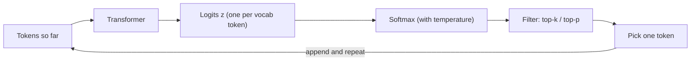

```callout-before
Before you start
You should know that the transformer produces one vector per position, and that the vocabulary is a fixed list of tokens with integer IDs. Nothing else is assumed.
```

Ask a model to continue "The capital of France is" and it does not answer with a word. It answers with a list of numbers, one for every token in its vocabulary: tens of thousands of scores, most of them very negative, a handful large. Those raw scores are **logits**. Writing text means repeatedly turning that list into a single chosen token, appending it, and asking again.

This lesson is about that last step. It looks small, but it is where you control how creative, repetitive, safe or reproducible a model is, and it is where the numbers come from that engineers use to measure models (log-probs and perplexity).

## Where the logits come from

After the last transformer block, the model has a vector $\mathbf{h} \in \mathbb{R}^{d}$ for the final position ($d$ is the model width, 768 for GPT-2 small). The **unembedding** (or LM head) is a matrix $W_U$ of shape $V \times d$, where $V$ is the vocabulary size. One matrix-vector product gives a logit per token:

$$
\mathbf{z} = W_U \mathbf{h}, \qquad z_i = \mathbf{u}_i \cdot \mathbf{h}
$$

Here $\mathbf{u}_i$ is row $i$ of $W_U$, a learned vector for token $i$. A logit is just a dot product: how well the model's current state lines up with each token's vector. For GPT-2, $V = 50{,}257$, so every step produces 50,257 logits. Many models tie $W_U$ to the input embedding matrix, which is why the same token vectors appear at both ends.

## Softmax: scores to probabilities

Logits can be any real numbers. To sample, we need non-negative numbers that sum to 1. **Softmax** does this by exponentiating and normalising:

$$
p_i = \frac{e^{z_i}}{\sum_{j=1}^{V} e^{z_j}}
$$

$p_i$ is the probability of token $i$, $z_i$ its logit, and the denominator (the **partition function**, often written $Z$) sums over all $V$ tokens. Exponentiating makes everything positive and turns differences in logits into ratios of probabilities: $p_i / p_j = e^{z_i - z_j}$. A logit that is 1 higher means a token $e \approx 2.72$ times more likely, whatever the other logits are.

```steps
Softmax by hand on four tokens
Suppose only four tokens matter: " Paris" with logit $2.0$, " the" $1.0$, " a" $0.5$ and " Lyon" $-1.0$.
---
Exponentiate each: $e^{2.0} = 7.389$, $e^{1.0} = 2.718$, $e^{0.5} = 1.649$, $e^{-1.0} = 0.368$.
---
Sum them: $Z = 7.389 + 2.718 + 1.649 + 0.368 = 12.124$.
---
Divide: $p = (7.389, 2.718, 1.649, 0.368) / 12.124 = (0.609, 0.224, 0.136, 0.030)$. They sum to 1 (0.999 here from rounding).
---
Check the ratio rule: $p_\text{Paris} / p_\text{the} = 0.609 / 0.224 = 2.72 = e^{2.0 - 1.0}$.
```

Two properties follow directly from the formula. Adding the same constant to every logit changes nothing (it cancels top and bottom), which is why implementations subtract $\max_j z_j$ before exponentiating to avoid overflow. And no token ever gets probability exactly zero: even " Lyon" keeps 3%, and across 50,000 tokens those small tails add up. Much of sampling is about deciding what to do with that tail.

## See it

The sampling simulation starts from a short list of candidate tokens and their logits. At temperature 1 with no filtering you see plain softmax.

```sim
sampling
{"temperature": 1, "topP": 1}
```

Look at the bar heights and compare them with the logits. Find two tokens whose logits differ by about 1 and check that their probabilities differ by a factor near 2.7. Then sample several times with different seeds: the top token wins most often but not always, which is exactly what $p = 0.6$ means.

## The generation loop



Every token you have ever seen an LLM write came out of one pass round this loop. The model is the expensive box; the sampler is a few lines of code applied to its output, and it runs once per generated token.

## In practice

APIs often let you request **logprobs**: the log of $p_i$ for the chosen token and a few alternatives. These are the softmax outputs above, after the log. Engineers use them to score classification answers ("how sure was it that the label is *spam*?"), to detect low-confidence spans, and to compute perplexity on evaluation text. One common mistake: reading a logit as a probability. A logit of 8 means nothing on its own; only its difference from the other logits does.

```quiz
{"q": "Two tokens have logits 3.0 and 1.0. Roughly how many times more likely is the first, whatever the other logits are?", "options": ["3 times", "2 times", "About 7.4 times", "It depends on the other logits"], "answer": 2, "explain": "Softmax gives $p_1/p_2 = e^{z_1 - z_2} = e^{2} \\approx 7.39$. The denominator cancels in the ratio, so the other logits do not matter. Answering 3 treats logits as probabilities; the absolute values never matter, only differences."}
```

```quiz
{"q": "You add 100 to every logit before applying softmax. What happens to the probabilities?", "options": ["They all move towards uniform", "Nothing: they are unchanged", "The top token goes to probability 1", "They overflow and become invalid"], "answer": 1, "explain": "$e^{z_i + c} / \\sum_j e^{z_j + c} = e^{c} e^{z_i} / (e^{c} \\sum_j e^{z_j})$, so $e^{c}$ cancels. This is why implementations subtract the max logit for numerical stability. Overflow is a real risk only if you exponentiate naively in low precision, not a property of softmax."}
```
