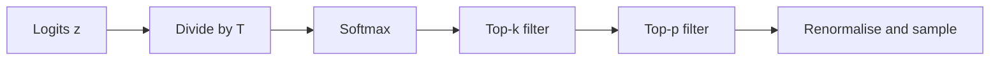

Temperature reshapes the whole distribution, but it cannot remove anything. With a vocabulary of 50,000 tokens, even if each nonsense token has only 0.001% probability, together they can hold several percent. Sample a few hundred tokens and you will almost certainly draw one of them. One wrong token ("The capital of France is Paris, which borders the Pacific") and the model, which conditions on everything it has written, carries on from the mistake.

**Truncation samplers** fix this by deleting the tail before sampling. Keep only the plausible candidates, renormalise them so they sum to 1, then sample. The two standard ways to decide what counts as plausible are top-k and top-p.

## Top-k: keep a fixed number

**Top-k** keeps the $k$ tokens with the highest probability. Let $S_k$ be that set. The new distribution is

$$
\tilde{p}_i = \begin{cases} \dfrac{p_i}{\sum_{j \in S_k} p_j} & i \in S_k \\[4pt] 0 & \text{otherwise} \end{cases}
$$

$p_i$ are the softmax probabilities (after temperature), $S_k$ the kept set, and the denominator renormalises. $k = 1$ is greedy. $k = V$ is plain sampling.

The weakness is that $k$ is fixed while the model's certainty is not. After "The capital of France is", only one or two tokens are reasonable; after "My favourite food is", hundreds are. A $k$ of 40 is far too loose for the first and possibly too tight for the second.

## Top-p (nucleus): keep a fixed amount of probability

**Top-p**, also called **nucleus sampling**, sorts tokens by probability and keeps the smallest set whose probabilities add up to at least $p$:

$$
S_p = \text{smallest set of top tokens such that } \sum_{i \in S_p} p_i \ge p
$$

then renormalises over $S_p$ exactly as above. The size of the kept set now adapts: when the model is confident, one token may already exceed $p$; when it is uncertain, many tokens are needed to reach it.

## Worked example

Take the four-token distribution at $T = 1$ from earlier: " Paris" 0.609, " the" 0.224, " a" 0.136, " Lyon" 0.030.

```steps
Top-k and top-p on the same distribution
**Top-k with $k = 2$.** Keep " Paris" and " the". Their sum is $0.609 + 0.224 = 0.833$. Renormalise: $0.609 / 0.833 = 0.731$ and $0.224 / 0.833 = 0.269$.
---
**Top-p with $p = 0.9$.** Running totals in sorted order: $0.609$, then $0.833$, then $0.969$. The first total to reach $0.9$ is after three tokens, so " Lyon" is cut.
---
Renormalise the three: divide by $0.969$ to get $0.629$, $0.231$, $0.140$. Lyon's 3% has been redistributed.
---
**Top-p with $p = 0.8$.** The running total passes $0.8$ after two tokens ($0.833$), so this gives the same result as $k = 2$ here.
---
**Now a confident step.** Suppose a later step has probabilities $(0.95, 0.03, 0.01, 0.01)$. Top-p $0.9$ keeps one token (0.95 already exceeds 0.9): effectively greedy. Top-k $2$ would still leave a 3% chance of the second token.
```

That last step is the whole argument for top-p: it is strict when the model is sure and permissive when it is not.

## The order of operations

Libraries apply the steps in a fixed order, and the order matters because top-p looks at probabilities that temperature has already reshaped:



At high temperature, the distribution is flatter, so reaching $p = 0.9$ needs more tokens. At $T = 2$ the same four tokens have probabilities $(0.434, 0.263, 0.205, 0.097)$, running totals $0.434, 0.697, 0.902$: still three tokens, but only just. With a real 50,000-token vocabulary, raising $T$ can make the nucleus grow from a handful of tokens to hundreds. Most libraries treat the two filters as independent; if both are set, a token must survive both. (Implementations differ in small details, such as whether the token that crosses the threshold is included. The definition above includes it, so the nucleus is never empty.)

## See it

```sim
sampling
{"temperature": 1, "topP": 0.9}
```

The greyed-out bars are tokens the filter removed. Lower top-p to 0.5 and count how many tokens survive; raise it to 0.99 and watch the tail return. Then hold top-p at 0.9 and move temperature from 0.5 to 1.8: the number of surviving tokens grows even though top-p did not change, because temperature flattened the distribution first.

## In practice

Common defaults are top-p between 0.9 and 0.95 with temperature around 0.7 to 1, and top-k (when used) around 40 to 50. Many API providers recommend changing temperature *or* top-p, not both, because they interact and tuning two coupled dials by feel is hard. For deterministic tasks, neither matters: set temperature to 0 and the filters do nothing. A newer alternative, **min-p**, keeps tokens whose probability is at least a fraction of the top token's probability; it adapts like top-p but is defined relative to the favourite.

```quiz
{"q": "Sorted probabilities are 0.50, 0.20, 0.15, 0.10, 0.05. How many tokens does top-p = 0.8 keep, and what is the renormalised probability of the top token?", "options": ["3 tokens, top token 0.588", "2 tokens, top token 0.714", "4 tokens, top token 0.526", "3 tokens, top token 0.50"], "answer": 0, "explain": "Running totals: 0.50, 0.70, 0.85. The first total to reach 0.8 is after three tokens. Renormalise: $0.50 / 0.85 = 0.588$. Stopping at two tokens (0.70) is the tempting error: 0.70 has not yet reached 0.8. Leaving 0.50 un-renormalised forgets that the kept probabilities must sum to 1."}
```

```quiz
{"q": "Why is top-p usually preferred over top-k for open-ended chat?", "options": ["It is faster to compute", "It adapts the number of candidates to how confident the model is at each step", "It guarantees the output is factually correct", "It removes the need for a softmax"], "answer": 1, "explain": "A fixed $k$ is too loose when one token is clearly right and too tight when many are acceptable. The nucleus shrinks to one token in the first case and grows in the second. Neither sampler adds correctness; they only stop the tail from being drawn."}
```
