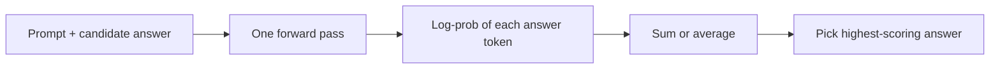

A language model does not only generate text. It can also **score** text: given any sequence, it tells you how probable it finds that sequence. This is how models are evaluated during training, how you can use a generative model as a classifier, and how you can spot text the model finds strange.

The probability of a whole sequence comes from the chain rule of probability. Each token's probability is conditioned on the tokens before it, and the probabilities multiply:

$$
P(x_1, \dots, x_n) = \prod_{t=1}^{n} p_\theta(x_t \mid x_{<t})
$$

$x_t$ is the token at position $t$, $x_{<t}$ all tokens before it, $p_\theta$ the model's softmax output for that token, and $n$ the sequence length. This is exactly how the model was trained: one next-token prediction per position.

## Why logs

Multiply a few hundred probabilities of around 0.1 and the result underflows any floating-point number ($0.1^{400} = 10^{-400}$, far below anything a 64-bit float can hold, which bottoms out around $10^{-308}$ for normal numbers). Taking logs turns the product into a sum, which is numerically safe:

$$
\log P(x_{1:n}) = \sum_{t=1}^{n} \log p_\theta(x_t \mid x_{<t})
$$

Each term is a **log-prob**: always $\le 0$, equal to $0$ only for a certain token. Log-probs near 0 mean "expected"; large negative values mean "surprising". With natural logs, $\ln 0.9 = -0.105$, $\ln 0.5 = -0.693$, $\ln 0.1 = -2.303$, $\ln 0.01 = -4.605$.

## Perplexity

Sums grow with length, so to compare texts of different lengths we average. The **average negative log-likelihood** per token is the cross-entropy loss $\mathcal{L}$, and **perplexity** is its exponential:

$$
\mathcal{L} = -\frac{1}{n}\sum_{t=1}^{n} \ln p_\theta(x_t \mid x_{<t}), \qquad \text{PPL} = e^{\mathcal{L}}
$$

Perplexity has a friendly reading: it is the size of a uniform choice that would be equally surprising. A perplexity of 10 means the model is, on average, as uncertain as if it were picking uniformly among 10 tokens at each step. Lower is better; 1 is perfect prediction.

```steps
Perplexity of a four-token sentence, by hand
The model assigns the correct tokens probabilities $0.5$, $0.25$, $0.8$ and $0.1$.
---
Take natural logs: $\ln 0.5 = -0.693$, $\ln 0.25 = -1.386$, $\ln 0.8 = -0.223$, $\ln 0.1 = -2.303$.
---
Sum: $-0.693 - 1.386 - 0.223 - 2.303 = -4.605$. Check: the product $0.5 \times 0.25 \times 0.8 \times 0.1 = 0.01$, and $\ln 0.01 = -4.605$.
---
Average and negate: $\mathcal{L} = 4.605 / 4 = 1.151$ nats per token.
---
Exponentiate: $\text{PPL} = e^{1.151} = 3.16$. Equivalently, perplexity is $1 / (\text{geometric mean of the probabilities}) = 1/0.01^{1/4} = 1/0.316 = 3.16$.
```

Notice how much the single 0.1 token costs. It contributes half of the total log-loss. Perplexity is dominated by the tokens the model gets most wrong.

## The loss-perplexity table

Because training curves are usually plotted as loss in nats, it helps to know a few conversions:

| loss $\mathcal{L}$ (nats/token) | perplexity $e^{\mathcal{L}}$ |
|---|---|
| 1.0 | 2.7 |
| 2.0 | 7.4 |
| 3.0 | 20.1 |
| 4.0 | 54.6 |
| 10.8 | ~50,000 (uniform over a GPT-2-sized vocabulary) |

The last row is where an untrained model starts: random logits are roughly uniform, so loss is about $\ln V$. For $V = 50{,}257$, $\ln V = 10.8$. Watching loss fall from about 10.8 is how you know training has started working.

```callout-warn
Perplexity depends on the tokenizer
Perplexity is per token. A tokenizer that splits text into more, smaller tokens makes each prediction easier, so its perplexity looks lower even if the model is no better. Only compare perplexities between models that share a tokenizer, or convert to a tokenizer-free unit such as bits per byte (total log-loss in bits divided by the number of UTF-8 bytes).
```

## Scoring answers with log-probs

You can use log-probs to pick between fixed options. To classify a review, compute $\log P(\text{" positive"} \mid \text{prompt})$ and $\log P(\text{" negative"} \mid \text{prompt})$ and take the larger. When options have different lengths, the sum of log-probs penalises longer options (more negative terms), so it is common to compare the **average** log-prob per token instead.



## See it

```sim
sampling
{"temperature": 1, "topP": 1}
```

Pick any token in the list and read its probability; compute its log-prob with a calculator. Then lower the temperature to 0.5: the top token's log-prob moves towards 0 and the others become much more negative. This is why log-probs you collect for scoring should be taken at temperature 1, the model's real distribution; temperature-adjusted log-probs no longer measure what the model learned.

## In practice

Perplexity on held-out text is the standard training-time metric, but it predicts downstream usefulness only loosely: two chat models with similar perplexity can differ greatly in how well they follow instructions. Use it to compare checkpoints of the same model on the same data, to detect domain shift (perplexity on your support tickets suddenly rises), or to filter training data (very high perplexity often means garbage text). Do not use it as your product's quality metric.

```quiz
{"q": "A model's average loss on a test set is 2.3 nats per token. What is its perplexity, approximately?", "options": ["2.3", "About 10", "About 4.9", "About 200"], "answer": 1, "explain": "$\\text{PPL} = e^{2.3} \\approx 9.97$, so about 10: the model is as uncertain as a uniform choice among 10 tokens. 4.9 is $2^{2.3}$, which would be right only if the loss were measured in bits."}
```

```quiz
{"q": "Model A has perplexity 8 and model B perplexity 12 on the same text, but they use different tokenizers. A splits text into 30% more tokens than B. What can you conclude?", "options": ["A is the better model", "B is the better model", "Nothing directly: per-token perplexity is not comparable across tokenizers", "A is 50% better"], "answer": 2, "explain": "Finer tokenization makes each step easier, lowering per-token perplexity without the model knowing more. Compare total log-likelihood of the text, or bits per byte. Concluding 'A is better' is the classic mistake."}
```

```lab
tune-the-sampler
```
