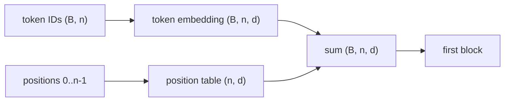

Attention compares every token with every other token, and nothing in that comparison knows which token came first. Shuffle the input rows and the attention outputs shuffle with them, unchanged. The [Transformer Block](/learn/model-foundations/transformer-block) lesson explains why that is a problem; this topic writes the two classic fixes as PyTorch modules.

Both fixes do the same thing mechanically: build a vector for each position $0, 1, \dots, n-1$ and **add** it to the token embedding before the first block. The token vector says *what*, the position vector says *where*, and their sum is what the attention layers see. The difference is where the position vectors come from.

A **learned positional encoding** is a second embedding table, indexed by position instead of token ID. Its rows are trained like any other weights. GPT-2 uses this, with 1,024 rows. A **sinusoidal positional encoding** is a fixed table computed from sines and cosines of different frequencies. It has no parameters, as in the original transformer paper.

## In everyday life

Imagine a notebook falls apart and its loose pages scatter across the floor. You gather them up. Every page still has the right words, but you no longer know the order, so the story makes no sense. The fix is simple: write a page number in the corner of each page. Now you can sort them, and anyone reading knows where each page belongs.

A transformer faces this same problem. Its attention step looks at all the tokens together, like someone holding the pile of pages without the order. Nothing inside attention says which word came first. So before the first block, the model adds a **positional encoding**: a short list of numbers for each place (0, 1, 2 and so on), added onto that token's own numbers. The token's numbers say what the word is. The position's numbers say where it sits.

There are two ways to make them. One is a fixed formula, the **sinusoidal** method. The other is a table that the model **learns** during training, like a numbering stamp it designs for itself. Unlike a printed page number, a position vector is blended into the token's numbers, and a table only covers as many places as it has rows.

**Where you meet it.** A translation tool must tell "dog bites man" from "man bites dog". Without position information, both look like the same bag of words. Adding a position vector to every token is the small fix that lets attention tell the two orders apart.

```scene
title: Numbering the scattered pages
step: 📖 A notebook falls apart and the pages scatter | Tokens with no built-in order
step: 🤷 Every page has its words, but you cannot tell which comes first | Attention alone ignores order
step: 🔢 You write a page number in each corner, one per place | A position vector for each place
step: ➕ The number becomes part of the page you read, not a separate sheet | Added to the token embedding
step: 📚 Now you read the pages in the right order | The first block sees what and where
takeaway: Attention cannot see order by itself, so we add a position signal to every token.
```

## The maths

For position $p$ and feature pair $i = 0, 1, \dots, d/2 - 1$:

$$
PE(p, 2i) = \sin\!\big(p \cdot \omega_i\big), \qquad PE(p, 2i + 1) = \cos\!\big(p \cdot \omega_i\big), \qquad \omega_i = 10000^{-2i/d}
$$

Each pair of columns is a clock hand turning at angular speed $\omega_i$. The first pair turns fast ($\omega_0 = 1$ radian per position), later pairs turn ever more slowly, and the last pair barely moves over thousands of positions. Together the pairs give every position a distinct pattern, the way the hour, minute and second hands together identify a time.

**Worked example, $d = 4$.** There are two frequencies: $\omega_0 = 10000^{0} = 1$ and $\omega_1 = 10000^{-2/4} = 0.01$. Each row is $(\sin p,\ \cos p,\ \sin 0.01p,\ \cos 0.01p)$:

| Position $p$ | col 0: $\sin(p)$ | col 1: $\cos(p)$ | col 2: $\sin(0.01p)$ | col 3: $\cos(0.01p)$ |
|---|---|---|---|---|
| 0 | 0.0000 | 1.0000 | 0.0000 | 1.0000 |
| 1 | 0.8415 | 0.5403 | 0.0100 | 1.0000 |
| 2 | 0.9093 | −0.4161 | 0.0200 | 0.9998 |
| 3 | 0.1411 | −0.9900 | 0.0300 | 0.9996 |

Check one with a calculator in radians: $\cos(2) = -0.4161$. The fast columns change a lot between neighbours; the slow columns change by about 0.01 per step, which separates positions that are far apart without the pattern wrapping around.

## The code

The repo computes $\omega_i$ as $\exp(-2i \cdot \ln 10000 / d)$, which is the same number written in a numerically friendly form.

```python
import math, torch, torch.nn as nn

class SinusoidalPositionalEncoding(nn.Module):
    def __init__(self, max_len: int, d: int):
        super().__init__()
        pe = torch.zeros(max_len, d)                                   # (max_len, d)
        pos = torch.arange(max_len, dtype=torch.float).unsqueeze(1)    # (max_len, 1)
        omega = torch.exp(torch.arange(0, d, 2).float()
                          * (-math.log(10000.0) / d))                  # (d/2,)
        pe[:, 0::2] = torch.sin(pos * omega)                           # (max_len, d/2)
        pe[:, 1::2] = torch.cos(pos * omega)
        self.register_buffer("pe", pe)      # saved and moved with .to(), not trained

    def forward(self, x):                   # x: (B, n, d)
        B, n, _ = x.shape
        return x + self.pe[:n].unsqueeze(0) # (1, n, d) broadcasts over B

class LearnedPositionalEncoding(nn.Module):
    def __init__(self, max_len: int, d: int):
        super().__init__()
        self.emb = nn.Embedding(max_len, d)                            # max_len * d params

    def forward(self, x):                   # x: (B, n, d)
        B, n, _ = x.shape
        pos = torch.arange(n, device=x.device)                         # (n,)
        return x + self.emb(pos).unsqueeze(0)                          # (B, n, d)
```

`pos * omega` is a broadcast outer product: $(\text{max\_len}, 1) \times (d/2,) \to (\text{max\_len}, d/2)$, every position times every frequency in one line. `register_buffer` is the key PyTorch idiom: the table travels with the model to the GPU and into the checkpoint, but the optimiser never touches it. The full version is `llm_from_scratch/part_1/pos_encoding.py`.



## In practice

- **Cost.** A learned table costs $\text{max\_len} \times d$ parameters: $1{,}024 \times 768 = 786{,}432$ for GPT-2 small, about 0.6% of the model. The sinusoidal table costs zero parameters and the same memory as a buffer.
- **Length limits are hard.** With a learned table, a sequence longer than `max_len` raises an index error. With the sinusoidal buffer, `self.pe[:n]` silently returns only `max_len` rows and the add fails with a shape mismatch. Either way, assert `n <= max_len` at the top of the model's forward so the error message is yours.
- **Modern models use neither.** Llama-family models rotate queries and keys instead (RoPE), inside attention rather than at the input. The [modern architecture](/learn/model-foundations/modern-architecture) lesson implements it. The add-at-the-input versions here are still the right first build: simple, and easy to test.
- **Device bugs.** `torch.arange(n)` without `device=x.device` creates the indices on the CPU and fails when the model is on a GPU. The repo passes the device explicitly; copy that habit.

```quiz
{"q": "A sinusoidal encoding has $d = 6$. What is $PE(10, 2)$, the sine column of the second frequency pair ($i = 1$), at position 10?", "options": ["$\\sin(10 \\times 10000^{-1/3}) \\approx 0.448$", "$\\sin(10) \\approx -0.544$", "$\\sin(10 \\times 10000^{-2/3}) \\approx 0.022$", "$\\cos(10 \\times 10000^{-1/3}) \\approx 0.894$"], "answer": 0, "explain": "Column 2 is $2i$ with $i = 1$, so $\\omega_1 = 10000^{-2/6} = 10000^{-1/3} \\approx 0.0464$ and $PE = \\sin(0.464) \\approx 0.448$. $\\sin(10)$ uses the first pair's frequency ($i = 0$). The cosine value belongs to column 3, the other half of the same pair."}
```

```quiz
{"q": "You swap `register_buffer('pe', pe)` for `self.pe = nn.Parameter(pe)`. What changes?", "options": ["The table becomes trainable: it gets gradients and the optimiser updates it, turning the fixed encoding into a learned one initialised with sinusoids", "Nothing, buffers and parameters behave the same", "The table is no longer saved in the checkpoint", "The model can now handle sequences longer than `max_len`"], "answer": 0, "explain": "`nn.Parameter` registers the tensor as a weight, so it appears in `model.parameters()`, receives gradients and is updated. A buffer is also saved and moved with the model, so the checkpoint and device behaviour do not change; only trainability does. Neither choice adds rows beyond `max_len`."}
```
