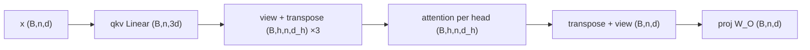

The theory of [multi-head attention](/learn/model-foundations/attention) says: run $h$ small heads side by side, each in a $d_h = d/h$ dimensional space, then concatenate their outputs and mix them with $W_O$. A naive implementation would build $h$ single-head modules and loop over them. Nobody does that. Real code runs all heads as **one batched matrix multiply** by treating the head index as an extra batch axis.

One `nn.Linear(d, 3d)` produces queries, keys and values for every head at once. A `view` splits the last axis into (Q/K/V, head, feature), a `transpose` moves the head axis next to the batch axis, and the rest is single-head code with one more leading axis. The same steps in reverse merge the heads.

Shape bugs get subtle here: the wrong reshape usually produces the **right shape** with scrambled contents. Nothing crashes; the model just learns worse.

## In everyday life

After a cricket match, the team does not ask one person to watch all the footage and say everything. A bowling analyst studies how the bowlers used the pitch. A fielding analyst studies the catches and saved runs. A batting analyst studies shot selection. They watch the same match at the same time, each looking for a different pattern, and then the coach combines their notes into one plan.

Multi-head attention works like that panel. Each **head** is one small attention unit that reads the same sentence in its own way. Each head works in a smaller space than the full vector, so the heads together cost about the same as one big unit. They all run at once, as one big batch of calculation, not one after another. Their outputs are joined side by side, called **concatenation**, and a final layer mixes them into one result of the original size.

In trained models heads often end up with different habits, such as watching the previous word. Unlike a coach, nobody assigns those jobs. They emerge from training.

**Where you meet it.** A translation system must work out which noun a pronoun refers to and also respect the order of nearby words. Several heads let one layer track both kinds of link at once. Running all heads as one batched step, instead of looping over them, is what keeps this fast.

```scene
title: A cricket analysis panel
step: 🏏 After the match, every analyst gets the same footage | The same input goes to every head
step: ✂️ Each analyst works from a smaller part of the notes | Each head uses a smaller space
step: 🔍 Each watches for a different pattern, all at the same time | Attention in every head at once
step: 📋 Each writes a short report | One output per head
step: 📎 The reports are stapled side by side | Concatenate the heads
step: 🧠 The coach reads them all and writes one plan | The output projection mixes the heads
takeaway: Several small heads look at the same words in different ways, then their results are merged into one.
```

## The maths

With $X$ of shape $(B, n, d)$ and $d = h \cdot d_h$:

$$
[Q \,|\, K \,|\, V] = X W_{QKV}^{\top}, \quad W_{QKV} \in \mathbb{R}^{3d \times d}
$$

$$
\text{head}_i = \text{softmax}\!\left(\frac{Q_i K_i^{\top}}{\sqrt{d_h}} + M\right) V_i, \qquad
\text{out} = \big[\text{head}_1 \,\|\, \cdots \,\|\, \text{head}_h\big]\, W_O^{\top}
$$

where $Q_i$ is the slice of columns $i \cdot d_h$ to $(i+1) \cdot d_h - 1$ of $Q$. Note the scale uses $d_h$, not $d$.

**Parameter count**, no biases: $W_{QKV}$ has $3d \cdot d$ weights and $W_O$ has $d \cdot d$, so the layer has $4d^2$, independent of $h$.

**Worked example** (the repo's `demo_mha_shapes.py`): $B = 1$, $n = 5$, $d = 12$, $h = 3$, so $d_h = 4$. Parameters: $36 \times 12 = 432$ for $W_{QKV}$ plus $12 \times 12 = 144$ for $W_O$, total $576 = 4 \times 12^2$. For GPT-2 small, $d = 768$: $4 \times 768^2 = 2{,}359{,}296$ weights per layer, plus $3{,}072$ biases in the original model.

## The shapes, step by step

| Step | Operation | Shape (symbols) | Demo shape |
|---|---|---|---|
| input | `x` | $(B, n, d)$ | (1, 5, 12) |
| project | `self.qkv(x)` | $(B, n, 3d)$ | (1, 5, 36) |
| split axis | `.view(B, n, 3, h, d_h)` | $(B, n, 3, h, d_h)$ | (1, 5, 3, 3, 4) |
| separate | `.unbind(dim=2)` | 3 × $(B, n, h, d_h)$ | (1, 5, 3, 4) |
| heads forward | `.transpose(1, 2)` | $(B, h, n, d_h)$ | (1, 3, 5, 4) |
| scores | `q @ k.transpose(-2, -1)` | $(B, h, n, n)$ | (1, 3, 5, 5) |
| context | `w @ v` | $(B, h, n, d_h)$ | (1, 3, 5, 4) |
| merge | `.transpose(1, 2).contiguous().view(B, n, d)` | $(B, n, d)$ | (1, 5, 12) |
| mix | `self.proj(out)` | $(B, n, d)$ | (1, 5, 12) |

## The code

```python
class MultiHeadSelfAttention(nn.Module):
    def __init__(self, d: int, h: int):
        super().__init__()
        assert d % h == 0, "d must be divisible by h"
        self.h, self.d_h = h, d // h
        self.qkv = nn.Linear(d, 3 * d, bias=False)   # all heads' Q, K, V at once
        self.proj = nn.Linear(d, d, bias=False)      # W_O

    def forward(self, x):                                        # (B, n, d)
        B, n, d = x.shape
        qkv = self.qkv(x).view(B, n, 3, self.h, self.d_h)        # (B, n, 3, h, d_h)
        q, k, v = qkv.unbind(dim=2)                              # each (B, n, h, d_h)
        q, k, v = (t.transpose(1, 2) for t in (q, k, v))         # each (B, h, n, d_h)
        scores = q @ k.transpose(-2, -1) / math.sqrt(self.d_h)   # (B, h, n, n)
        mask = causal_mask(n, device=x.device)                   # (1, 1, n, n), attn_mask.py
        w = F.softmax(scores.masked_fill(mask, float("-inf")), dim=-1)
        ctx = w @ v                                              # (B, h, n, d_h)
        out = ctx.transpose(1, 2).contiguous().view(B, n, d)     # (B, n, d)
        return self.proj(out), w
```

Everything between `transpose` and `w @ v` is the single-head code from the previous topic, unchanged; the extra $h$ axis rides along as a batch axis, and the $(1, 1, n, n)$ mask broadcasts over both $B$ and $h$. The full version, with optional shape printing, is `llm_from_scratch/part_1/multi_head.py`, and `demo_mha_shapes.py` prints every row of the table above.



```parsons
{"title":"Order the lines of `MultiHeadSelfAttention.forward`","lines":["B, n, d = x.shape","qkv = self.qkv(x).view(B, n, 3, self.h, self.d_h)","q, k, v = qkv.unbind(dim=2)","q, k, v = (t.transpose(1, 2) for t in (q, k, v))","scores = q @ k.transpose(-2, -1) / math.sqrt(self.d_h)","w = F.softmax(scores.masked_fill(causal_mask(n, device=x.device), float(\"-inf\")), dim=-1)","ctx = w @ v","out = ctx.transpose(1, 2).contiguous().view(B, n, d)","return self.proj(out), w"],"explain":"Split the projection's last axis first, `(B, n, 3d)` to `(B, n, 3, h, d_h)`, keeping each token's features together; only then `transpose(1, 2)` moves heads in front of tokens, giving `(B, h, n, d_h)`. Scores, mask and softmax are the single-head code with `h` as an extra batch axis, and the mask is applied **before** the softmax. Merging mirrors the split: transpose back to `(B, n, h, d_h)`, `.contiguous()` so `view` can flatten to `(B, n, d)`, then mix the heads with `proj`."}
```

## In practice

- **Split, then transpose; never view straight to heads.** `view` only reinterprets memory in order. The last axis of the projection is laid out as $[3][h][d_h]$ for each token, so you must first split that axis, keeping $n$ in place, and then move $h$. Viewing $(B, n, 3d)$ directly as $(B, 3, h, n, d_h)$ has the right element count and mixes features from different tokens into one "token".
- **`.contiguous()` before the merging `view`.** After `transpose`, the tensor's memory is no longer in row order, and `view` raises an error. Either call `.contiguous()` first, as the repo does, or use `.reshape`, which copies when needed.
- **Test against the slow version.** Copy the weights of one head into a `SingleHeadSelfAttention` and compare outputs with `torch.allclose`. This short test catches every reshape bug in this list. Grouped-query attention, in the [modern architecture](/learn/model-foundations/modern-architecture) lesson, changes only the K/V projections, and the same test still applies.

```quiz
{"q": "A model has $d = 1{,}024$ and $h = 16$. How many weights do `qkv` and `proj` hold together (no biases), and what is the scale factor applied to the scores?", "options": ["$4{,}194{,}304$ weights; divide by $\\sqrt{64} = 8$", "$4{,}194{,}304$ weights; divide by $\\sqrt{1024} = 32$", "$67{,}108{,}864$ weights; divide by 8", "$262{,}144$ weights; divide by 8"], "answer": 0, "explain": "$W_{QKV}$ is $3d \\times d$ and $W_O$ is $d \\times d$, so $4d^2 = 4 \\times 1{,}024^2 = 4{,}194{,}304$, regardless of $h$. Scores are scaled by $\\sqrt{d_h}$ with $d_h = 1024/16 = 64$, so by 8. Dividing by $\\sqrt{d}$ is the classic slip; multiplying the weights by $h = 16$ assumes each head has full-size matrices."}
```

```quiz
{"q": "Someone replaces `.view(B, n, 3, h, d_h)` + `unbind` + `transpose(1, 2)` with `self.qkv(x).view(B, 3, h, n, d_h).unbind(1)`. With $n = 5$, $d = 12$, $h = 3$, what happens?", "options": ["It runs and returns tensors of the correct shape $(B, h, n, d_h)$, but each 'token' row now mixes features from different tokens, so the model trains poorly with no error", "It raises a shape error because the element counts differ", "It is equivalent, since `view` and `transpose` commute", "It works but uses three times the memory"], "answer": 0, "explain": "Both views have $n \\cdot 3d = 180$ elements per sequence, so no error is raised. But `view` reads memory in order, and memory is laid out token-major: the first 36 numbers belong to token 1. Reading them as Q's head-1 block for tokens 1-5 assigns token 1's features to several positions. Only `transpose` moves the head axis without moving data between tokens."}
```
