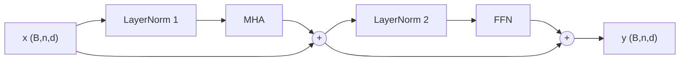

You now have every part: an attention layer that mixes tokens and a feed-forward network that processes each token. A **transformer block** wires them together with two more ingredients, both covered in [The Transformer Block](/learn/model-foundations/transformer-block): **residual connections**, which add each sublayer's output back onto its input, and **LayerNorm**, which rescales each token vector before it enters a sublayer.

The wiring used here is **pre-norm**, the GPT-2 arrangement: normalise, run the sublayer, add the result to the unnormalised input. The running vector $x$, the residual stream, is never normalised in place. Each sublayer reads a normalised copy and writes a correction back. That is the whole forward pass: two lines.

The block's contract is what makes stacking possible: **shape in equals shape out**, $(B, n, d) \to (B, n, d)$. A model is this block repeated $L$ times, and the tests at the end of this topic are the ones you will rely on for the rest of the module.

## In everyday life

Think of a file moving through a government office. The original papers are never rewritten or thrown away. At each desk, the clerk first makes a clean photocopy at a standard size and brightness, so every file is easy to read. The clerk studies the copy, writes a note on a separate sheet and staples that sheet onto the original file. The file then moves on, a little thicker but still the same file.

A **transformer block** works this way. The running vector for each token is the file. **LayerNorm** is the photocopy step: it rescales the numbers of each token so they sit in a steady range. A **residual connection** is the stapling: each part adds its result onto its input instead of replacing it. A block has two desks. The first is attention, where the clerk compares this file with the earlier ones. The second is the feed-forward network, where the clerk studies this file alone.

The file leaves in the same shape it arrived, which is why many blocks can be stacked like offices in a row.

**Where you meet it.** A chatbot's model is many of these blocks stacked. If the wiring is slightly wrong, say a mask lets later tokens leak backward, the model can still train and pass a shape check. Writing the three tests from this lesson, shape, parameter count and "does the past change?", catches such quietly broken blocks.

```scene
title: A file passing two office desks
step: 📁 A file arrives carrying the token's current numbers | The input to the block
step: 📄 The first clerk makes a clean standard-size photocopy | LayerNorm before attention
step: 🔎 The clerk compares it with earlier files and writes a note | Multi-head attention
step: 📎 The note is stapled onto the original, not copied over it | The residual add
step: 🔁 The second clerk repeats this but studies the file alone | Second LayerNorm, FFN and residual add
step: 📤 The file leaves in the same shape, ready for the next office | Shape in equals shape out
takeaway: A block reads a cleaned copy, writes a note, and adds the note back, so the original is never lost.
```

## The maths

$$
x' = x + \text{MHA}\big(\text{LN}_1(x)\big), \qquad y = x' + \text{FFN}\big(\text{LN}_2(x')\big)
$$

LayerNorm acts on each token vector separately, over its $d$ features:

$$
\text{LN}(\mathbf{x}) = \boldsymbol{\gamma} \odot \frac{\mathbf{x} - \mu}{\sqrt{\sigma^2 + \epsilon}} + \boldsymbol{\beta}, \qquad \mu = \frac{1}{d}\sum_j x_j, \quad \sigma^2 = \frac{1}{d}\sum_j (x_j - \mu)^2
$$

with learned scale $\boldsymbol{\gamma}$ and shift $\boldsymbol{\beta}$ (initialised to 1 and 0) and a small $\epsilon$ ($10^{-5}$ in PyTorch) for stability. Note the variance divides by $d$, not $d - 1$.

**Worked example, LayerNorm.** $\mathbf{x} = (1, 2, 3, 6)$. Mean $\mu = 12/4 = 3$. Deviations $(-2, -1, 0, 3)$, squares $(4, 1, 0, 9)$, variance $14/4 = 3.5$, standard deviation $\sqrt{3.5} = 1.871$. Normalised: $(-1.069, -0.535, 0, 1.604)$, which has mean 0 and variance 1. With $\boldsymbol{\gamma} = 1$, $\boldsymbol{\beta} = 0$ that is the output.

**Worked example, parameter count** for the repo's block (attention without biases, FFN with biases, two LayerNorms with $2d$ each) at $d = 64$, $h = 4$:

| Part | Formula | Parameters |
|---|---|---|
| Attention | $4d^2$ | 16,384 |
| FFN | $8d^2 + 5d$ | 33,088 |
| Two LayerNorms | $4d$ | 256 |
| **Block** | | **49,728** |

The number of heads does not appear: $h = 4$ and $h = 8$ give the same count.

## The code

```python
class TransformerBlock(nn.Module):
    def __init__(self, d: int, h: int, dropout: float = 0.0):
        super().__init__()
        self.ln1 = nn.LayerNorm(d)
        self.attn = MultiHeadSelfAttention(d, h)     # returns (out, weights)
        self.ln2 = nn.LayerNorm(d)
        self.ffn = FeedForward(d, mult=4, dropout=dropout)

    def forward(self, x):                            # (B, n, d)
        x = x + self.attn(self.ln1(x))[0]            # mix across tokens, (B, n, d)
        x = x + self.ffn(self.ln2(x))                # per token, (B, n, d)
        return x
```

The `[0]` picks the output and drops the attention weights. The full version is `llm_from_scratch/part_1/block.py`.



## Three tests every block should pass

```python
torch.manual_seed(0)
blk = TransformerBlock(d=64, h=4).eval()
x = torch.randn(2, 10, 64)                                   # B=2, n=10, d=64

# 1. Shape in == shape out
assert blk(x).shape == x.shape

# 2. Parameter count matches the formula
assert sum(p.numel() for p in blk.parameters()) == 49_728

# 3. Causality: changing token 6 must not change positions 0..5
x2 = x.clone(); x2[:, 6] += 1.0
y, y2 = blk(x), blk(x2)
assert torch.allclose(y[:, :6], y2[:, :6], atol=1e-6)        # past untouched
assert not torch.allclose(y[:, 6:], y2[:, 6:])               # present and future change
```

Test 3 is the most valuable one. A wrong mask, a softmax on the wrong axis or a scrambled head reshape all leak information from the future, and this test fails for each of them, whereas the shape test passes for all of them. `.eval()` turns dropout off so the two runs are comparable.

## See it

```sim
transformer-flow
{"stage": "attention", "layers": 2}
```

Step from "Attention" to "MLP" and back. The packet stays the same size, $n \times d$, through every block: that is test 1 in picture form. Then raise the number of blocks shown and notice that only the count changes, never the shape.

## In practice

- **Post-norm is the original, pre-norm is what trains.** The 2017 transformer computed $\text{LN}(x + \text{sublayer}(x))$. With the norm on the main path, gradients to early layers must pass through every LayerNorm, and deep post-norm stacks need careful learning-rate warm-up. Pre-norm leaves a clean identity path from output to input, which is why GPT-2 and almost every model since use it.
- **Pre-norm needs a final norm.** Because the residual stream itself is never normalised, a full model applies one more LayerNorm after the last block, before the output layer. The [Train a Tiny GPT](/learn/model-foundations/train-a-tiny-gpt) lesson adds it.
- **Turn tracing off.** The repo's `MultiHeadSelfAttention` defaults to `trace_shapes=True`, and `block.py` does not override it, so every forward pass prints shapes. Useful once; pass `trace_shapes=False` before training, or the log will be all shapes.
- **Activation growth is a health signal.** Each block adds to the residual stream, so its scale tends to grow with depth. Logging `x.std()` after each block is a cheap check; a sudden jump in one layer usually points at a bug or an unstable learning rate.

```quiz
{"q": "Using the repo's block (attention without biases, FFN with biases and expansion 4, two LayerNorms), how many parameters does one block have at $d = 128$, $h = 8$?", "options": ["$197{,}760$", "$196{,}608$", "$197{,}248$", "$1{,}582{,}080$"], "answer": 0, "explain": "Attention $4d^2 = 65{,}536$; FFN $8d^2 + 5d = 131{,}072 + 640 = 131{,}712$; LayerNorms $4d = 512$. Total $197{,}760$. $196{,}608 = 12d^2$ is the rule of thumb that drops biases and norms. Multiplying by $h = 8$ is wrong because heads split the same matrices."}
```

```quiz
{"q": "Your block passes the shape test but fails the causality test: changing token 6 changes outputs at positions 0-5. Which bug is the most likely cause?", "options": ["The mask was built with `torch.tril` instead of `torch.triu`, or applied with the wrong sense, so future keys are allowed", "The FFN expansion factor is 2 instead of 4", "LayerNorm uses $\\epsilon = 10^{-6}$ instead of $10^{-5}$", "The residual connection is missing around the FFN"], "answer": 0, "explain": "Earlier positions can only be affected by token 6 through attention to future keys, so the mask is the suspect. The FFN, LayerNorm and residual act per position: changing their settings alters outputs but cannot move information from position 6 to position 2. A missing residual is a real bug, but it would not break causality."}
```
