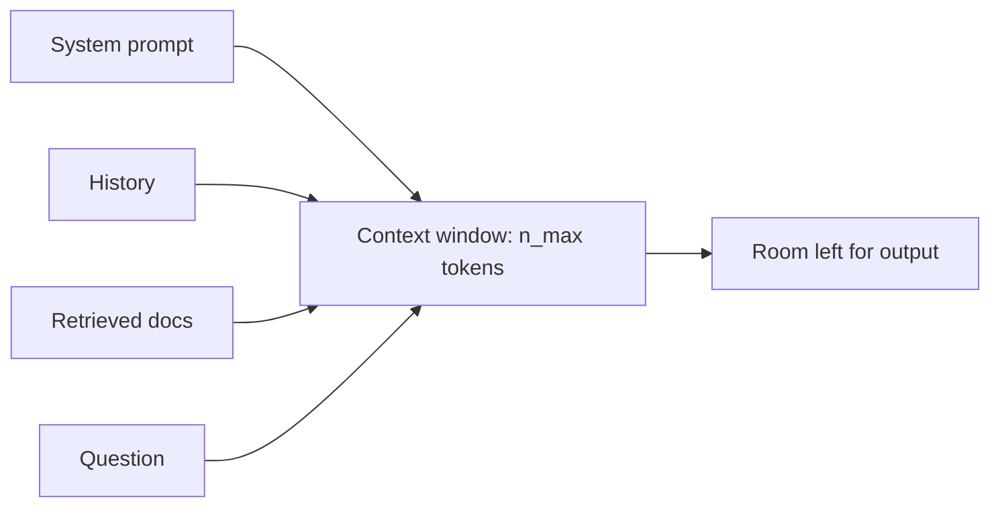

```callout-before
Before you start
You need the attention mechanism: each token produces a query, a key and a value, and a token's output is a weighted mix of the values of the tokens it can see. Revisit the attention lesson if that is hazy.
```

A language model has no memory between calls. Everything it knows about your conversation, your documents and your instructions has to be in the tokens it is given right now. That list of tokens is the **context**, and the maximum length the model can handle is its **context window**, measured in tokens.

Think of a desk with room for a fixed number of pages. The system prompt, the chat history, retrieved documents, tool results and the answer being written all have to fit on the desk at once. When a chat "forgets" what you said an hour ago, it is usually because the application dropped old turns to make room.

## The budget

The prompt and the generated output share the window:

$$
n_\text{prompt} + n_\text{output} \le n_\text{max}
$$

$n_\text{prompt}$ is the number of input tokens (system prompt, history, documents, question), $n_\text{output}$ the tokens the model writes, and $n_\text{max}$ the context window.

Worked example: a model with an 8,192-token window. Your system prompt is 1,500 tokens, retrieved documents 5,000, chat history 1,000 and the user question 100. That is $1500 + 5000 + 1000 + 100 = 7{,}600$ tokens, leaving $8192 - 7600 = 592$ tokens for the answer. If you asked for max tokens of 1,000, the request either fails or the answer is cut off, depending on the API.

| Model | Context window (tokens) |
|---|---|
| GPT-2 (2019) | 1,024 |
| Llama 2 (2023) | 4,096 |
| Llama 3 (2024) | 8,192 |
| Llama 3.1 and many current models | 128,000 or more |

## Why the window is limited

Three things cap the window, and the next topics take them one at a time.

**Attention cost grows with length.** In each layer, every token's query is compared with the keys of all tokens before it. For a sequence of $n$ tokens that is about $n^2/2$ dot products per head per layer, each of length $d_h$ (the head dimension). The score matrix for one head is $n \times n$. At $n = 4{,}096$ in 16-bit precision, one head's full score matrix is $4096^2 \times 2 \text{ bytes} = 32 \text{ MiB}$; for 32 heads and 32 layers, storing them all would need 32 GiB. Modern kernels such as FlashAttention never store the whole matrix (they compute it in tiles), which solves the memory problem but not the quadratic compute.

**Positions must be understood.** Attention by itself has no notion of order, so models add position information, today usually with **rotary position embeddings (RoPE)**, which rotate query and key vectors by an angle that depends on position. A model trained on sequences up to 4,096 tokens has never seen positions beyond that, and quality typically collapses past its training length unless the window was extended with further training.

**The KV cache grows with length.** During generation the model keeps every earlier token's keys and values in GPU memory. That memory is linear in $n$, and at long contexts and many users it, not the weights, becomes the limit. This is the main subject of the lesson.



## See it

```sim
context-position
```

This simulation hides a fact somewhere in a long context and measures whether the model can use it. For now, only notice the two axes: total context length and the fact's position. Increase the context length and see whether recall stays flat. You will come back to this simulation at the end of the lesson.

## In practice

A bigger window is not free room. You pay for every input token (APIs charge per input token, often a few times cheaper than output tokens), time-to-first-token grows with prompt length, and models use information in long contexts less reliably than in short ones. Good systems treat the window as a budget: they cap history, summarise old turns, retrieve only the top few documents, and reserve explicit room for the output. Count tokens with the model's own tokenizer, never by words or characters; the ratio changes across languages and for code.

```quiz
{"q": "A model has a 16,384-token window. The prompt is 15,000 tokens. What is the largest answer it can produce?", "options": ["16,384 tokens", "1,384 tokens", "Unlimited, the output has its own window", "15,000 tokens"], "answer": 1, "explain": "Prompt and output share one window: $16384 - 15000 = 1384$. The output is not a separate budget, which is why long prompts silently shorten answers."}
```

```quiz
{"q": "You double the context length from 4k to 8k tokens. Roughly how does the attention score computation per layer change?", "options": ["It doubles", "It quadruples", "It stays the same", "It grows by 8k"], "answer": 1, "explain": "Every query is compared with every earlier key, about $n^2/2$ pairs, so doubling $n$ multiplies the work by 4. The rest of the block (the MLP and projections) is linear in $n$ and only doubles, so the total grows by between 2 and 4 times."}
```
