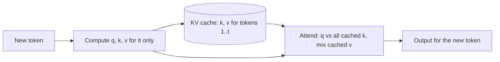

Generation is a loop: run the model, pick a token, append it, run the model again. Done naively, each new run processes the entire sequence from scratch. To write token 1,001 the model would recompute everything it already computed for tokens 1 to 1,000, and then do it again for token 1,002. Almost all of that work produces numbers identical to last time.

The **KV cache** is the observation that the expensive per-token results needed by later tokens, the keys and values in every attention layer, never change once computed. So compute them once, keep them in GPU memory, and at each step process only the newest token.

## Why past keys and values never change

In layer $\ell$, a token at position $t$ produces

$$
\mathbf{q}_t = W_Q \mathbf{x}_t, \quad \mathbf{k}_t = W_K \mathbf{x}_t, \quad \mathbf{v}_t = W_V \mathbf{x}_t
$$

where $\mathbf{x}_t$ is that token's hidden vector entering the layer and $W_Q, W_K, W_V$ are the layer's projection matrices. Its attention output is

$$
\mathbf{o}_t = \sum_{s \le t} \alpha_{t,s}\, \mathbf{v}_s, \qquad \alpha_{t,s} = \operatorname{softmax}_s\!\left(\frac{\mathbf{q}_t \cdot \mathbf{k}_s}{\sqrt{d_h}}\right)
$$

with $\alpha_{t,s}$ the attention weight from position $t$ to an earlier position $s$ and $d_h$ the head dimension. The causal mask restricts the sum to $s \le t$.

Follow the dependency. $\mathbf{x}_t$ depends only on tokens $1..t$, because every layer below was also causal. So $\mathbf{k}_t$ and $\mathbf{v}_t$ depend only on tokens $1..t$, and appending token $t+1$ cannot change them. The new token needs:

- its own query $\mathbf{q}_{t+1}$, used once and then never again (no later token reads an earlier token's query), and
- the keys and values of every token so far, which it reads but does not modify.

That is why it is a *KV* cache: queries are thrown away; keys and values are kept, per layer and per head.

```steps
One decode step with a cache
The cache holds $\mathbf{k}_1..\mathbf{k}_t$ and $\mathbf{v}_1..\mathbf{v}_t$ for every layer and head.
---
Embed the new token and, in each layer, compute only its $\mathbf{q}_{t+1}$, $\mathbf{k}_{t+1}$, $\mathbf{v}_{t+1}$: one token's worth of matrix multiplications.
---
Append $\mathbf{k}_{t+1}$ and $\mathbf{v}_{t+1}$ to that layer's cache.
---
Score $\mathbf{q}_{t+1}$ against all $t+1$ cached keys, softmax, and mix the $t+1$ cached values. This part still grows with context length.
---
Pass the result through the rest of the block (MLP, residual), then to the next layer. At the top, the logits give the next token.
```

## How much work it saves

Suppose the prompt is 1,000 tokens and you generate 1,000 more. Without a cache, step $j$ reprocesses the whole sequence of $999 + j$ tokens, so the total number of token-positions pushed through the network is

$$
\sum_{t=1000}^{1999} t = \frac{1000 \times (1000 + 1999)}{2} = 1{,}499{,}500
$$

With a cache, the prompt is processed once (1,000 positions) and each new token once (1,000 positions): $2{,}000$ in total, about 750 times fewer. The attention dot products against cached keys are still there, but the projections and MLPs, which hold most of the FLOPs at moderate lengths, are done once per token.



## The price: memory

Nothing is free. For every token in every active sequence, the cache stores one key vector and one value vector per KV head per layer. Those bytes stay in GPU memory for as long as the sequence is alive, and they grow by one token's worth with every generated token. The next topics put numbers on it; the headline is that for long contexts and many concurrent users, the cache can be larger than the model weights.

## See it

```sim
kv-cache-memory
```

Leave the model settings at their defaults for now and change only the sequence length. Watch the cache size grow in a straight line: double the tokens and the bytes double. Then change the batch size (the number of sequences served at once) and confirm the same linear behaviour. The cache is per token, per sequence.

## In practice

Every serious inference engine uses a KV cache; you never turn it off. What engineers manage is its memory. Engines such as vLLM store the cache in fixed-size blocks (**PagedAttention**), so sequences of unpredictable length do not waste memory on pre-reserved space, and identical prompt prefixes can share blocks. When an API offers **prompt caching** at a discount, it is keeping the KV cache of your repeated prefix so that the next request can skip recomputing it.

```quiz
{"q": "Why does the cache store keys and values but not queries?", "options": ["Queries are larger than keys and values", "A past token's query is never used again; later tokens only read past keys and values", "Queries are recomputed from the cache cheaply", "Queries are stored in the MLP instead"], "answer": 1, "explain": "Token $s$'s query only scores token $s$'s own attention, which is already finished. Later tokens compute their own queries and compare them with earlier keys, then mix earlier values. Queries are the same size as keys in standard attention, so size is not the reason."}
```

```quiz
{"q": "Why is it valid to reuse cached keys after a new token is appended?", "options": ["Keys are approximately constant, so the error is small", "The causal mask means earlier positions never depend on later tokens, so their keys are exactly unchanged", "The model is retrained after each token", "Keys only depend on the token's embedding, not on context"], "answer": 1, "explain": "Every layer is causal, so the hidden state at position $t$, and hence its key and value, depends only on tokens $1..t$. The reuse is exact, not approximate. Keys do depend on context (from layer 2 onwards), which is why they must be stored per layer, not recomputed from embeddings."}
```
