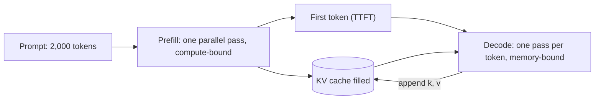

Watch a chat model answer and you see two phases. First a pause, then words streaming out at a steady pace. Those are two different computations with different bottlenecks.

**Prefill** processes the entire prompt in one forward pass. All prompt tokens are known up front, so the model handles them in parallel, as one big matrix multiplication, and fills the KV cache for every prompt position. The pause before the first word is mostly prefill; its length is the **time to first token (TTFT)**.

**Decode** then generates one token per forward pass, each pass processing only the newest token and reading the cache. The steady streaming rate is set by the **time per output token (TPOT)**. You cannot parallelise decode across positions, because token $t+1$ depends on the choice of token $t$.

## Counting the work

A useful rule: a forward pass costs about $2N$ floating-point operations (FLOPs) per token, where $N$ is the number of parameters. Each parameter takes part in one multiply and one add per token. This counts the weight matrix multiplications and ignores attention over the context, which we add back below.

For a 7B model, $2N = 2 \times 7 \times 10^{9} = 1.4 \times 10^{10}$ FLOPs per token.

**Prefill of a 2,000-token prompt:** $2{,}000 \times 1.4 \times 10^{10} = 2.8 \times 10^{13}$ FLOPs = 28 TFLOP. An NVIDIA A100 peaks around 312 TFLOP/s in 16-bit, so the ideal time is $28 / 312 \approx 0.09$ s. Real kernels reach perhaps half of peak, so expect around 0.2 s.

**Decode, one token at batch size 1:** only $1.4 \times 10^{10}$ FLOPs, which takes $1.4 \times 10^{10} / 3.12 \times 10^{14} \approx 0.045$ ms of compute. But the GPU must still read *every weight* from memory to do it. In 16-bit, 7B parameters are 14 GB. The A100 80GB reads memory at roughly 2 TB/s, so

$$
t_\text{decode} \ge \frac{\text{bytes read}}{\text{bandwidth}} = \frac{14 \times 10^{9}}{2 \times 10^{12}} = 7 \text{ ms per token}
$$

That is about 140 tokens per second at best, and the compute units sit idle more than 99% of the time. Decode is **memory-bandwidth-bound**; prefill is **compute-bound**.

## Arithmetic intensity

The quantity that decides which bound applies is **arithmetic intensity**: FLOPs performed per byte read from memory.

$$
I = \frac{\text{FLOPs}}{\text{bytes moved}}, \qquad I_\text{ridge} = \frac{\text{peak FLOP/s}}{\text{bandwidth (bytes/s)}}
$$

If $I < I_\text{ridge}$ the GPU waits on memory; if $I > I_\text{ridge}$ it waits on compute. For the A100, $I_\text{ridge} = 312 \times 10^{12} / 2 \times 10^{12} = 156$ FLOP/byte.

| Phase | FLOPs per pass | Weight bytes read | Intensity | Bound |
|---|---|---|---|---|
| Decode, batch 1 | $2N$ | $2N$ (2 bytes/param) | 1 | memory |
| Decode, batch 64 | $64 \cdot 2N$ | $2N$ | 64 | memory |
| Prefill, 2,000 tokens | $2000 \cdot 2N$ | $2N$ | 2,000 | compute |

The weights are read once per pass no matter how many tokens use them. Prefill shares that read across thousands of tokens; batch-1 decode spends it on one. This is why serving systems **batch** many users' decode steps together: at batch 64, each weight read serves 64 tokens, and throughput rises almost 64 times while each user's speed barely changes. (Each sequence also reads its own KV cache, which does not get shared, so the cache erodes the benefit at long contexts.)

## Attention adds a context-dependent term

Each decoded token also scores its query against every cached key and mixes every cached value: about $4 n d$ FLOPs per layer for a context of $n$ tokens and model width $d$ ($2nd$ for $QK^\top$, $2nd$ for the weighted sum of values). For Llama-2-7B ($L = 32$, $d = 4096$) at $n = 4096$:

$$
4 \times 4096 \times 4096 \times 32 \approx 2.1 \times 10^{9} \text{ FLOPs}
$$

That is about 15% on top of the $1.4 \times 10^{10}$ from the weights, and it grows with context. More importantly, those keys and values must be *read*: the cache adds to the bytes moved at every decode step.



## See it

```sim
kv-cache-memory
```

Set a 7B-class model and raise the sequence length from 1,000 to 32,000 tokens at batch size 1, then at batch size 16. Each decode step must read the whole cache, so a cache that grows to many gigabytes becomes a second, growing tax on every token, on top of the fixed weight read.

## In practice

The two phases explain most latency numbers you will see. Long prompts hurt TTFT (prefill is linear-ish in prompt length) but barely change TPOT. Long answers hurt total time linearly through TPOT. A 2,000-token prompt with a 500-token answer at 7 ms/token spends about 0.2 s in prefill and 3.5 s in decode, so for chat the output length usually dominates. Production engines also schedule the phases carefully: a large prefill inserted into a running batch stalls everyone's decode, so engines split prefills into chunks or run them on separate GPUs.

```quiz
{"q": "A 13B model in 16-bit precision runs on a GPU with 2 TB/s memory bandwidth. What is the best possible decode speed at batch size 1, ignoring the KV cache?", "options": ["About 13 tokens/s", "About 77 tokens/s", "About 154 tokens/s", "About 1,000 tokens/s"], "answer": 1, "explain": "Weights are $13 \\times 10^9 \\times 2 = 26$ GB. Each token needs one full read: $26 / 2000$ GB/ms $= 13$ ms, so about $1000/13 \\approx 77$ tokens/s. The compute (26 GFLOP) would take well under a millisecond, so FLOPs are not the limit."}
```

```quiz
{"q": "Why does batching 32 users together increase decode throughput almost 32 times?", "options": ["Each user's tokens are computed with fewer FLOPs", "The weights are read from memory once per pass and shared by all 32 tokens, and decode was bandwidth-bound", "The KV caches of the users are merged", "Batching makes prefill faster"], "answer": 1, "explain": "At batch 1, decode does about 1 FLOP per byte of weights, far below the GPU's ridge point. Sharing one weight read across 32 tokens raises intensity 32 times while staying under the ridge, so time per pass barely grows. KV caches are per sequence and are not shared, which is why the gain shrinks at long contexts."}
```
