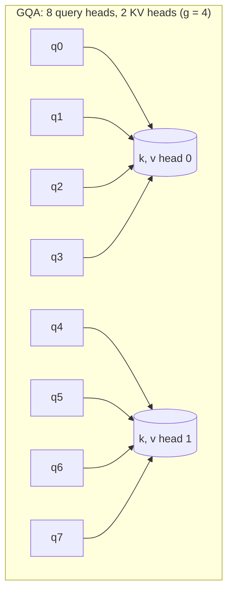

In standard **multi-head attention (MHA)**, every head has its own query, key and value projections. That is good for quality: each head can look for different things. But at decode time the queries are cheap and short-lived, while the keys and values pile up in the cache. If you could let several query heads share one set of keys and values, the cache would shrink by that factor, and since decode is limited by memory reads, every step would get faster too.

That is exactly what modern models do. **Multi-query attention (MQA)** goes to the extreme: all query heads share a single key head and a single value head. **Grouped-query attention (GQA)** is the middle ground: query heads are split into groups, and each group shares one key/value head.

## The idea in symbols

Let $h$ be the number of query heads and $h_{kv}$ the number of key/value heads. The **group size** is

$$
g = \frac{h}{h_{kv}}
$$

Query head $j$ (numbered from 0) uses key/value head $\lfloor j / g \rfloor$. Its attention is computed exactly as before, just with a shared $K$ and $V$:

$$
\mathbf{o}^{(j)}_t = \operatorname{softmax}\!\left(\frac{\mathbf{q}^{(j)}_t K^{(\lfloor j/g \rfloor)\top}}{\sqrt{d_h}}\right) V^{(\lfloor j/g \rfloor)}
$$

$\mathbf{q}^{(j)}_t$ is head $j$'s query for the current token, $K^{(m)}$ and $V^{(m)}$ the cached keys and values of KV head $m$ (one row per earlier token), and $d_h$ the head dimension. Each query head still computes its own attention pattern; it is only the material it attends over that is shared.

- $h_{kv} = h$: MHA ($g = 1$).
- $1 < h_{kv} < h$: GQA.
- $h_{kv} = 1$: MQA ($g = h$).



## Worked example: Llama-2-7B vs Llama-3-8B

Both have $L = 32$ layers, 32 query heads, and $d_h = 128$. Llama-2-7B uses MHA ($h_{kv} = 32$); Llama-3-8B uses GQA with $h_{kv} = 8$, so $g = 4$.

| Model | $h_{kv}$ | bytes per token (bf16) $2 \cdot L \cdot h_{kv} \cdot d_h \cdot 2$ | one 8,192-token sequence |
|---|---|---|---|
| Llama-2-7B shape (MHA) | 32 | $2 \times 32 \times 32 \times 128 \times 2 = 524{,}288$ = 512 KiB | 4 GiB |
| Llama-3-8B (GQA) | 8 | $2 \times 32 \times 8 \times 128 \times 2 = 131{,}072$ = 128 KiB | 1 GiB |
| Same shape with MQA | 1 | $2 \times 32 \times 1 \times 128 \times 2 = 16{,}384$ = 16 KiB | 128 MiB |

Check the middle row: $131{,}072 \times 8{,}192 = 1{,}073{,}741{,}824$ bytes, which is exactly $2^{30}$ = 1 GiB.

Now the capacity question on an 80 GB GPU. Llama-3-8B's weights are about $8.0 \times 10^9 \times 2 = 16$ GB (about 15 GiB). Suppose around 55 to 60 GiB is left for the cache. At 1 GiB per full 8k sequence, that is roughly 55 to 60 concurrent full-length sequences. With an MHA cache of the same shape, at 4 GiB each, only about 14 would fit. GQA gives four times the batch, and because decode throughput rises with batch, roughly up to four times the throughput per GPU.

Larger models benefit even more. Llama-2-70B (80 layers, 64 query heads, $d_h = 128$) already used GQA with 8 KV heads: $2 \times 80 \times 8 \times 128 \times 2 = 327{,}680$ bytes = 320 KiB per token, where full MHA would have been eight times larger, 2.5 MiB per token.

## What it costs

Fewer KV heads also means smaller $W_K$ and $W_V$ matrices: in Llama-3-8B each is $4096 \times 1024$ (that is $d \times h_{kv} d_h$) instead of $4096 \times 4096$. The parameters saved are usually given back elsewhere, typically to a wider MLP, so the total stays near the target size.

The cost is some expressiveness. With MQA, all heads attend over the same keys and values, which measurably hurts quality and can make training less stable. GQA with 4 to 8 KV heads recovers nearly all of MHA's quality in practice, which is why it has become the default in many open models. The GQA paper also showed that an existing MHA model can be converted by mean-pooling its key and value heads within each group and then training briefly (**uptraining**), rather than training from scratch.

## See it

```sim
kv-cache-memory
```

Set 32 layers and head dimension 128, a sequence of 8,192 tokens and batch 16. Switch between MHA (32 KV heads), GQA (8 KV heads) and MQA (1 KV head) and note the cache in each case; check the GQA figure against $16 \times 1 \text{ GiB} = 16$ GiB. Then, with GQA selected, find the largest batch that still fits on an 80 GB GPU.

## In practice

When you compare models for serving, look up the number of KV heads, not just the parameter count. Two 8B models can differ fourfold in cache size, and therefore in how many users each GPU serves and what each token costs. Tensor parallelism splits KV heads across GPUs, so the number of KV heads also caps how many GPUs a model can be split across without duplicating heads: with 8 KV heads, splitting over 8 GPUs gives one KV head each.

```quiz
{"q": "A model has 48 layers, 64 query heads, 8 KV heads and head dimension 128, with a bf16 cache. How many bytes does each token add to the cache?", "options": ["196,608 bytes", "1,572,864 bytes", "98,304 bytes", "393,216 bytes"], "answer": 0, "explain": "$2 \\times 48 \\times 8 \\times 128 \\times 2 = 196{,}608$ bytes (192 KiB). Using the 64 query heads instead of the 8 KV heads gives 1,572,864, the MHA figure. Forgetting the factor of 2 for keys and values gives 98,304."}
```

```quiz
{"q": "You switch from an MHA model to a GQA model with the same layers, head dimension and 32 query heads but 8 KV heads. Which statement is true?", "options": ["Each query head now has a quarter of the head dimension", "The cache shrinks 4×, while each query head still computes its own attention pattern", "Only 8 of the 32 query heads are used", "Prefill becomes 4× faster but decode is unchanged"], "answer": 1, "explain": "$g = 32/8 = 4$ query heads share each KV head, so the cache is $8/32 = 1/4$ the size. All 32 query heads remain, each with its own query and its own softmax over the shared keys. The main speed gain is in memory-bound decode, not prefill."}
```

```lab
fit-the-kv-cache
```
