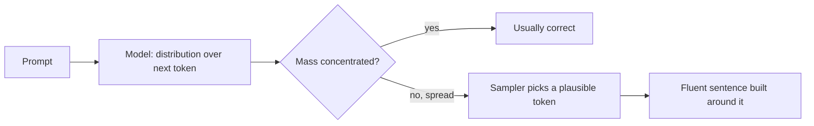

Ask a well-read friend a question they half-remember and they will usually hedge: "I think it was around 1987, but don't quote me." Ask a language model the same question and it will often answer in the same smooth, confident sentence it uses for things it knows cold. Nothing in the output tells you which kind of answer you got.

This is **hallucination**: output that is fluent and plausible but not supported by the facts or by the context the model was given. It is not a bug bolted onto an otherwise truthful system. It falls straight out of what the model is: a machine that, at every step, produces a probability distribution over the next token and then picks from it. The training objective rewarded *likely text*, and likely text and true text overlap a lot, but not completely.

## Where the wrong answer comes from

At each step the model outputs probabilities $p_\theta(x_t \mid x_{<t})$ over the vocabulary, where $x_t$ is the next token, $x_{<t}$ everything before it and $\theta$ the parameters. When the model knows a fact well, almost all the mass sits on the right token. When it half-knows, the mass is spread over several plausible candidates. The sampler then picks one, and the rest of the sentence is written to be consistent with that pick. The grammar, tone and confidence of the sentence come from the language patterns, which the model knows extremely well. Only the one content token carries the uncertainty, and it is invisible in the final text.

The probability that one sampled answer is wrong is simply the mass on wrong candidates:

$$
P(\text{wrong}) = \sum_{i \notin \mathcal{C}} p_i = 1 - \sum_{i \in \mathcal{C}} p_i
$$

where $\mathcal{C}$ is the set of tokens that would make the answer correct and $p_i$ is the probability of token $i$ after temperature and truncation.

## Worked example

Prompt: "The capital of Australia is". Suppose the model's logits for four candidates are $(2.0, 1.4, 0.3, -0.5)$ for " Canberra", " Sydney", " Melbourne" and everything else. Softmax at temperature $T$ is $p_i = e^{z_i/T} / \sum_j e^{z_j/T}$.

| $T$ | Canberra | Sydney | Melbourne | other | $P(\text{wrong})$ |
|---|---|---|---|---|---|
| 0.5 | 0.746 | 0.225 | 0.025 | 0.005 | 0.254 |
| 1.0 | 0.551 | 0.303 | 0.101 | 0.045 | 0.449 |
| 1.5 | 0.458 | 0.307 | 0.148 | 0.087 | 0.542 |

At $T = 1$, check the first column yourself: $e^{2.0} = 7.389$, $e^{1.4} = 4.055$, $e^{0.3} = 1.350$, $e^{-0.5} = 0.607$, total $13.40$, so $7.389 / 13.40 = 0.551$. Nearly half of all sampled answers name the wrong city, and every one of them is a perfectly grammatical sentence.

Greedy decoding ($T \to 0$) would always say Canberra here, because it is the top token. But greedy only helps when the top token is right. If the model had learned the wrong association so that " Sydney" had the highest logit, greedy would be wrong 100% of the time, and confidently so.

## Errors compound over a long answer

A long answer contains many factual claims. If each of $k$ independent claims is right with probability $q$, the chance the whole answer is right is

$$
P(\text{all correct}) = q^{k}
$$

With $q = 0.9$ and $k = 5$ claims: $0.9^5 = 0.590$. Even a model that is right 90% of the time per fact produces a fully correct five-fact paragraph only 59% of the time. This is why long generated biographies, citations and reference lists are such fertile ground for hallucination.

## See it

```sim
sampling
{"temperature": 1, "topP": 1}
```

Treat the top token as the correct answer and everything else as a hallucination. Read off $1 - p_{\text{top}}$ at temperature 1: that is the per-sample error rate. Lower the temperature to 0.3 and watch it shrink. Then raise it to 1.5 and set top-p to 0.9: notice that truncation removes the far tail but leaves the plausible wrong answers, because they are exactly the ones with high probability.



## Two kinds of hallucination

It helps to separate two failure types, because they have different fixes:

| Type | What happens | Typical fix |
|---|---|---|
| Unsupported by world knowledge | The model invents a fact, a paper, a function name | Give it sources (grounding), let it abstain |
| Unfaithful to the given context | The answer contradicts or goes beyond the document in the prompt | Better instructions, citation checks, faithfulness evaluation |

The second kind surprises people: even with the right document in the context, the model can blend in its own prior beliefs, because the next-token distribution mixes what the context says with what pretraining made likely.

## In practice

Engineers treat every factual token as a draw from a distribution, not as a lookup. The practical consequences: keep temperature low for factual tasks, keep answers short when facts matter (fewer claims, fewer chances to be wrong), ask for the source of each claim, and check identifiers that can be checked (URLs, function names, citations) by code, not by eye. A common mistake is reading a confident tone as evidence: tone is produced by the same language patterns whether the fact is right or not.

```quiz
{"q": "Logits $(2.0, 1.4, 0.3, -0.5)$ give probabilities $(0.551, 0.303, 0.101, 0.045)$ at $T = 1$, and only the first token is correct. If you sample 1,000 answers, about how many are wrong?", "options": ["About 449", "About 45", "About 551", "None, because the correct token is the most likely"], "answer": 0, "explain": "Each sample is wrong with probability $1 - 0.551 = 0.449$, so about 449 of 1,000. Being the most likely token only guarantees correctness under greedy decoding; sampling picks the other tokens in proportion to their probability."}
```

```quiz
{"q": "A model gets each individual fact right 95% of the time. About how likely is a 20-fact report to be entirely correct?", "options": ["About 95%", "About 36%", "About 75%", "About 5%"], "answer": 1, "explain": "Assuming independent facts, $0.95^{20} \\approx 0.358$. The tempting answer, 95%, is the per-fact rate; long outputs multiply many chances of error."}
```
