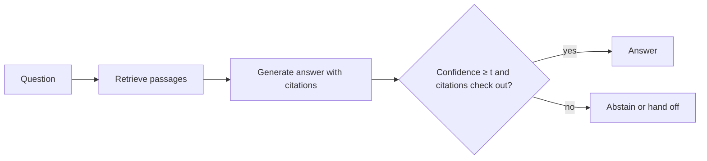

An open-book exam is easier than a closed-book one, and not because the student got smarter. The answer is on the desk; the job changes from *remembering* to *finding and copying correctly*. A language model works the same way. Put the relevant passage in its context and the next-token distribution shifts sharply towards the tokens in that passage. This is **grounding**: making the answer depend on supplied evidence rather than on what the parameters happen to remember.

The second tool is the one a careful student also uses: leave a question blank rather than guess. **Abstention** means the system says "I don't know" (or hands off to a person or a search) when its confidence is too low. Grounding raises the chance of a correct answer; abstention removes the answers most likely to be wrong.

## How grounding shifts the probabilities

Attention lets every generated token read the context. When the context contains "The company was founded in 1994", the tokens " 1994" become very likely at the moment the answer is written, because copying from context is one of the easiest patterns a transformer learns. Suppose that on some question set the model is right $q_0 = 0.40$ of the time from memory alone and $q_1 = 0.95$ of the time when the right passage is in the context. Retrieval finds the right passage with probability $r$ (its **recall**). Then

$$
P(\text{correct}) = r\, q_1 + (1 - r)\, q_0
$$

With $r = 0.8$: $0.8 \times 0.95 + 0.2 \times 0.40 = 0.76 + 0.08 = 0.84$, up from 0.40. Two lessons are hidden in the formula. Grounding is capped by retrieval: with $r = 0.5$ you get only $0.675$. And when retrieval fails, the model falls back to memory, so the 20% of unsupported answers still hallucinate at the old rate unless you also let it abstain.

## When to abstain: a decision rule

Score an answer $+1$ if correct, $-c$ if wrong, and $0$ if the system abstains. The cost $c$ says how much worse a wrong answer is than no answer: a casual chat app might have $c = 1$, a medical or legal tool $c = 10$ or more. If the model's calibrated confidence is $p$, the expected score of answering is

$$
\mathbb{E}[\text{score}] = p \cdot 1 + (1 - p)\cdot(-c) = p - c(1 - p)
$$

Answering beats abstaining when this is positive:

$$
p - c(1 - p) > 0 \iff p > \frac{c}{1 + c}
$$

So the threshold follows from the cost: $c = 1$ gives $0.5$, $c = 3$ gives $0.75$, $c = 9$ gives $0.9$. This only works if $p$ is calibrated, which is why the previous topic comes first.

## Worked example: the coverage trade-off

A system answers 1,000 questions. Grouped by confidence:

| confidence | questions | correct |
|---|---|---|
| $\ge 0.9$ | 400 | 380 |
| 0.75–0.9 | 250 | 205 |
| 0.5–0.75 | 200 | 130 |
| $< 0.5$ | 150 | 60 |

Now try thresholds $t$ (answer only if confidence $\ge t$). **Coverage** is the fraction answered; **selective accuracy** is the accuracy on answered questions. Score uses $c = 3$.

| threshold $t$ | answered | correct | wrong | coverage | selective accuracy | score $= \text{correct} - 3 \cdot \text{wrong}$ |
|---|---|---|---|---|---|---|
| 0 (always answer) | 1,000 | 775 | 225 | 100% | 77.5% | 100 |
| 0.5 | 850 | 715 | 135 | 85% | 84.1% | 310 |
| 0.75 | 650 | 585 | 65 | 65% | 90.0% | **390** |
| 0.9 | 400 | 380 | 20 | 40% | 95.0% | 320 |

Check one row: at $t = 0.75$ you keep the top two bins, $400 + 250 = 650$ answered with $380 + 205 = 585$ correct, so $585 / 650 = 0.900$ and score $585 - 3 \times 65 = 390$. The best threshold is 0.75, exactly what $c / (1 + c)$ predicted. Raising the threshold always increases selective accuracy, but past the optimum you throw away too many correct answers.



## See it

```sim
sampling
{"temperature": 0.7, "topP": 1}
```

Imagine the distribution shown is the model answering without a source. Note the top-token probability; with $c = 3$ it must exceed 0.75 to be worth answering. Lower the temperature to 0.3 and watch the top probability cross the threshold. That is the trap: temperature changes the displayed confidence without changing what the model knows. Thresholds must be chosen and checked at the temperature you deploy with.

## In practice

Production RAG systems combine both tools: retrieve, instruct the model to answer only from the provided passages and to cite them, and refuse when the passages do not contain the answer. Teams then measure four numbers on a labelled set: retrieval recall, faithfulness (is every claim supported by a cited passage?), coverage and selective accuracy. A common mistake is optimising accuracy alone: a system that abstains on everything hard looks excellent on accuracy and useless to users. Another is evaluating with a metric that gives no credit for abstaining, which quietly rewards the model for guessing.

```quiz
{"q": "A wrong answer costs 4 points, a correct one earns 1, abstaining scores 0. Above what calibrated confidence should the system answer?", "options": ["0.5", "0.8", "0.75", "0.25"], "answer": 1, "explain": "Answer when $p > c/(1+c) = 4/5 = 0.8$. Check: at $p = 0.8$, expected score $= 0.8 - 4 \\times 0.2 = 0$. Using $1/(1+c)$ gives 0.2 (or 0.25 for $1/c$), which would answer far too often."}
```

```quiz
{"q": "Retrieval recall is 0.6. The model is right 0.95 of the time with the right passage and 0.3 without. What is overall accuracy if it always answers?", "options": ["0.95", "0.69", "0.57", "0.74"], "answer": 1, "explain": "$0.6 \\times 0.95 + 0.4 \\times 0.3 = 0.57 + 0.12 = 0.69$. 0.57 forgets that the model is still sometimes right from memory when retrieval misses."}
```
