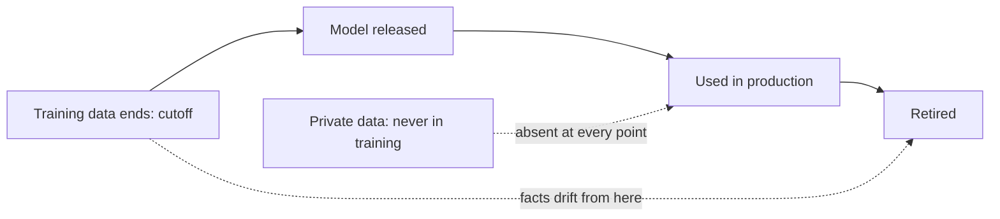

A printed encyclopedia is a snapshot. It is accurate about the day it went to press and grows quietly wrong after that, one changed fact at a time, with no mark on the page to say which entries have gone stale. A trained language model is that kind of snapshot. Its parameters $\theta$ were fixed when training ended, and nothing the world does afterwards reaches them.

The date after which the training data stops is the model's **knowledge cutoff**. Two separate gaps follow from it. Things that happened after the cutoff are simply absent. Things that were never in the training data at all, such as your company's internal documents, a customer's order history or yesterday's support ticket, are absent too, however old they are. Neither gap is a reasoning failure. The information is not in the weights, and the model, asked anyway, will produce its most plausible guess.

## Why the model does not say "I don't know"

The model has no list of what it knows. It has only next-token probabilities. A question about a post-cutoff event looks, to the model, like any other question whose answer it is unsure of, and the most likely continuation of "The latest version of the library is" is a version number, usually the latest one it saw. That answer was true at training time, which makes it especially convincing.

Knowledge is also thin near the cutoff even before it. The web keeps writing about an event for years after it happens, so the final months before a cutoff are represented by far fewer documents than older periods. Facts from that stretch tend to be recalled less reliably than older ones.

## A simple model of staleness

Some facts never change (the boiling point of water at sea level). Others are "current state" facts: who holds an office, a product's price, the newest release of a framework. Suppose a fraction $\lambda$ of a category of current-state facts changes each year, independently. The probability that a fact the model learned is still true $t$ years after the cutoff is

$$
P(\text{still true}) = (1 - \lambda)^{t}
$$

where $\lambda$ is the yearly change rate and $t$ the time since the cutoff in years.

## Worked example

Take software-library facts (latest versions, recommended APIs) with $\lambda = 0.15$ per year. A model is released 6 months after its cutoff and used for 18 months, so at the end of its life $t = 2$ years.

| time since cutoff $t$ | $(0.85)^t$ | share of these facts now stale |
|---|---|---|
| 0.5 years (release) | 0.922 | 7.8% |
| 1 year | 0.850 | 15.0% |
| 2 years (end of use) | 0.723 | 27.7% |

Check the last row: $0.85^2 = 0.7225$. By the end of its service life, more than a quarter of this category of answers is out of date, and the model states every one of them with the same fluency. The worse feature is that it cannot tell which quarter.



## See it

```sim
sampling
{"temperature": 0.7, "topP": 1}
```

Read the distribution as the model completing "The newest version is". The candidates are the versions it saw in training, ranked by how often they appeared. No setting of temperature or top-p can add a token for a version released after the cutoff, because sampling only reorders and reweights what the model already assigns probability to. Change the temperature from 0.2 to 1.5 and confirm that the set of candidates never gains a new answer.

## How systems work around it

| need | approach | why it works |
|---|---|---|
| Recent public facts | Web or news search, results put in context | Fresh evidence enters through the prompt |
| Private documents | Retrieval over your own index (RAG) | The weights never need to contain the data |
| Live state (orders, stock, prices) | Tool or API call | Ask the system of record at question time |
| Telling the model its own limits | Put today's date and the cutoff in the system prompt | Lets it flag answers that may be stale |
| Stable domain knowledge and style | Fine-tuning | Changes behaviour, but is a poor way to inject facts that change |

Fine-tuning is the tempting wrong answer for freshness. It is slow, must be repeated each time facts change, and teaches facts less reliably than putting the source in the context.

## In practice

Engineers assume anything time-sensitive or private must come from the context, never the weights. They put the current date in the system prompt, route "latest", "current" and "today" questions to search or tools, and store the date of each retrieved document so the answer can say how fresh its source is. A common mistake is testing a feature on facts that happen to predate the cutoff, seeing perfect answers, and shipping it for questions about the present.

```quiz
{"q": "Facts in some category change at 20% per year. Roughly what fraction the model learned is still true 2 years after its cutoff?", "options": ["60%", "64%", "80%", "40%"], "answer": 1, "explain": "$(1 - 0.2)^2 = 0.8^2 = 0.64$. Subtracting $2 \\times 20\\%$ to get 60% ignores that the second year's changes apply only to facts that survived the first."}
```

```quiz
{"q": "Users ask an assistant about their own account balance and it answers with plausible, wrong numbers. What is the best fix?", "options": ["Fine-tune the model on account data every night", "Lower the temperature to 0", "Fetch the balance with a tool call and put it in the context", "Use a model with a later knowledge cutoff"], "answer": 2, "explain": "Private, live state was never in the weights and changes constantly, so it must come from the system of record at question time. A later cutoff does not help with private data, temperature 0 just picks the most plausible fabricated number, and nightly fine-tuning is costly, stale within hours and unreliable at storing exact values."}
```
