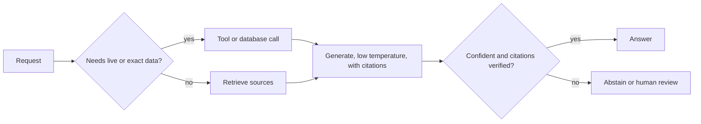

Bridges are built from steel that can crack and concrete that can crumble. Engineers do not wait for perfect materials; they know each material's failure modes, add margins, inspect, and design so that one failure does not bring the bridge down. Building with language models is the same discipline. The model will sometimes produce fluent falsehoods, will not know recent or private facts, and will slip on long exact computations. Those are properties of the material. The system around it decides whether users ever see them.

This lesson has given you the reasons. This topic puts the fixes into one pipeline and counts, with numbers, what each layer buys.

## Each layer removes a share of the errors

Think of the system as a series of filters. Let $E_0$ be the number of wrong answers the bare model would give on a workload. Each layer $j$ removes a fraction $f_j$ of the errors that reach it, so after $m$ layers

$$
E_m = E_0 \prod_{j=1}^{m} (1 - f_j)
$$

Layers that catch errors also catch some correct answers, which then go to abstention or human review. The two numbers to track are **coverage** (the share of requests answered automatically) and **selective accuracy** (the share of those answers that are correct).

## Worked example: 10,000 support questions

| stage | answered automatically | correct | wrong | selective accuracy |
|---|---|---|---|---|
| Bare model, always answers | 10,000 | 8,500 | 1,500 | 85.0% |
| + retrieval and "answer only from sources" | 10,000 | 9,300 | 700 | 93.0% |
| + abstain below confidence threshold (removes 750 correct, 450 wrong) | 8,800 | 8,550 | 250 | 97.2% |
| + citation check (flags 150 wrong, 100 correct) | 8,550 | 8,450 | 100 | 98.8% |

Check the last two rows: $9{,}300 - 750 = 8{,}550$ correct and $700 - 450 = 250$ wrong, so $8{,}550 / 8{,}800 = 0.972$; then $8{,}550 - 100 = 8{,}450$ correct and $250 - 150 = 100$ wrong, so $8{,}450 / 8{,}550 = 0.988$. Coverage ends at $8{,}550 / 10{,}000 = 85.5\%$; the other 1,450 requests go to a person or a fallback answer.

Wrong answers fell from 1,500 to 100, a 15-fold reduction, while the model itself never changed. The price is 14.5% of traffic not answered automatically, plus the cost of retrieval and checking. Whether that trade is right depends on the cost of a wrong answer, exactly as in the abstention rule $p > c/(1 + c)$.



## A checklist mapped to causes

| limit (from this lesson) | design response |
|---|---|
| Sampling picks plausible wrong tokens | Low temperature for facts; short, structured answers; fewer claims per response |
| Confidence may be miscalibrated | Measure ECE on your data; recalibrate; pick thresholds from the cost of errors |
| Knowledge cutoff, private data | Retrieval, search and tools; put the current date in the prompt |
| Fixed compute per token | Let the model reason in steps; give it a calculator or code tool |
| Tokenization artefacts | Avoid character-level tasks or route them to code |
| Long outputs compound errors ($q^k$) | Break work into checked steps; verify the final result independently |

## See it

```sim
sampling
{"temperature": 0.2, "topP": 0.9}
```

These are typical settings for a grounded factual answer: low temperature and a mild top-p cut. Note the top-token probability and the entropy. Now set temperature to 1.2 and top-p to 1, typical for brainstorming. The tail of unlikely tokens returns, and with it the chance of a fluent fabrication. Choosing sampler settings per feature, not per product, is one of the cheapest reliability decisions you can make.

## In practice

Mature teams treat hallucination as a measured rate, not an anecdote. They keep a labelled evaluation set of real questions, report coverage and selective accuracy for every change, and sample production traffic for review. They make answers checkable: citations a script can verify, structured outputs a schema can validate, numbers recomputed by code. They also design the product for the remaining errors: show sources so users can check, make "I could not find this" a normal answer, and keep a human in the loop where the cost of a mistake is high. Later modules build each of these pieces: retrieval and RAG, evaluation, guardrails and production monitoring.

A common mistake is reaching first for a bigger model. Larger models do hallucinate less on many benchmarks, but the improvement is gradual, and none of the structural limits in this lesson disappears with scale: a bigger model still has a cutoff, still lacks your private data and still samples from a distribution.

```quiz
{"q": "A system gives 800 wrong answers a day. Retrieval removes 50% of errors, then an abstention rule removes 40% of what remains. How many wrong answers are left?", "options": ["80", "240", "160", "320"], "answer": 1, "explain": "$800 \\times (1 - 0.5) \\times (1 - 0.4) = 800 \\times 0.5 \\times 0.6 = 240$. Adding the percentages to 90% and getting 80 is the tempting error: each layer only sees the errors the previous one let through."}
```

```quiz
{"q": "A legal-research assistant shows a wrong citation to 1 in 50 users. Which change attacks the cause most directly?", "options": ["Switch to a model with a later knowledge cutoff", "Raise temperature to make answers more varied", "Check every citation against the source database before showing it, and drop or flag ones that do not match", "Ask the model to state its confidence in words"], "answer": 2, "explain": "Citations are checkable identifiers, so code can verify them exactly; this is a filter that removes errors regardless of why the model made them. Verbal confidence is generated text and may not be calibrated, a later cutoff does not stop invention, and higher temperature increases fabrication."}
```
