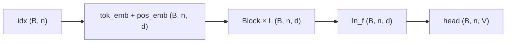

In [Attention in code](/learn/model-foundations/attention-in-code) you built the transformer block: causal multi-head attention and a feed-forward network, each wrapped in a pre-norm residual. A GPT is that block stacked $L$ times, with a little plumbing at both ends. At the bottom, integers have to become vectors. At the top, vectors have to become a score for every possible next token.

The plumbing is three pieces:

- a **token embedding**, a lookup table with one learned row of length $d$ per vocabulary entry,
- a **position embedding**, a second table with one learned row per position $0, \dots, n_{\max}-1$, added to the token vector so the model knows where each token sits,
- a **final LayerNorm** and an **LM head**, a linear layer from $d$ to $V$ that produces the logits.

Everything else is the blocks.

## Shapes through the model

Input IDs have shape $(B, n)$. Write $E \in \mathbb{R}^{V \times d}$ for the token table, $P \in \mathbb{R}^{n_{\max} \times d}$ for the position table and $W_{\text{head}} \in \mathbb{R}^{d \times V}$ for the head. For one sequence:

$$
H^{(0)}_t = E[x_t] + P[t], \qquad H^{(\ell)} = \text{Block}_\ell\big(H^{(\ell-1)}\big), \qquad \text{logits} = \text{LN}\big(H^{(L)}\big)\, W_{\text{head}}
$$

for $t = 0, \dots, n-1$ and $\ell = 1, \dots, L$. Row $t$ of the logits is the model's score for every one of the $V$ possible next tokens after seeing $x_0, \dots, x_t$.



## The code

Adapted from `model_gpt.py`. The block is the one from the previous lesson; the repo's version fuses $W_Q, W_K, W_V$ into one `nn.Linear(d, 3d)` and calls PyTorch's `F.scaled_dot_product_attention(..., is_causal=True)`, which applies the mask for you.

```python
class GPT(nn.Module):
    def __init__(self, vocab_size, block_size, n_layer=4, n_head=4, n_embd=256, dropout=0.0):
        super().__init__()
        self.block_size = block_size                              # n_max
        self.tok_emb = nn.Embedding(vocab_size, n_embd)           # V x d
        self.pos_emb = nn.Embedding(block_size, n_embd)           # n_max x d
        self.drop = nn.Dropout(dropout)
        self.blocks = nn.ModuleList([Block(n_embd, n_head, dropout) for _ in range(n_layer)])
        self.ln_f = nn.LayerNorm(n_embd)
        self.head = nn.Linear(n_embd, vocab_size, bias=False)     # d x V
        self.apply(self._init_weights)                            # N(0, 0.02) everywhere

    def forward(self, idx, targets=None):
        B, T = idx.shape                                          # (B, n)
        assert T <= self.block_size
        pos = torch.arange(T, device=idx.device).unsqueeze(0)     # (1, n)
        x = self.tok_emb(idx) + self.pos_emb(pos)                 # (B, n, d) + (1, n, d)
        x = self.drop(x)
        for blk in self.blocks:
            x = blk(x)                                            # (B, n, d)
        logits = self.head(self.ln_f(x))                          # (B, n, V)
        loss = None
        if targets is not None:                                   # next topic
            loss = F.cross_entropy(logits.view(-1, logits.size(-1)), targets.view(-1))
        return logits, loss
```

Three things to notice:

- **The position table has a hard size.** `pos_emb` has exactly `block_size` rows, so the model cannot process a sequence longer than the one it was built for: row 256 does not exist. That is why the forward pass asserts `T <= block_size` and why generation crops the context. Rotary embeddings, in [the modern architecture lesson](/learn/model-foundations/modern-architecture), remove this table.
- **Broadcasting does the position add.** `pos` has shape $(1, n)$, so `pos_emb(pos)` is $(1, n, d)$ and is added to every sequence in the batch.
- **Initialisation is small.** Every linear and embedding weight is drawn from $\mathcal{N}(0, 0.02^2)$. With weights that small, the initial logits are all close to zero. That fact predicts the very first loss value, which is the subject of the next topic.

The full version is `llm_from_scratch/part_2/model_gpt.py`.

## Counting the parameters

Use the repo's default config: $V = 256$, $n_{\max} = 256$, $L = 4$, $h = 4$, $d = 256$, FFN width $4d = 1{,}024$. One block contains:

| Piece | Formula | Count |
|---|---|---|
| ln1, ln2 (weight and bias each) | $2 \times 2d$ | 1,024 |
| Fused QKV, no bias | $3d^2$ | 196,608 |
| Attention output projection, no bias | $d^2$ | 65,536 |
| FFN up, with bias | $4d^2 + 4d$ | 263,168 |
| FFN down, with bias | $4d^2 + d$ | 262,400 |
| **One block** | $12d^2 + 9d$ | **788,736** |

Then the whole model:

$$
\underbrace{Vd}_{\text{tok\_emb}} + \underbrace{n_{\max} d}_{\text{pos\_emb}} + \underbrace{L(12d^2 + 9d)}_{\text{blocks}} + \underbrace{2d}_{\text{ln\_f}} + \underbrace{dV}_{\text{head}}
$$

$$
= 65{,}536 + 65{,}536 + 3{,}154{,}944 + 512 + 65{,}536 = 3{,}352{,}064
$$

About 3.35 million parameters, and `sum(p.numel() for p in model.parameters())` prints exactly that. Embeddings and the head together are $3 \times 65{,}536 = 196{,}608$, under 6% of the model. That is the payoff of a 256-entry vocabulary: almost every parameter sits in the blocks, where the computation happens.

## See it

```sim
transformer-params
{"dModel": 256, "layers": 4, "heads": 4, "kvHeads": 4, "ffnHidden": 1024, "vocab": 1000, "gated": false, "tied": false}
```

The sim counts a Llama-style model without biases or a position table, and its smallest vocabulary is 1,000, so it shows about 3.66 M rather than 3.35 M. Watch the embedding share. Now drag the vocabulary up to about 50,000, GPT-2's size: the total jumps to roughly 29 M and about 89% of it is embeddings and head. With a BPE vocabulary, a model this narrow would be mostly lookup table. Then turn on "Tie LM head to embeddings" and see how much one shared matrix saves.

## In practice

- **Print the count before training.** If it is not the number you computed by hand, a layer is the wrong size or is missing. A typo like `4 * n_head` instead of `4 * n_embd` shows up here, not as a mysterious loss curve.
- **No weight tying in this repo.** GPT-2 reuses the token embedding matrix as the LM head (the head is $E^{\top}$). Here they are separate. With $V = 256$ the saving would be only 65,536 parameters, so it does not matter much.
- **Dropout defaults to 0.** For a model this small trained on a few hundred kilobytes, overfitting is a real risk (topic 7). Setting `--dropout 0.1` is the first regulariser to try.
- **Width must divide by heads.** The attention module asserts `n_embd % n_head == 0`; with $d = 256$ and $h = 4$ each head has $d_h = 64$.

```quiz
{"q": "The repo's quick-start config uses $V = 256$, $n_{\\max} = 128$, $L = 2$, $h = 2$, $d = 128$. Using $12d^2 + 9d$ per block, how many parameters does the model have?", "options": ["477,696", "395,520", "444,928", "461,312"], "answer": 0, "explain": "Token table $256 \\times 128 = 32{,}768$; positions $128 \\times 128 = 16{,}384$; blocks $2 \\times (12 \\cdot 16{,}384 + 9 \\cdot 128) = 2 \\times 197{,}760 = 395{,}520$; final norm $2 \\times 128 = 256$; head $32{,}768$. Total 477,696. 395,520 counts only the blocks, and 444,928 forgets the separate LM head."}
```

```quiz
{"q": "You train with `block_size = 256`, then call the model on a prompt of 300 tokens without cropping. What happens?", "options": ["The forward pass fails: there is no position embedding for positions 256 to 299", "It works, but attention only looks at the first 256 tokens", "It works, because the causal mask handles any length", "The token embeddings are reused as position embeddings for the extra tokens"], "answer": 0, "explain": "The learned position table has exactly 256 rows, so positions 256 and above have no vector, and the repo's assert fires before the lookup would fail. The causal mask works for any length, but it is the position table that limits the input; that is why `generate` keeps only the last `block_size` tokens."}
```
