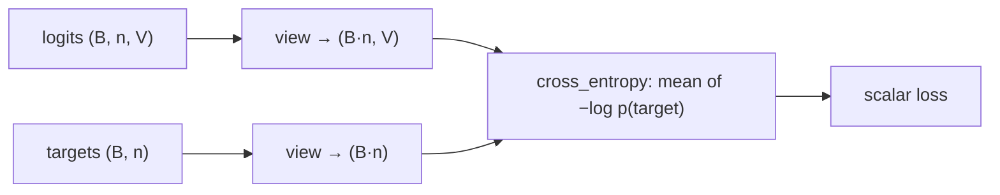

The model hands back logits of shape $(B, n, V)$: for every position in every sequence, one score per possible next byte. The dataset hands back targets of shape $(B, n)$: the byte that actually came next. The loss has to compare these and produce a single number to minimise.

That number is **cross-entropy**, the same loss you computed by hand in [How a network learns](/learn/model-foundations/how-networks-learn): turn the scores into probabilities with softmax and take the negative log of the probability given to the correct answer. A confident correct prediction costs almost nothing; a confident wrong one costs a lot. Here we care about two practical things: how to feed $B \cdot n$ predictions into PyTorch's loss in one call, and what value the loss must start at if the model is wired correctly.

## The formula

For a single position with logits $z \in \mathbb{R}^V$ and correct next token $y$:

$$
\ell = -\log \operatorname{softmax}(z)_y = -z_y + \log \sum_{j=1}^{V} e^{z_j}
$$

The batch loss is the mean over all $M = B \cdot n$ predictions:

$$
\mathcal{L} = \frac{1}{B n} \sum_{b=1}^{B} \sum_{t=0}^{n-1} \ell_{b,t}
$$

Every position counts equally. A position near the start of a window, which sees only one or two bytes of context, is weighted the same as the last position, which sees $n$.

**Worked example.** Take a toy vocabulary of $V = 4$ with logits $z = (2, 1, 0, -1)$ and correct token $y = 0$. The exponentials are $e^2 = 7.389$, $e^1 = 2.718$, $e^0 = 1$, $e^{-1} = 0.368$, summing to $11.475$. So $p_y = 7.389 / 11.475 = 0.644$ and $\ell = -\ln 0.644 = 0.440$. Had the correct token been $y = 3$, the loss would be $-\ln(0.368 / 11.475) = -\ln 0.032 = 3.44$.

## The first number: $\ln V$

At initialisation every weight is drawn from $\mathcal{N}(0, 0.02^2)$, so all logits are close to zero. Equal logits mean softmax is uniform: every token gets probability $1/V$. Then

$$
\ell = -\ln \frac{1}{V} = \ln V, \qquad \ln 256 = 8 \ln 2 = 8 \times 0.6931 = 5.545
$$

So a correctly built byte-level GPT should report a loss of about **5.55** on its very first batch. Running the repo's default 3.35 M parameter model on random input gives 5.59: slightly above, because the logits are small but not exactly equal.

This is the most useful sanity check in the whole project. If step 0 prints 5.5, the plumbing is probably right. If it prints 9 or 40, something is producing large logits (a missing LayerNorm, a bad initialisation, logits multiplied instead of divided by a temperature). If it prints 0.3, the targets are probably leaking into the inputs.

Dividing by $\ln 2$ converts nats to bits: $5.545 / 0.693 = 8$ bits per byte, exactly the cost of storing a byte with no model at all. Everything the model learns shows up as bits per byte below 8.

| Loss (nats) | Bits per byte | What it means for a byte model |
|---|---|---|
| 5.55 | 8.0 | uniform guessing: the untrained model |
| 3.10 | 4.5 | has learned which bytes are common (letters, space) |
| 2.40 | 3.5 | has learned common pairs and short words |
| 1.50 | 2.2 | spelling and frequent words mostly right |
| 1.00 | 1.4 | good small character-level model on plain English |

## Reshaping for `F.cross_entropy`

`F.cross_entropy` expects logits of shape $(M, V)$ and integer targets of shape $(M,)$. The batch and time dimensions are not special to the loss, so we flatten them together:

```python
# logits: (B, n, V)   targets: (B, n)
B, n, V = logits.shape
loss = F.cross_entropy(
    logits.view(B * n, V),     # (B*n, V): one row per prediction
    targets.view(B * n),       # (B*n,):   one correct byte per row
)                              # scalar, mean over B*n rows

# sanity check at initialisation
import math
print(loss.item(), math.log(V))   # ~5.55 and 5.545 for V = 256
```

The repo writes this as `logits.view(-1, logits.size(-1))` and `targets.view(-1)`, letting PyTorch infer $B \cdot n$. The full version is the end of `GPT.forward` in `llm_from_scratch/part_2/model_gpt.py`.



## Where the shift lives

There are two places a codebase can shift labels, and it must happen in exactly one of them. In this repo, the dataset shifts (`y` is `x` moved one to the right) and the model does not. Hugging Face models do the opposite: you pass `labels = input_ids` unshifted and the model drops the last logit and the first label internally.

| Shifts done | What the model learns | Symptom |
|---|---|---|
| None | copy the current token | loss falls toward 0 within a few hundred steps; samples are garbage |
| One (correct) | predict the next token | starts at 5.55, falls steadily |
| Two | predict the token after next | loss plateaus well above a normal run; samples skip characters |

Mixing a repo-style dataset with a Hugging Face-style model is the classic way to get two shifts.

## In practice

- **Log the loss at step 0, before any update.** Compare it with $\ln V$. For a GPT-2 vocabulary of 50,257, expect $\ln 50{,}257 \approx 10.8$.
- **`view` versus `reshape`.** `view` needs a contiguous tensor; the logits straight out of a linear layer are contiguous, so it works. After a transpose, use `.reshape` or `.contiguous().view`.
- **Do not pass $(B, n, V)$ directly.** `F.cross_entropy` reads a 3-D input as $(B, C, \ldots)$, with classes in dimension 1. Passing $(B, n, V)$ makes it treat $n$ as the class dimension and will either error or compute nonsense when $n = V$, which is exactly the default here: $n = V = 256$.
- **`ignore_index` for padding.** Later, when sequences have padding or prompts that should not be trained on, targets set to $-100$ are skipped by `F.cross_entropy`. Pretraining on contiguous windows needs none.

```quiz
{"q": "A freshly initialised GPT with a 32,000-token vocabulary and small random weights prints its first loss. Roughly what should you expect?", "options": ["About 10.4", "About 5.5", "About 0.0", "About 32,000"], "answer": 0, "explain": "Near-zero logits give a uniform distribution, so the loss is $\\ln V = \\ln 32{,}000 \\approx 10.37$. 5.5 is $\\ln 256$, right only for a byte-level vocabulary; the loss is a log-probability, never the vocabulary size itself."}
```

```quiz
{"q": "With $B = 4$, $n = 8$, $V = 256$, what shapes go into `F.cross_entropy`?", "options": ["Logits $(32, 256)$ and targets $(32,)$", "Logits $(4, 8, 256)$ and targets $(4, 8)$", "Logits $(32, 256)$ and targets $(32, 256)$", "Logits $(4, 2048)$ and targets $(4,)$"], "answer": 0, "explain": "Flatten batch and time: $B \\cdot n = 32$ rows of 256 logits, and 32 integer class indices. Passing the 3-D tensors would make PyTorch read dimension 1 (size 8) as the classes. Targets are class indices, not one-hot vectors, so they are $(32,)$, not $(32, 256)$."}
```
