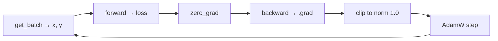

Every neural network you will ever train runs the same four-beat loop: get a batch, compute the loss, compute the gradients, update the weights. The [gradient descent](/learn/model-foundations/how-networks-learn) lesson did it by hand for a handful of numbers. For a GPT it is the same loop over 3.35 million numbers, with three upgrades that make it work reliably on transformers: the **AdamW** optimiser instead of plain gradient descent, **gradient clipping** to survive the occasional huge gradient, and logging that tells you whether things are going well before the run is over.

## AdamW in one paragraph

Plain gradient descent moves every weight by $\eta g$, the learning rate times its gradient. Transformers have weights whose gradients differ in scale by orders of magnitude (embeddings, attention, LayerNorm gains), and no single learning rate suits all of them. Adam keeps two running averages per weight, of the gradient $g$ and of its square, and divides one by the square root of the other. Every weight then moves by roughly $\eta$ per step regardless of how big its raw gradient is. With step counter $k$:

$$
m_k = \beta_1 m_{k-1} + (1 - \beta_1) g_k, \qquad v_k = \beta_2 v_{k-1} + (1 - \beta_2) g_k^2
$$

$$
\theta_k = \theta_{k-1} - \eta \left( \frac{\hat m_k}{\sqrt{\hat v_k} + \epsilon} + \lambda\, \theta_{k-1} \right)
$$

Here $\hat m_k = m_k / (1 - \beta_1^k)$ and $\hat v_k = v_k / (1 - \beta_2^k)$ correct for the averages starting at zero, $\epsilon \approx 10^{-8}$ avoids division by zero, and $\lambda$ is the **weight decay**. The "W" in AdamW means the decay term $\lambda\theta$ is applied directly to the weights, decoupled from the gradient averages; in the original Adam it was mixed into $g$ and got rescaled away.

The repo uses $\eta = 3 \times 10^{-4}$, $\beta_1 = 0.9$, $\beta_2 = 0.95$ and $\lambda = 0.1$.

**Worked example.** On step 1, $\hat m_1 = g_1$ and $\hat v_1 = g_1^2$, so the update is $\eta \cdot g_1 / |g_1| = \pm\eta$: every weight moves by exactly $3 \times 10^{-4}$ in the downhill direction, whether its gradient was $0.001$ or $50$. The decay alone shrinks each weight by a factor $1 - \eta\lambda = 1 - 3 \times 10^{-5}$ per step. Over 2,000 steps that compounds to $(1 - 3\times 10^{-5})^{2000} \approx e^{-0.06} \approx 0.94$: a weight that received no gradient signal shrinks by about 6%.

## Gradient clipping

Occasionally one batch produces a gradient far larger than usual, and a single step can then throw the weights somewhere the loss is terrible. **Gradient clipping** caps the size of the whole gradient vector. Compute the global norm over all parameters, $\|g\| = \sqrt{\sum_i g_i^2}$, and if it exceeds a threshold $c$, scale everything down:

$$
g \leftarrow g \cdot \min\!\left(1, \frac{c}{\|g\|}\right)
$$

With $c = 1.0$ and a measured norm of $4.0$, every gradient entry is multiplied by $0.25$. The direction is unchanged; only the length is capped. With a norm of $0.6$, nothing happens. `clip_grad_norm_` returns the pre-clip norm, which is worth logging: a run whose norm sits far above $c$ on every step is effectively running at a lower learning rate than you think.

## The loop

Adapted from `train.py`, with mixed precision removed for clarity:

```python
model = GPT(vocab_size=256, block_size=256, n_layer=4, n_head=4, n_embd=256).to(device)
opt = torch.optim.AdamW(model.parameters(), lr=3e-4, betas=(0.9, 0.95), weight_decay=0.1)

model.train()
for step in range(1, steps + 1):
    xb, yb = ds.get_batch("train", batch_size=32, device=device)  # (B, n), (B, n)
    _, loss = model(xb, yb)                                        # scalar

    opt.zero_grad(set_to_none=True)   # clear last step's .grad
    loss.backward()                   # fill .grad for all 3.35M params
    norm = torch.nn.utils.clip_grad_norm_(model.parameters(), 1.0)
    opt.step()                        # AdamW update

    if step % 50 == 0:
        print(f"step {step:5d} | loss {loss.item():.4f} | grad norm {norm:.2f}")
```

The repo's version also wraps the forward pass in `autocast` with a `GradScaler` when `--amp` is set, evaluates on a schedule (topic 7) and saves a checkpoint whenever validation loss improves. Mixed precision gets a full treatment in [Scaling the training loop](/learn/model-foundations/scaling-the-training-loop). The full version is `llm_from_scratch/part_2/train.py`.



Two orderings matter. `zero_grad` must happen before `backward`, because PyTorch **adds** new gradients into `.grad`; forget it and every step uses the sum of all previous gradients. Clipping must happen after `backward` and before `step`, because it edits the gradients the optimiser is about to read.

```bughunt
{"q":"This loop runs without errors and prints a sensible gradient norm every step, but the loss sits at about 5.55 forever. Click the line with the bug.","code":"model.train()\nfor step in range(1, steps + 1):\n    xb, yb = ds.get_batch(\"train\", batch_size=32, device=device)\n    _, loss = model(xb, yb)\n    loss.backward()\n    norm = torch.nn.utils.clip_grad_norm_(model.parameters(), 1.0)\n    opt.zero_grad(set_to_none=True)\n    opt.step()","bug":7,"explain":"`zero_grad` sits between `backward` and `step`, so it wipes the gradients just computed. With `set_to_none=True` every `.grad` is `None`, and AdamW skips parameters with no gradient, so `opt.step()` changes nothing: the loss stays at $\\ln 256 \\approx 5.55$. The printed norm looks healthy because it was measured before the wipe. Fix: clear gradients before the backward pass (at the top of the iteration, or right after `opt.step()`), so the order is zero_grad, forward, backward, clip, step."}
```

## What a healthy run prints

A run of the repo's small config ($L = 2$, $d = 128$, $n = 128$, $B = 32$) on `tiny.txt`, on a CPU, prints lines like these:

| Step | Training loss | Reading |
|---|---|---|
| 0 | about 5.55 | uniform over 256 bytes, as predicted |
| 50 | 3.10 | learned byte frequencies: spaces, vowels, common letters |
| 200 | 2.36 | learned common pairs and short words |
| 600 | 2.10 | spelling familiar words; samples look like English-shaped verse |

Each block of 50 steps took about 2.5 seconds. The drop from 5.55 to about 3 is fast and easy (just learning which bytes are common); everything after is slower and harder. Loss printed every 50 steps is from a single batch, so expect it to wobble by a few hundredths; a smooth estimate comes from the evaluation in topic 7.

## See it

```sim
gradient-descent
{"surface": "ravine", "lr": 0.18, "momentum": 0, "steps": 60, "startX": -2, "startY": 1}
```

The ravine is ten times steeper in $y$ than in $x$, like a transformer whose parameters have very different gradient scales. At $\eta = 0.18$ plain gradient descent zig-zags across the steep direction. Raise the learning rate to 0.21 and it diverges: the steepest direction sets the speed limit ($\eta < 0.2$) for every direction, so the shallow one is stuck crawling. That is the problem Adam removes by giving each parameter its own effective step size. Now set $\eta = 0.05$ and momentum to 0.9 (the role $\beta_1$ plays in Adam) and watch the averaged velocity carry the path along the valley floor.

## In practice

- **Memory for the optimiser.** AdamW stores $m$ and $v$ for every parameter. In fp32, weights, gradients, $m$ and $v$ cost $4 \times 4 = 16$ bytes per parameter: $3.35\text{M} \times 16 \approx 54$ MB here, and about 112 GB for a 7B model before any activations.
- **Weight decay on everything.** The repo decays all parameters, including LayerNorm gains and biases and the embeddings. Many codebases (nanoGPT, for one) put those in a second parameter group with `weight_decay=0.0`, since shrinking a LayerNorm gain toward zero is not regularisation anyone wants.
- **No learning-rate schedule.** The repo trains at a constant $3 \times 10^{-4}$. Warmup and cosine decay usually lower the final loss; they arrive in a later lesson.
- **First debugging move.** If the loss rises or goes to `nan`, halve the learning rate and log the gradient norm. A norm in the hundreds on step 1 points at initialisation or a missing normalisation, not at the optimiser.

```quiz
{"q": "Before clipping, the global gradient norm is 2.5 and the clip threshold is 1.0. One parameter's gradient is 0.8. What is it after clipping?", "options": ["0.32", "0.8", "1.0", "0.4"], "answer": 0, "explain": "Clipping scales the whole vector by $c / \\|g\\| = 1.0 / 2.5 = 0.4$, so $0.8 \\times 0.4 = 0.32$. It does not clip each entry separately to 1.0 (that would leave 0.8 unchanged); 0.4 is the scale factor, not the result."}
```

```quiz
{"q": "Someone removes `opt.zero_grad()` from the loop. What goes wrong?", "options": ["Gradients accumulate across steps, so each update uses the sum of all past gradients and training soon becomes unstable", "Nothing: `backward()` overwrites the gradients each time", "The optimiser's $m$ and $v$ averages are reset every step", "The loss can no longer be computed"], "answer": 0, "explain": "PyTorch's `backward()` adds into `.grad` rather than overwriting it; that is deliberate, to support gradient accumulation. Without zeroing, step 100 uses the sum of 100 gradients. Adam's normalisation partly hides the growing scale, but the direction is dominated by stale gradients and training degrades. The forward pass and loss are unaffected."}
```
