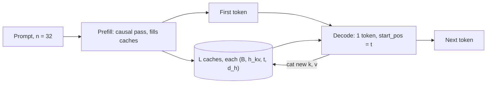

The `generate` method of the part 2 GPT does the obvious thing. Every step it crops the sequence to the last `block_size` tokens, runs the whole model over all of them, keeps only the last row of logits and throws everything else away. To write token 401 it recomputes the keys and values of the 400 tokens before it, which are exactly the numbers it computed on the previous step.

The [KV cache lesson](/learn/model-foundations/context-and-kv-cache) explains why those keys and values never change once computed (the causal mask) and how much memory they take. This topic builds the cache into the modern model: what the cache tensors look like, how attention appends to them, how the generate loop splits into **prefill** and **decode**, and how to prove the cached model is still the same model.

## In everyday life

A cricket scorer does not recount every ball from the first over each time a new ball is bowled. They keep a running scoreboard and add the newest ball to it. At the start, they enter the balls already bowled in one go. After that, each ball costs one small update. To check the scorer is honest, an umpire occasionally recounts the whole match from scratch, and the two totals must agree exactly.

Text generation can work the same way. The **KV cache** is the scoreboard: for every **token** so far (a word or word piece), it stores two lists of numbers that attention needs, a **key** and a **value**. In code, **prefill** feeds the whole prompt in one pass and fills the cache. **Decode** then feeds only the newest token, adds its numbers to the cache and moves on. The cache also tells the model how many tokens came before, the **start position**, so the new token knows its place.

Unlike a scoreboard, this cache is large and sits in GPU memory, and a mistake in the code can slip in without any crash. The recount check catches it.

**Where you meet it.** Any chat service that streams text uses this loop. Without the cache, each new word would reprocess the whole conversation. With it, the loop does a small amount of work per word. Teams keep a test that compares cached output with a full recount, because bugs here do not crash the program.

```scene
title: The scorer and the running scoreboard
step: 🏏 The match starts with some balls already bowled | the prompt tokens
step: 📋 The scorer enters all of them on the sheet in one go | prefill fills the cache
step: ⚾ A new ball is bowled | one new token fed in decode
step: 📝 The scorer adds only that ball to the running board | append its key and value
step: 🔢 The ball count says which ball this is | start position
step: 🧮 An umpire recounts from scratch; the totals must match | cached equals uncached output
takeaway: A cache saves the old work, but only a full recount proves it still gives the same answer.
```

## The maths

Per layer, the cache holds keys and values for every token seen so far, for each of the $h_{kv}$ key/value heads:

$$
K_{\text{cache}}, V_{\text{cache}} \in \mathbb{R}^{B \times h_{kv} \times t \times d_h}, \qquad \text{bytes per token} = 2 \cdot L \cdot h_{kv} \cdot d_h \cdot b
$$

where $t$ is the number of tokens cached and $b$ is bytes per number. A decode step feeds one token, so the new query has shape $(B, h, 1, d_h)$ and attends over $t + 1$ keys.

Work saved: with a prompt of $P$ tokens and $N$ generated tokens, the uncached loop pushes $\sum_{j=0}^{N-1}(P + j)$ token positions through every layer; the cached loop pushes $P + N$.

For $P = 32$, $N = 400$: uncached $= 400 \times (32 + 431)/2 = 92{,}600$ positions; cached $= 432$. That is 214 times fewer.

Memory for the configuration used below ($L = 6$, $h_{kv} = h = 8$, $d_h = 64$, fp32 so $b = 4$): $2 \times 6 \times 8 \times 64 \times 4 = 24{,}576$ bytes, 24 KiB per token. The demo model in `demo_generate.py` uses grouped-query attention with 2 KV heads, $L = 2$, $d_h = 32$: $2 \times 2 \times 2 \times 32 \times 4 = 1$ KiB per token.

## The code

The cache itself is a plain container.

```python
@dataclass
class KVCache:
    k: torch.Tensor   # (B, h_kv, t, d_h), keys already rotated by RoPE
    v: torch.Tensor   # (B, h_kv, t, d_h)
```

Inside `CausalSelfAttentionModern.forward`, after projecting and rotating the current $n$ tokens:

```python
# q: (B, h, n, d_h); k, v: (B, h_kv, n, d_h); start_pos = number of tokens already cached
if kv_cache is not None:
    k_all = torch.cat([kv_cache.k, k], dim=2)        # (B, h_kv, t + n, d_h)
    v_all = torch.cat([kv_cache.v, v], dim=2)
else:
    k_all, v_all = k, v                              # prefill: nothing cached yet

if h_kv != h:                                        # GQA: share each KV head across h / h_kv query heads
    k_all = k_all.repeat_interleave(h // h_kv, dim=1)    # (B, h, t + n, d_h)
    v_all = v_all.repeat_interleave(h // h_kv, dim=1)

y = F.scaled_dot_product_attention(q, k_all, v_all,
                                   is_causal=(kv_cache is None))   # (B, h, n, d_h)
new_cache = KVCache(torch.cat(...), torch.cat(...))  # store the compact h_kv heads, not the expanded ones
```

And the generate loop in `GPTModern` becomes two phases:

```python
kvs = [None] * L                                     # one cache per layer
for _ in range(max_new_tokens):
    if kvs[0] is None:                               # PREFILL: whole prompt, one parallel pass
        idx_cond, start_pos = idx[:, -block_size:], 0
    else:                                            # DECODE: only the newest token
        idx_cond, start_pos = idx[:, -1:], kvs[0].k.size(2)
    logits, _, kvs = model(idx_cond, kv_cache_list=kvs, start_pos=start_pos)
    next_id = sample(logits[:, -1, :])               # (B, 1)
    idx = torch.cat([idx, next_id], dim=1)
```

The full version is `llm_from_scratch/part_3/attn_modern.py`, `kv_cache.py` and `model_modern.py`. Details that are easy to get wrong:

- **`is_causal` only during prefill.** In a decode step the single query is the newest token, and every cached key is in its past, so no mask is needed. But PyTorch aligns `is_causal=True` to the top-left corner when the query and key lengths differ, which would let the new token see only the first cached key. That is why the flag is switched off when a cache exists. The consequence: feeding several new tokens at once with a cache (chunked prefill, speculative decoding) needs an explicit mask.
- **`start_pos` comes from the cache length**, and it feeds RoPE (previous topic).
- **The cache stores $h_{kv}$ heads.** Expanding to $h$ heads happens on a temporary copy. Storing the expanded version would throw away the whole memory saving of GQA.
- **`torch.cat` copies.** Each step allocates a new tensor and copies the entire cache into it: $O(t)$ bytes moved per step, $O(t^2)$ over a generation. It is fine for a tutorial. Production engines preallocate `torch.empty(B, h_kv, max_len, d_h)` and write each new key into slice `[:, :, t]`, or page the cache in blocks.



```parsons
{"title":"Order the cached generation loop (simplified from `GPTModern.generate`)","lines":["kvs = [None] * len(self.blocks)","for _ in range(max_new_tokens):","    if kvs[0] is None:","        idx_cond = idx[:, -self.block_size:]","        start_pos = idx.size(1) - idx_cond.size(1)","    else:","        idx_cond, start_pos = idx[:, -1:], idx.size(1) - 1","    logits, _, kvs = self(idx_cond, kv_cache_list=kvs, start_pos=start_pos)","    idx = torch.cat([idx, sample(logits[:, -1, :])], dim=1)"],"explain":"One empty cache per layer, then two phases. **Prefill** (no cache yet) feeds the visible prompt in one causal pass; its first token's absolute position is however much of the prompt was cropped off. **Decode** feeds only the newest token, at position `idx.size(1) - 1`, and that `start_pos` is what RoPE rotates by. The forward pass returns the updated caches, which the next iteration passes back in. The repo's version also resets the caches when the text outgrows `block_size` without a sliding window, so the cached view keeps matching the uncached one."}
```

## Measured on a CPU

A randomly initialised `GPTModern` with $d = 512$, $L = 6$, $h = 8$, a 32-token prompt and greedy decoding, timed on a CPU (your numbers will differ; the trend will not):

| Tokens generated | No cache | With cache | Speed-up | Same tokens? |
|---|---|---|---|---|
| 100 | 3.17 s | 1.35 s | 2.3× | yes |
| 400 | 20.3 s | 5.75 s | 3.5× | yes |

The speed-up is far below the 214× reduction in positions, and it grows with length. The reason is the prefill/decode split itself: the uncached loop processes many positions per call as one efficient matrix multiplication, while each cached decode step is a full trip through Python, every layer and every kernel launch for a single row. Per-call overhead dominates small models; on a GPU with a real model, decode is limited by reading the weights, as the [prefill and decode](/learn/model-foundations/context-and-kv-cache) topic explains.

```sim
latency-breakdown
```

Lower the prompt length and raise the output tokens: total time becomes almost entirely decode, one weight read per token. That per-token cost is what the cache keeps from also growing with context.

## In practice

The one test every cache implementation needs: with greedy decoding, the cached and uncached loops must produce **identical tokens**. The table's last column is that test, run against the repo's code. Bugs in `start_pos`, masks or cache order all leave shapes intact and show up only here. Run it in fp32; in fp16 tiny rounding differences can legitimately flip a near-tie after a few hundred tokens.

```quiz
{"q": "A model has $L = 12$, $h = 12$, $h_{kv} = 4$, $d_h = 64$, and caches in bf16. How many bytes of KV cache does each token add?", "options": ["12,288 bytes", "36,864 bytes", "6,144 bytes", "3,072 bytes"], "answer": 0, "explain": "$2 \\times L \\times h_{kv} \\times d_h \\times 2 = 2 \\times 12 \\times 4 \\times 64 \\times 2 = 12{,}288$. Using the 12 query heads instead of the 4 KV heads gives 36,864, which is what you would store if you cached the `repeat_interleave`-expanded tensors."}
```

```quiz
{"q": "You extend the decode loop to feed 4 draft tokens at once with a cache of 100 tokens, still passing `is_causal=(kv_cache is None)`. What is wrong?", "options": ["No mask is applied, so each of the 4 new tokens can attend to the draft tokens after it", "Nothing; the cache makes masking unnecessary", "The cache will be stored with the wrong number of heads", "RoPE positions will be off by 4"], "answer": 0, "explain": "With a cache the flag is False, so the 4 queries attend to all 104 keys, including later draft tokens: the future leaks. Masking is unnecessary only when exactly one token is fed. Turning `is_causal` on is not the fix either, because PyTorch aligns it top-left when lengths differ; you need an explicit mask allowing key $j$ for query $i$ when $j \\le 100 + i$."}
```

```lab
fit-the-kv-cache
```
