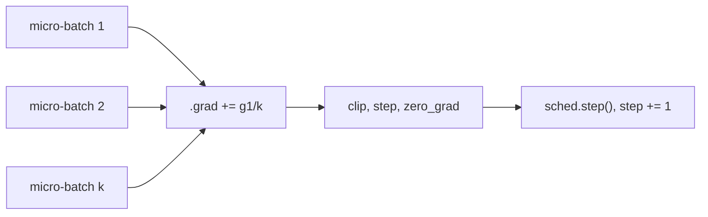

The batch size you want is set by optimisation: larger batches give a less noisy gradient, and language models are usually trained with hundreds of thousands to millions of tokens per optimizer step. The batch size you can fit is set by memory: activations grow linearly with $B \times n$, and the previous topic showed that the logits alone for $B = 32$, $n = 256$, $V = 32{,}000$ take a gigabyte. These two numbers rarely agree.

**Gradient accumulation** decouples them. You run several small **micro-batches** forward and backward, let their gradients pile up in the parameters' `.grad` buffers, and only then take one optimizer step. To the optimizer it looks exactly like one big batch. To the GPU it looks like a sequence of small ones, so peak activation memory is set by the micro-batch alone.

The trick works because of one PyTorch behaviour you may have treated as an annoyance in part 2: `loss.backward()` **adds** into `.grad` rather than overwriting it. That is why the part 2 loop called `zero_grad()` every iteration. Accumulation simply delays the zeroing.

## In everyday life

A teacher wants to judge how her whole class did in a test, but her small desk holds only one pile of answer sheets at a time. So she marks the first pile and jots down what its mistakes suggest about her teaching. She moves to the next pile and adds to the same notes. Only after the last pile does she change how she teaches. Because she looked at the whole class first, the change is steadier than a reaction to one pile.

**Gradient accumulation** is this trick for training a model. The model learns by adjusting its **weights** (its learned numbers) in the direction that cuts its mistakes, and that direction is the **gradient**. A **batch** is the set of examples behind one adjustment: big batches give a steadier direction but need more memory. So we run small **micro-batches**, let each add its share to a running total, and adjust the weights only once at the end. Each share is divided by the number of piles, so the total is an average, not a sum.

Unlike the teacher, the GPU forgets each pile's examples right away. Only the running notes stay.

**Where you meet it.** Someone trains a small language model on one rented GPU. The batch size that learns smoothly does not fit in its memory, and a smaller one makes the loss curve jumpy. Accumulation keeps the memory use of the small batch and gives much of the steadiness of the big one, for a little extra time per adjustment.

```scene
title: Marking piles, changing teaching once
step: 📚 The class is too big, so she takes one small pile at a time | micro-batch
step: 📝 She marks a pile and adds its notes to the running notes | backward pass adds to the gradient
step: ➗ Each pile counts for one share of the total, not all of it | dividing the loss by accumulation steps
step: 🔄 She moves to the next pile without changing her teaching yet | gradients keep piling up
step: 🎯 After the last pile, she changes her teaching once | one optimizer step
step: 🧹 She clears her notes and starts fresh for the next round | zeroing the gradients
takeaway: Accumulation lets small pieces add up to one big, steady update, with memory sized for a single piece.
```

## The maths

The loss of a big batch is the mean of its per-token losses. Split the big batch into $k$ equal micro-batches with mean losses $\mathcal{L}_1, \dots, \mathcal{L}_k$. The big-batch loss and its gradient are

$$
\mathcal{L} = \frac{1}{k}\sum_{j=1}^{k} \mathcal{L}_j, \qquad \nabla \mathcal{L} = \sum_{j=1}^{k} \nabla\!\left(\frac{\mathcal{L}_j}{k}\right)
$$

The right-hand form is exactly what the code computes: backpropagate $\mathcal{L}_j / k$ for each micro-batch and let `.grad` do the sum. The **effective batch** is

$$
B_{\text{eff}} = B_{\text{micro}} \times k \times G, \qquad \text{tokens per step} = B_{\text{eff}} \times n
$$

where $G$ is the number of data-parallel GPUs (1 here).

```steps
One optimizer step with the part 4 defaults
Settings: micro-batch $B = 32$, $n = 256$, $k = 4$ (`--grad_accum_steps 4`). Effective batch $32 \times 4 = 128$ sequences, $128 \times 256 = 32{,}768$ tokens per optimizer step.
---
Track one weight. The four micro-batches give it gradients $0.8, 1.2, 0.6, 1.4$. Each backward pass adds $g_j / 4$: after them `.grad` holds $0.2 + 0.3 + 0.15 + 0.35 = 1.0$, the mean, exactly what one batch of 128 would give.
---
Forget the division and `.grad` holds $0.8 + 1.2 + 0.6 + 1.4 = 4.0$, four times too large. With plain SGD at $\eta = 3\times10^{-4}$ the weight would move $1.2\times10^{-3}$ instead of $3\times10^{-4}$.
---
After the fourth backward: clip, `optimizer.step()`, `zero_grad()`, and advance the learning-rate schedule by **one** step, not four.
```

The SGD case is the obvious failure. With AdamW it is subtler: Adam divides the first moment by the square root of the second, so scaling every gradient by $k$ scales $m$ by $k$ and $\sqrt{v}$ by $k$, and the update barely changes. What does change is anything that reads the raw gradient: the gradient norm you log is $k$ times too big, and gradient clipping at 1.0 starts firing on almost every step. So the bug can hide for a long time.

## The code

Here is the part 4 helper, reduced to its core, and the loop that uses it:

```python
class AmpGrad:
    def __init__(self, optimizer, accum=4):
        self.optim, self.accum, self._n = optimizer, accum, 0

    def backward(self, loss):              # loss: scalar, mean over B*n tokens
        (loss / self.accum).backward()     # .grad += d(loss/k)/dw
        self._n += 1

    def should_step(self):
        return self._n % self.accum == 0

for xb, yb in train_loader:                # xb, yb: (B, n) = (32, 256)
    logits, loss, _ = model(xb, yb)        # logits: (B, n, V)
    amp.backward(loss)
    if amp.should_step():
        torch.nn.utils.clip_grad_norm_(model.parameters(), 1.0)
        optim.step()
        optim.zero_grad(set_to_none=True)
        lr = sched.step()                  # schedule counts optimizer steps
        step += 1
```

What changes in the part 2 loop: `zero_grad()` moves from the top of every iteration to just after the optimizer step; `step` now counts optimizer steps, not batches; and anything keyed on `step` (schedule, logging, checkpoints) fires once per $k$ micro-batches. The real `AmpGrad` also handles the gradient scaler from the next topic. The full version is `llm_from_scratch/part_4/amp_accum.py`.



```bughunt
{"q":"With `accum=4` this loop runs and the loss goes down, but the curve is as noisy as a run with a quarter of the batch. Click the line with the bug.","code":"for xb, yb in train_loader:\n    optim.zero_grad(set_to_none=True)\n    logits, loss, _ = model(xb, yb)\n    amp.backward(loss)\n    if amp.should_step():\n        torch.nn.utils.clip_grad_norm_(model.parameters(), 1.0)\n        optim.step()\n        lr = sched.step()\n        step += 1","bug":2,"explain":"`zero_grad` at the top of every micro-batch is the part 2 habit, and with accumulation it is wrong: it erases the gradients of the previous micro-batches, so each optimizer step sees only the last one. The effective batch is `B`, not `4B`: three of every four forward and backward passes are computed and thrown away, and the steps are as noisy as without accumulation. The surviving gradient was also divided by `accum` inside `amp.backward`, so the logged gradient norm is a quarter of the true one. Fix: call `optim.zero_grad(set_to_none=True)` inside the `if amp.should_step():` branch, after `optim.step()`."}
```

## See it

```sim
training-memory
{"model": "llama3-1b", "precision": "mixed", "optimizer": "adam", "zero": 0, "gpus": 1, "seqLen": 4096, "microBatch": 16, "checkpointing": false, "gpu": "a100"}
```

A 1B model at 4,096 tokens per sequence with a micro-batch of 16 does not fit on one 80 GB A100: activations and the 128k-wide logits swamp everything. Halve the micro-batch step by step to 2 and watch those bars shrink in proportion (it fits from 8 down) while weights, gradients and optimizer states stay fixed. To keep the same effective batch of 16 sequences you would set $k = 8$. Same maths, one-eighth the activation memory, roughly the same compute, and somewhat lower throughput because small matmuls use the GPU less efficiently.

## In practice

- **Pick the micro-batch first, then $k$.** Use the largest micro-batch that fits with some headroom, then set $k = B_{\text{eff}} / (B_{\text{micro}} G)$.
- **Divide by tokens, not micro-batches, when lengths vary.** In part 4 every micro-batch has exactly $B \times n$ tokens, so dividing by $k$ is exact. With padding or masked labels (as in fine-tuning), micro-batches hold different numbers of real tokens, and averaging their means over-weights the short ones. Sum the token losses and divide by the total token count of the whole accumulated batch.
- **Log the mean over the accumulation window.** `train.py` adds each micro-batch's loss to `loss_sum` and logs `loss_sum / amp.accum` once per optimizer step. An earlier version logged `loss.item()` from whichever micro-batch happened to be last, which is noisier than the loss the step actually optimised.
- **Leftover micro-batches.** If an epoch ends with $k - 1$ micro-batches accumulated, their gradients roll into the next epoch's first step. Harmless here, but know that it happens.
- With multiple GPUs (DistributedDataParallel), wrap the first $k - 1$ backward passes in `model.no_sync()` so gradients are all-reduced once per step, not $k$ times.

```quiz
{"q": "You want 524,288 tokens per optimizer step with $n = 2{,}048$ on 8 GPUs, and a micro-batch of 4 sequences is the most that fits. What accumulation factor $k$ do you need?", "options": ["8", "64", "32", "4"], "answer": 0, "explain": "Sequences per step $= 524{,}288 / 2{,}048 = 256$. Each micro-step covers $4 \\times 8 = 32$ sequences across the GPUs, so $k = 256 / 32 = 8$. Forgetting the 8 GPUs gives $256/4 = 64$."}
```

```quiz
{"q": "With AdamW and $k = 8$, you forget to divide the loss by $k$. Which symptom are you most likely to see?", "options": ["The model diverges immediately because updates are 8 times too large", "Training looks almost normal, but the logged gradient norm is about 8 times higher and clipping at 1.0 fires on nearly every step", "The loss curve is 8 times higher", "Nothing at all changes"], "answer": 1, "explain": "Adam's update is $m/\\sqrt{v}$, which is unchanged when every gradient is scaled by the same factor, so the step size barely moves. The raw gradient norm is 8 times larger, though, so clipping now rescales nearly every step. The 8-times-larger updates would happen with plain SGD, and the loss value itself is computed before the division, so it is unaffected."}
```
