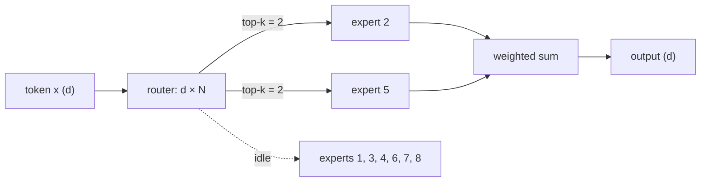

```predict
{"q":"Mixtral 8x7B has 8 experts per layer and sends each token through 2 of them. How many parameters does it hold in total?","options":["56B, since it is 8 times 7B","About 46.7B","About 14B"],"answer":1,"reveal":"About 46.7B, of which only about 12.9B are active per token. Attention, embeddings and norms are shared rather than copied eight times. The parameter table below counts every piece."}
```

A hospital does not send every patient to every doctor. A receptionist looks at each case and sends it to one or two specialists. The hospital employs fifty doctors, but any single patient costs only the time of two. Hiring more specialists makes the hospital more capable without making each visit more expensive.

A **mixture-of-experts (MoE)** layer applies this idea to the feed-forward network. A dense transformer runs every token through the same FFN, so every parameter in that FFN is used for every token. An MoE layer keeps $N$ separate FFNs, the **experts**, plus a small **router** (or gate) that picks $k$ of them for each token, usually $k = 1$ or $2$. The token only passes through the chosen experts. The others sit idle for that token.

This separates two numbers that are identical in a dense model:

- **Total parameters**: everything stored in memory. This sets how much the model can learn and how much memory it needs.
- **Active parameters**: the parameters a single token actually multiplies through. This sets the compute per token.

A dense model has one dial. An MoE model has two. You can grow total parameters by adding experts while active parameters, and therefore FLOPs per token, stay fixed.

## In everyday life

A large wedding caterer sets up many live counters: dosa, chaat, tandoor, sweets and more. No guest visits them all. Each guest walks to two or three counters and eats there. Yet the caterer must staff, stock and power every counter all evening, because any guest might walk to any of them. The bill depends on how many counters exist, but how long a guest waits depends only on the counters that guest uses.

That is a **mixture of experts**. The **experts** are separate feed-forward networks (small blocks of learned numbers that each **token**, a piece of a word, passes through), and a small **router** chooses a few of them for each token. **Total parameters** count everything stored, like all the counters. **Active parameters** count only what one token actually uses, like the two counters one guest visits. So the model can know more without doing more work per token.

Unlike guests, tokens do not choose for themselves. The router picks for them.

**Where you meet it.** A company wants its chat assistant to know more subjects without making every reply slower. Simply making the model bigger makes every reply costlier. A mixture of experts adds capacity in stored experts while each reply still uses only a few of them, though the whole set must still fit in memory.

```scene
title: A wedding with many counters
step: 🎪 The caterer sets up many counters, each cooking something different | many experts in one layer
step: 🚶 A guest arrives with an empty plate | a token enters the layer
step: 🧭 A guide points the guest to two counters | the router picks the top-k experts
step: 🍽 The guest eats only there, and the other counters stay idle for this guest | active parameters
step: 🏗 Every counter is still staffed and stocked, as any guest might come | total parameters held in memory
takeaway: Many experts are stored, but each token runs only a few, so capacity grows faster than per-token work.
```

## Counting total and active parameters

Let one expert have $P_e$ parameters and let the router be a single $d \times N$ linear layer. For one MoE layer:

$$
P_{\text{total}} = N \cdot P_e + dN, \qquad P_{\text{active}} = k \cdot P_e + dN
$$

The router term $dN$ is tiny next to the experts. A forward pass costs about 2 FLOPs per active parameter per token (one multiply, one add), so

$$
\text{FLOPs per token} \approx 2 \cdot P_{\text{active}}
$$

The ratio $P_{\text{total}} / P_{\text{active}} \approx N/k$ is the "free" capacity you get for the same compute. In practice it is not free: you pay in memory and communication, which the last topic covers.

### A toy layer from the repo

The demo in `llm_from_scratch/part_5/demo_moe.py` uses $d = 128$, $N = 4$, $k = 1$, and SwiGLU experts with a hidden size of $4d = 512$. A SwiGLU expert has three matrices (two in, one out), none with biases:

$$
P_e = 3 \cdot d \cdot 4d = 3 \times 128 \times 512 = 196{,}608
$$

The router is `nn.Linear(128, 4)` with a bias: $128 \times 4 + 4 = 516$.

- Total: $4 \times 196{,}608 + 516 = 786{,}948$
- Active per token: $1 \times 196{,}608 + 516 = 197{,}124$

That is four times the FFN parameters for almost exactly the compute of one dense FFN of the same shape.

### A real model: Mixtral 8x7B

Mixtral has $L = 32$ layers, $d = 4{,}096$, and $N = 8$ SwiGLU experts per layer, each with hidden size $14{,}336$. Every token goes to $k = 2$ of them. The name is misleading: it is not $8 \times 7 = 56$B, because attention, embeddings and norms are shared, not copied eight times.

| Component | Count | Parameters |
|---|---|---|
| One expert | $3 \times 4096 \times 14336$ | 176.2M |
| All experts, all layers | $8 \times 32 \times 176.2$M | 45.1B |
| Attention (grouped-query), all layers | $32 \times 41.9$M | 1.34B |
| Embeddings + output head | $2 \times 32000 \times 4096$ | 0.26B |
| **Total** | | **≈ 46.7B** |
| **Active per token** (2 experts) | $2 \times 32 \times 176.2\text{M} + 1.34\text{B} + 0.26\text{B}$ | **≈ 12.9B** |

Each token costs about $2 \times 12.9 \approx 26$ GFLOPs in the forward pass, the compute of a 13B dense model. A dense model with 46.7B parameters would cost about 93 GFLOPs per token.

## The expert is just the FFN

There is nothing new inside an expert. It is the same SwiGLU feed-forward block you built in [Modernising the architecture](/learn/model-foundations/modern-architecture), and it plays the same role as the FFN in [the transformer block](/learn/model-foundations/transformer-block). Adapted from the repo's `experts.py`:

```python
import torch.nn as nn

class ExpertMLP(nn.Module):
    """One expert: a SwiGLU FFN, d -> mult*d -> d."""
    def __init__(self, dim: int, mult: int = 4):
        super().__init__()
        inner = mult * dim
        self.inp1 = nn.Linear(dim, inner, bias=False)   # value branch
        self.inp2 = nn.Linear(dim, inner, bias=False)   # gate branch
        self.act = nn.SiLU()
        self.out = nn.Linear(inner, dim, bias=False)

    def forward(self, x):                # x: (tokens, d)
        a = self.inp1(x)                 # (tokens, 4d)
        b = self.act(self.inp2(x))       # (tokens, 4d)
        return self.out(a * b)           # (tokens, d)

experts = nn.ModuleList([ExpertMLP(128) for _ in range(4)])
router = nn.Linear(128, 4)
total = sum(p.numel() for p in experts.parameters()) + sum(p.numel() for p in router.parameters())
print(total)   # 786948
```

Note that the repo keeps the hidden size at $4d$ even for SwiGLU, so each expert has $12d^2$ parameters rather than the $8d^2$ you get by shrinking to $\tfrac83 d$. That is a deliberate simplification. The full version, which also offers a GELU expert, is `llm_from_scratch/part_5/experts.py`.

## See it



Only the solid paths cost compute for this token. A different token may light up a different pair. Across a batch of thousands of tokens, every expert gets used.

## In practice

- **Read model names carefully.** "8x7B" and "47B with 13B active" describe the same model. The active count predicts speed and FLOPs per token, while the total count predicts memory. Many people quote only the flattering one.
- **MoE changes the FFN only.** Attention, the residual stream, norms and the embedding stay exactly as in a dense model. That is why the repo's part 5 implements nothing but the feed-forward replacement.
- **Quality sits between the two counts.** As a rough rule, an MoE model performs better than a dense model with its active parameter count and worse than a dense model with its total parameter count. Mixtral's paper reports it matching or beating Llama 2 70B on many benchmarks while using about 13B active parameters.

```quiz
{"q": "An MoE layer has $N = 16$ experts of 10M parameters each, top-$k = 2$ routing, and a 0.1M-parameter router. What are its total and active parameter counts?", "options": ["160.1M total, 20.1M active", "160.1M total, 10.1M active", "20.1M total, 20.1M active", "320.1M total, 20.1M active"], "answer": 0, "explain": "Total $= 16 \\times 10 + 0.1 = 160.1$M because every expert is stored. Active $= 2 \\times 10 + 0.1 = 20.1$M because each token runs through $k = 2$ experts and the router. 10.1M would be top-1 routing. 320.1M counts each expert twice, as if $k$ multiplied the stored experts."}
```

```quiz
{"q": "You swap a 7B dense model for an MoE model with 47B total and 13B active parameters. Which statement is correct?", "options": ["Per-token compute roughly doubles and weight memory grows almost sevenfold", "Per-token compute and memory both stay near 7B because only 13B is active", "Memory grows to 13B worth of weights because idle experts can stay on disk", "Compute grows sevenfold because every expert must still be evaluated"], "answer": 0, "explain": "FLOPs track active parameters, $13/7 \\approx 1.9\\times$. Memory tracks total parameters, $47/7 \\approx 6.7\\times$, because any expert can be chosen by the next token, so all of them must be resident. The tempting idea that idle experts can stay on disk fails because routing changes token by token."}
```
