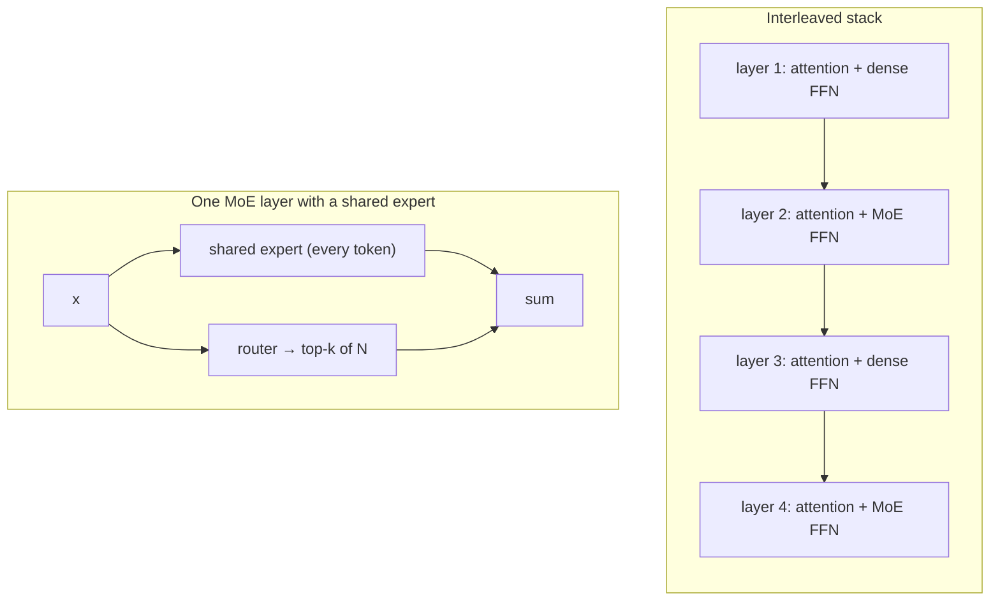

Nothing forces every FFN in a transformer to become an MoE layer. Real models mix the two, because sparse routing has costs of its own: routing instability, communication between devices, and experts that only ever see part of the data. A dense FFN is the opposite: every token passes through it, it trains smoothly, and it costs the same on every step.

There are three common ways to mix dense and sparse computation:

1. **Interleave layers.** Alternate dense FFN blocks and MoE blocks through the depth of the network. GShard replaced every other FFN with an MoE layer. DeepSeek-V3 keeps its first three layers dense and makes the rest MoE.
2. **Add a shared expert.** Inside one MoE layer, run one (or a few) experts on *every* token, and route only the rest. DeepSeekMoE introduced this: the shared expert learns common knowledge, so the routed experts are free to specialise.
3. **Blend outputs.** Run a dense FFN and an MoE layer side by side on the same input and mix them with a fixed weight. This is what the repo's `HybridFFN` does.

Patterns 1 and 2 are what production models use. Pattern 3 is a clean way to study the trade-off in a small model.

## In everyday life

Think of a school with a class teacher and visiting specialists. Every student spends time with the class teacher, who covers the basics everyone needs. Only some students also go to a specialist: a music teacher, a lab instructor, a coding mentor. The class teacher's time goes to every student, every day. The specialists' time goes only where needed. Many schools also alternate, with ordinary days and workshop days.

Real models mix **dense** and **MoE** layers in the same way. A dense feed-forward layer sends every **token** (piece of a word) through the same block, so it trains smoothly and costs the same each time. An MoE layer routes tokens to chosen **experts**. Designs differ in the mix: layers can alternate between dense and MoE, a **shared expert** can run on every token inside an MoE layer, or a dial can blend the two outputs. A shared expert holds the common basics once, so the routed experts are free to specialise.

The cost shows up too. The class teacher's time is always spent, so a shared expert adds work for every token.

**Where you meet it.** A team designing a large model keeps its first layers dense and makes the later ones MoE. Early layers handle general features that every token needs, and routing there tends to be less steady. The price is that the dense parts always run in full.

```scene
title: Class teacher plus visiting specialists
step: 👩 Every student sits with the class teacher for the basics | a dense feed-forward layer on every token
step: 🎻 Only some students go to a specialist workshop | routed experts
step: 📚 The basics are taught once, so specialists need not repeat them | the shared expert
step: 🔧 The head decides how much weight each kind of teaching gets | blending dense and MoE with a dial
step: 📅 The timetable alternates plain days and workshop days | interleaved dense and MoE layers
step: 💰 The class teacher's time is spent on every student | active compute for every token
takeaway: Mixing dense and expert layers trades the smoothness of always-on blocks against the extra capacity of routed ones.
```

## The blend in the repo

`HybridFFN` computes

$$
\mathbf{y} = \alpha \cdot \text{Dense}(\mathbf{x}) + (1 - \alpha) \cdot \text{MoE}(\mathbf{x}), \qquad \alpha \in [0, 1]
$$

At $\alpha = 1$ it is a plain dense FFN; at $\alpha = 0$ it is a plain MoE layer. In between, every token gets a guaranteed dense path plus a routed one. The repo's docstring describes $\alpha$ as a dial between "stability (dense) and capacity (MoE)".

Adapted from `llm_from_scratch/part_5/block_hybrid.py`:

```python
class HybridFFN(nn.Module):
    def __init__(self, dim, alpha=0.5, mult=4, n_expert=4, k=1, dropout=0.0):
        super().__init__()
        self.alpha = alpha
        inner = mult * dim
        self.dense = nn.Sequential(                       # classic GELU FFN, d -> 4d -> d
            nn.Linear(dim, inner), nn.GELU(), nn.Linear(inner, dim), nn.Dropout(dropout))
        self.moe = MoE(dim, n_expert=n_expert, k=k, mult=mult, dropout=dropout)

    def forward(self, x):                                 # x: (B, n, d)
        y_dense = self.dense(x)                           # (B, n, d)
        y_moe, aux = self.moe(x)                          # (B, n, d), scalar
        return self.alpha * y_dense + (1.0 - self.alpha) * y_moe, aux
```

Compare it with a shared expert, which is the same idea with the fixed $\alpha$ removed:

$$
\mathbf{y} = E_{\text{shared}}(\mathbf{x}) + \sum_{i \in \mathcal{T}} g_i \, E_i(\mathbf{x})
$$

Both run an always-on FFN plus $k$ routed experts. The difference is that a fixed $\alpha$ scales down the routed path for every token alike, while a shared expert lets the gate weights alone decide how much each routed expert adds. Turning `HybridFFN` into a shared-expert layer is a two-line change: drop $\alpha$ and sum the two outputs.

Neither pattern is free. The blend and the shared expert both run the dense FFN in full for every token, so the active compute is the dense FFN plus $k$ experts.

## Counting the trade-off

Take a 12-layer model with $d = 512$ and SwiGLU FFNs of hidden size $4d$ (the repo's expert), so one FFN has $12d^2 = 3{,}145{,}728$ parameters. Compare four designs with $N = 8$ and $k = 2$ wherever there is MoE, counting FFN parameters only:

| Design | Total FFN params | Active FFN params per token |
|---|---|---|
| All dense | $12 \times 3.15\text{M} = 37.7$M | 37.7M |
| All MoE | $12 \times 8 \times 3.15\text{M} = 302.0$M | $12 \times 2 \times 3.15\text{M} = 75.5$M |
| Alternate (6 dense, 6 MoE) | $6 \times 3.15 + 6 \times 8 \times 3.15 = 169.9$M | $6 \times 3.15 + 6 \times 2 \times 3.15 = 56.6$M |
| All MoE + shared expert | $12 \times 9 \times 3.15\text{M} = 339.7$M | $12 \times 3 \times 3.15\text{M} = 113.2$M |

Alternating halves both the extra memory and the number of layers that need routing and cross-device communication. The shared expert adds only one expert's worth of memory, but it adds a full FFN of compute to every token. To keep the active compute fixed, designs with shared experts usually make every expert smaller (DeepSeekMoE splits experts into many fine-grained ones) rather than adding a shared expert on top.



## Building an interleaved stack

The block only needs to know which FFN it holds. If the FFN returns an aux loss, the block forwards it; if it is dense, the block returns zero:

```python
def make_ffns(n_layer, dim, every=2, n_expert=8, k=2):
    """MoE in every `every`-th layer (1-indexed), dense elsewhere."""
    return nn.ModuleList([
        MoE(dim, n_expert=n_expert, k=k) if (i + 1) % every == 0 else ExpertMLP(dim)
        for i in range(n_layer)])

def ffn_forward(ffn, h):                       # h: (B, n, d)
    out = ffn(h) if isinstance(ffn, MoE) else (ffn(h), h.new_zeros(()))
    return out                                 # ((B, n, d), scalar aux)
```

Inside the block this sits exactly where the dense FFN sat in [the block you built from part 1](/learn/model-foundations/attention-in-code): after the second norm, before the second residual add.

```parsons
{"title":"Order the forward pass of a pre-norm block whose FFN may be an MoE layer","lines":["def forward(self, x):","    h = self.ln1(x)","    x = x + self.attn(h)","    h = self.ln2(x)","    y, aux = ffn_forward(self.ffn, h)","    x = x + y","    return x, aux"],"explain":"It is the part 1 pre-norm block with the FFN swapped: normalise, attend, add the residual; normalise the **updated** stream, run the FFN (MoE or dense), add the second residual. The one new requirement is the last line: the block must return `aux` so the training loop can add `0.01 * sum(aux_losses)` to the loss. Drop it and training still runs while routing quietly collapses."}
```

## In practice

- **Dense layers early, MoE later** is a common choice. Early layers handle generic token-level features, which every token needs and which gain little from specialisation. Routing there also tends to be less stable.
- **A shared expert reduces redundancy.** Without one, every routed expert has to relearn common patterns such as basic syntax, since any token might arrive. A shared expert holds those once.
- **The blend is a learning tool, not a speed-up.** Because `HybridFFN` always runs the dense FFN, it is more expensive than either pure option. Use it to measure how much the MoE path helps, by training at $\alpha = 1$, $0.5$ and $0$ and comparing validation loss at equal steps.

```quiz
{"q": "A 24-layer model alternates dense and MoE FFNs (12 of each). Each FFN or expert has 50M parameters, and MoE layers use $N = 16$, $k = 2$. How many FFN parameters are active per token?", "options": ["1.8B", "1.2B", "10.2B", "2.4B"], "answer": 0, "explain": "Dense layers: $12 \\times 50\\text{M} = 0.6$B. MoE layers: $12 \\times 2 \\times 50\\text{M} = 1.2$B. Active total 1.8B. 1.2B counts only the MoE layers. 10.2B is the total stored: $0.6 + 12 \\times 16 \\times 0.05 = 10.2$B, which sets memory, not compute."}
```

```quiz
{"q": "Compared with a plain top-2 MoE layer, what does adding one shared expert of the same size change?", "options": ["Total parameters rise by one expert and active compute per token rises by one expert", "Total parameters rise by one expert, but active compute is unchanged because the shared expert is not routed", "Active compute rises, but total parameters do not because the shared expert reuses routed weights", "Nothing, since the shared expert's output is multiplied by a gate weight of zero for most tokens"], "answer": 0, "explain": "The shared expert is a new FFN that is stored and run on every token, so both counts grow by one expert. The tempting wrong answer treats 'not routed' as 'not run'. In fact it is the opposite: being unrouted means it is always run."}
```
