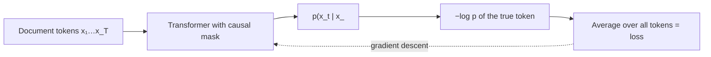

```callout-before
Before you start
You should know what a token is and what cross-entropy loss measures for a single prediction. Everything else in this module builds on the one equation in this topic.
```

Imagine learning a language by reading a library one word at a time, covering the next word with your hand and guessing it before you look. At first you guess badly. After millions of pages you can finish most sentences, and to do that well you have quietly learned grammar, facts, arithmetic, the style of legal contracts and the way Python functions usually end.

**Pretraining** is exactly that game played by a network over trillions of tokens. There are no labels written by people. The text supervises itself: every position in every document is a little exam whose answer is the token that actually comes next. This is called **self-supervised learning**, and it is why the quality and makeup of the data matter so much. The model can only become a summary of what it reads.

## One objective for everything

Take a document as a sequence of tokens $x_1, x_2, \dots, x_T$. The model with parameters $\theta$ produces, at each position $t$, a probability distribution over the whole vocabulary given everything before it, $p_\theta(\cdot \mid x_{<t})$. The **next-token cross-entropy** for that document is the average negative log-probability the model gave to the tokens that really occurred:

$$
\mathcal{L}(\theta) = -\frac{1}{T} \sum_{t=1}^{T} \log p_\theta(x_t \mid x_{<t})
$$

Here $T$ is the number of predicted tokens, $x_{<t}$ means all tokens before position $t$, and $\log$ is the natural log, so the loss is in **nats**. Over a whole corpus $\mathcal{D}$ the objective is the same average taken over every token of every document. Training adjusts $\theta$ by gradient descent to push this number down.

Two facts make the equation powerful. First, a transformer with a causal mask computes all $T$ predictions in one forward pass, so a 4,096-token sequence gives 4,096 training signals for the price of one pass. Second, minimising cross-entropy is the same as maximising the probability of the corpus, because $\sum_t \log p(x_t \mid x_{<t}) = \log p(x_1, \dots, x_T)$ by the chain rule of probability.

```steps
Cross-entropy for four tokens, by hand
The model reads "The cat sat on" and we score the four next-token predictions it made along the way. It gave the true tokens probabilities $0.40$, $0.25$, $0.80$ and $0.05$.
---
Take the negative natural log of each: $-\ln 0.40 = 0.916$, $-\ln 0.25 = 1.386$, $-\ln 0.80 = 0.223$, $-\ln 0.05 = 2.996$.
---
Average them: $\mathcal{L} = (0.916 + 1.386 + 0.223 + 2.996)/4 = 5.521/4 = 1.380$ nats per token.
---
Notice the one surprise ($p = 0.05$) contributes more than half the loss. Cross-entropy punishes confident ignorance far more than it rewards easy wins.
---
Convert to **perplexity**: $\text{PPL} = e^{\mathcal{L}} = e^{1.380} \approx 3.98$. The model was, on average, as uncertain as if it were choosing uniformly among about 4 tokens.
```

## Loss as compression

A model that assigns probability $p$ to the next token could encode it in $-\log_2 p$ bits with an arithmetic coder. So the average loss in bits, $\mathcal{L}/\ln 2$, is the number of bits per token the model would need to compress the corpus. Our example is $1.380 / 0.693 = 1.99$ bits per token. Lower pretraining loss literally means the model has found more of the structure in the text. This is why researchers often report **bits per byte** when comparing models with different tokenizers: dividing by bytes instead of tokens removes the tokenizer from the comparison.

| Quantity | Formula | Example value |
|---|---|---|
| Loss (nats/token) | $-\frac{1}{T}\sum \ln p$ | 1.380 |
| Loss (bits/token) | $\mathcal{L} / \ln 2$ | 1.99 |
| Perplexity | $e^{\mathcal{L}}$ | 3.98 |



## In practice

Every modern base model, whatever its size, is trained on this one objective. What differs between a mediocre and an excellent base model is mostly the **data**: which sources, in what proportions, how cleaned, how deduplicated, and how many tokens. Training teams watch the loss on a held-out validation set drawn from the same mixture. A typical large model ends pretraining at a validation loss somewhere around 1.5 to 2.5 nats per token, but the absolute number is only comparable between runs that share a tokenizer and validation set.

A common mistake is to compare perplexities across models with different tokenizers. A tokenizer with longer tokens makes each prediction harder (more information per token) and so raises per-token loss even if the model is better. Compare bits per byte, or compare on the same tokenizer.

```quiz
{"q": "A model assigns the true next tokens probabilities 0.5, 0.5, 0.5 and 0.5 over four positions. What is its perplexity on this sequence?", "options": ["0.5", "2", "4", "0.693"], "answer": 1, "explain": "Each token costs $-\\ln 0.5 = 0.693$ nats, so the average loss is 0.693 and the perplexity is $e^{0.693} = 2$: like choosing between 2 equally likely tokens. 0.693 is the loss, not the perplexity; 4 confuses the number of tokens with the branching factor."}
```

```quiz
{"q": "Why does one causal-transformer forward pass over a 2,048-token document give 2,048 training signals?", "options": ["Because the model is run 2,048 times in parallel on different copies", "Because the causal mask lets every position predict its next token from only earlier tokens, so all positions are scored at once", "Because the loss is multiplied by the sequence length", "Because each token is masked at random as in BERT"], "answer": 1, "explain": "The causal mask stops position $t$ seeing anything after it, so every position's prediction is a legitimate exam and all are computed together. It is not 2,048 separate runs, and it is not random masking (that is the masked-language-model objective, which scores only the masked ~15%)."}
```
