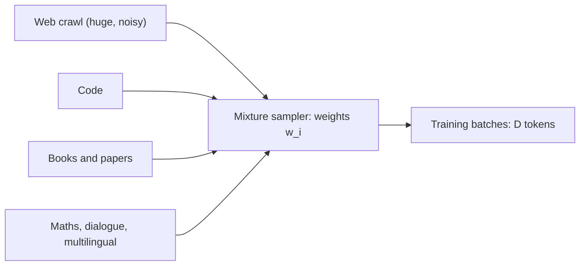

A pretraining corpus is not one dataset. It is a blend: a very large amount of filtered web text, plus smaller, higher-quality piles such as code, books, scientific papers, encyclopaedias, maths and conversation. Think of it like a diet. You need a lot of calories (web text), but the vitamins (code, maths, careful prose) come in small, dense sources, and you decide how often each one appears on the plate.

The decision is captured in a **data mixture**: a weight for each source saying what fraction of training tokens should be drawn from it. The weight is not the same as the source's share of the raw data. Teams deliberately **upsample** small, valuable sources (show them more than once) and **downsample** huge, noisy ones (never get through all of them).

## From weights to epochs

Let the training run see $D$ tokens in total. Source $i$ has $S_i$ unique tokens available and mixture weight $w_i$, with $\sum_i w_i = 1$. Then

$$
D_i = w_i D, \qquad \text{epochs}_i = \frac{D_i}{S_i} = \frac{w_i D}{S_i}
$$

$D_i$ is the number of tokens drawn from source $i$, and $\text{epochs}_i$ is how many times, on average, each of its tokens is seen. An epoch count below 1 means part of the source is never used.

Worked example for a run of $D = 1$ trillion tokens:

| Source | Unique tokens $S_i$ | Weight $w_i$ | Tokens drawn $D_i$ | Epochs |
|---|---|---|---|---|
| Filtered web | 800B | 0.70 | 700B | 0.875 |
| Code | 100B | 0.15 | 150B | 1.5 |
| Books | 20B | 0.05 | 50B | 2.5 |
| Academic papers | 40B | 0.10 | 100B | 2.5 |
| **Total** | 960B | 1.00 | 1,000B | |

Check one row: books get $0.05 \times 1000\text{B} = 50\text{B}$ tokens from a 20B pile, so $50/20 = 2.5$ passes. The web row never finishes a single pass: 100B web tokens are simply left unused. Real runs make exactly this kind of choice. GPT-3, for instance, drew its tokens from a weighted mix in which Wikipedia was seen several times over while less than half of the filtered Common Crawl was used.

## Balancing languages: temperature sampling

Multilingual corpora are wildly unbalanced: English can be hundreds of times larger than a lower-resource language. Sampling in proportion to size starves the small languages; sampling uniformly overfits them. A common compromise raises each source size to a power $\alpha$ between 0 and 1:

$$
w_i = \frac{S_i^{\alpha}}{\sum_j S_j^{\alpha}}
$$

With $\alpha = 1$ this is proportional sampling, with $\alpha = 0$ it is uniform. Take English with 900B tokens and Swahili with 100B. Proportional gives 90% and 10%. With $\alpha = 0.3$: $900^{0.3} \approx 7.70$ and $100^{0.3} \approx 3.98$, so the weights become $7.70/11.68 \approx 0.66$ and $3.98/11.68 \approx 0.34$. Swahili is now seen $0.34 D / 100\text{B}$ times, which for a 1T-token run is 3.4 epochs. That is the trade-off made explicit: more exposure for the small language, at the cost of repetition.



## How teams choose the weights

There is no closed-form answer. In practice teams train many **small proxy models** (say 100M to 1B parameters) on candidate mixtures, measure them on a broad set of evaluations, and pick the mixture whose trends look best before spending the big budget. Some patterns hold up widely:

- **Code helps reasoning**, not just coding. Most current general models include a substantial share of code.
- **Late-stage upweighting**: many runs shift the mixture toward the highest-quality sources (maths, curated text, instruction-like data) for the last part of training, often while the learning rate decays. This is sometimes called **annealing** on high-quality data.
- **Repetition has a cost, but not immediately**. Experiments on data-constrained scaling found a few epochs of repeated data are worth almost as much as fresh data, while many tens of epochs add very little. So upsampling a small source 2 to 4 times is normal; 30 times is a warning sign.

```callout-warn
Weights apply to tokens, not documents
If one source has long documents (books) and another has short ones (forum posts), equal document counts give very unequal token counts. Always express mixtures in tokens after tokenization, using the tokenizer you will train with.
```

```quiz
{"q": "A run of 2T tokens gives a 50B-token maths source a weight of 0.05. How many epochs of the maths data does the model see?", "options": ["0.05", "1", "2", "2.5"], "answer": 2, "explain": "Tokens drawn are $0.05 \\times 2000\\text{B} = 100\\text{B}$, and $100\\text{B}/50\\text{B} = 2$ epochs. 2.5 comes from using 1T instead of 2T in the wrong place; 0.05 is the weight itself, not an epoch count."}
```

```quiz
{"q": "Two languages have 400B and 25B tokens. Which sampling exponent gives the small language the largest share of training tokens?", "options": ["$\\alpha = 1$", "$\\alpha = 0.7$", "$\\alpha = 0.3$", "All give the same share"], "answer": 2, "explain": "Smaller $\\alpha$ flattens the sizes toward uniform. At $\\alpha = 1$ the small language gets $25/425 \\approx 6\\%$; at $\\alpha = 0.3$ it gets about 30%. Larger exponents keep the original imbalance."}
```
