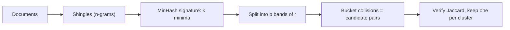

The web repeats itself. The same news story is syndicated to hundreds of sites, licence texts and cookie notices appear on millions of pages, and scrapers copy forums wholesale with a different header. If you train on this as-is, the model sees some passages thousands of times. It wastes compute on them, it **memorises** them (and can regurgitate them verbatim), and it gives them outsized influence on what it learns.

**Deduplication** removes the copies. **Exact deduplication** is easy: hash each document (or each normalised paragraph) and keep one per hash. The hard part is **near-duplicates**: pages that are 95% identical but differ in a date, an ad block or a footer. Exact hashes see them as completely different. For those we need a similarity measure and a way to find similar pairs without comparing every document with every other.

## Jaccard similarity on shingles

Turn each document into a set of **shingles**: overlapping runs of $n$ consecutive words (or characters). The **Jaccard similarity** of two sets $A$ and $B$ is the size of their overlap divided by the size of their union:

$$
J(A, B) = \frac{|A \cap B|}{|A \cup B|}
$$

$J = 1$ means identical shingle sets and $J = 0$ means nothing in common. Using word 2-shingles:

| Document | 2-shingles |
|---|---|
| A: "the cat sat on the mat" | the cat, cat sat, sat on, on the, the mat |
| B: "the cat sat on a mat" | the cat, cat sat, sat on, on a, a mat |

Shared shingles: *the cat, cat sat, sat on*, so $|A \cap B| = 3$. The union has $5 + 5 - 3 = 7$ distinct shingles. So $J = 3/7 \approx 0.43$. One changed word broke two shingles. Real pipelines use longer shingles (often 5 or more words) on whole documents, where a changed footer barely moves $J$ and pairs above roughly 0.8 are treated as duplicates.

## MinHash: a fingerprint that estimates Jaccard

Comparing all pairs is hopeless at web scale: a billion documents have about $\binom{10^9}{2} \approx 5 \times 10^{17}$ pairs. **MinHash** compresses each set into a short signature. Pick a random hash function $h$ that maps shingles to numbers, and record the smallest hash value in the set, $\min_{s \in A} h(s)$. The key fact:

$$
\Pr\left[\min_{s \in A} h(s) = \min_{s \in B} h(s)\right] = J(A, B)
$$

Why: under a random hash, every shingle in $A \cup B$ is equally likely to have the smallest value. The two minima agree exactly when that smallest shingle is in both sets, which happens with probability $|A \cap B| / |A \cup B|$. Repeat with $k$ independent hash functions and the fraction of matching minima estimates $J$, with standard error about $\sqrt{J(1-J)/k}$. For $J = 0.43$ and $k = 128$, that is $\sqrt{0.245/128} \approx 0.044$.

## Banding (LSH): finding candidates without all pairs

Now split each $k$-number signature into $b$ **bands** of $r$ numbers ($k = b \cdot r$). Hash each band into a bucket; two documents become **candidates** if any band matches exactly. A pair with Jaccard $s$ matches one band with probability $s^r$, so

$$
\Pr[\text{candidate}] = 1 - \left(1 - s^{r}\right)^{b}
$$

This is an S-shaped curve with its steep part near $s \approx (1/b)^{1/r}$. With $b = 20$ bands of $r = 5$ (so $k = 100$), the threshold sits near $(0.05)^{0.2} \approx 0.55$:

| Jaccard $s$ | $s^5$ | $\Pr[\text{candidate}]$ |
|---|---|---|
| 0.3 | 0.00243 | 0.047 |
| 0.5 | 0.03125 | 0.470 |
| 0.8 | 0.32768 | 0.9996 |
| 0.9 | 0.59049 | ≈ 1.0000 |

Check the 0.8 row: $1 - 0.32768 = 0.67232$, raised to the 20th power is about $0.00036$, so the candidate probability is $0.99964$. Near-duplicates almost always collide in some bucket; unrelated pages almost never do. Only candidate pairs get their true similarity checked.



## In practice

Production pipelines run exact dedup first (cheap, removes the bulk of copies), then MinHash near-dedup on documents, and sometimes **exact substring** dedup that removes long repeated spans (say, 50+ tokens) even inside otherwise unique documents. Deduplicated training data has been shown to reduce verbatim memorisation substantially while keeping or improving model quality. Two decisions need care: the threshold (too low merges genuinely different pages that share a template) and **which copy to keep** (usually the earliest or the one from the most trusted source). Deduplicate across the whole corpus, including against your evaluation sets, which is the subject of the last topic in this lesson.

```quiz
{"q": "Sets A and B each have 8 shingles and share 6. What is their Jaccard similarity?", "options": ["0.75", "0.60", "0.43", "0.86"], "answer": 1, "explain": "Union $= 8 + 8 - 6 = 10$, so $J = 6/10 = 0.6$. 0.75 divides by the size of one set (6/8) instead of the union."}
```

```quiz
{"q": "You use MinHash with 20 bands of 5 rows. You want to catch more pairs around Jaccard 0.5 without changing $k = 100$. Which change moves the threshold lower?", "options": ["10 bands of 10 rows", "50 bands of 2 rows", "Use 1-word shingles instead of more hash functions", "It cannot be moved without more hash functions"], "answer": 1, "explain": "The threshold is near $(1/b)^{1/r}$. With $b = 50, r = 2$: $(0.02)^{0.5} \\approx 0.14$, so far more pairs become candidates (at the price of many more false candidates). With $b = 10, r = 10$: $(0.1)^{0.1} \\approx 0.79$, a stricter threshold."}
```
