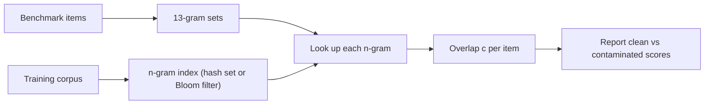

Benchmarks are published on the web. The web is the training set. So, unless someone takes care, the questions a model is graded on, and often their answers, are sitting in its pretraining data. A model that has seen the answer key can score well without having the skill the benchmark is supposed to measure. This is **contamination**, and it is one of the most common reasons a model looks better on paper than in use.

It is rarely deliberate. A test set gets copied into a GitHub repository, quoted in a blog post explaining the answers, or included in a scraped forum thread. Deduplication against the rest of the web does not catch it, because from the corpus's point of view those pages are perfectly unique.

## Measuring overlap with n-grams

The standard check is to break each benchmark item into token **n-grams** (runs of $n$ consecutive tokens) and look them up in an index of the training corpus. For an item with $m$ tokens there are $m - n + 1$ n-grams. Its **overlap** is

$$
c = \frac{\left|\,G_n(\text{item}) \cap G_n(\text{corpus})\,\right|}{\left|\,G_n(\text{item})\,\right|}
$$

where $G_n(\cdot)$ is the set of n-grams. Long n-grams such as $n = 13$ are used because a 13-token match almost never happens by chance in natural text, while short common phrases ("one of the most") would match everywhere. An item with $m = 40$ tokens has $40 - 13 + 1 = 28$ thirteen-grams; if 7 of them appear in the corpus, $c = 7/28 = 25\%$. Many audits flag an item as contaminated if $c$ exceeds a threshold, or even if any single long n-gram matches.

## How much contamination inflates a score

Split the benchmark into a contaminated fraction $f$ and a clean remainder. If the model scores $a_c$ on contaminated items and $a_{\text{clean}}$ on clean ones, the reported accuracy is a weighted average:

$$
a_{\text{reported}} = f \cdot a_c + (1 - f) \cdot a_{\text{clean}}
$$

```steps
A contaminated benchmark, by the numbers
An audit finds $f = 0.20$ of the items have long n-gram matches in the training data.
---
On those items the model scores $a_c = 0.95$; on the clean 80% it scores $a_{\text{clean}} = 0.60$.
---
Reported accuracy: $0.20 \times 0.95 + 0.80 \times 0.60 = 0.19 + 0.48 = 0.67$.
---
The honest estimate of the skill is the clean-subset score, 0.60. Seven points of the headline number came from memory, not ability.
```

Comparing the contaminated and clean subsets is itself the diagnostic. If they score about the same, the overlap probably did not help much (the items may share boilerplate but not answers). A large gap, as here, is strong evidence of memorisation.



## Prevention, not just detection

| Practice | What it does |
|---|---|
| Decontaminate before training | Remove documents with long n-gram overlap against all evaluation sets you care about |
| Keep private, held-out evals | A test set that has never been published cannot leak |
| Refresh benchmarks over time | Questions written after the training cutoff are clean by construction |
| Report clean-subset scores | Lets readers see how much overlap mattered |
| Canary strings | Some benchmarks embed a unique marker string so trainers can filter them out and auditors can detect them |

## In practice

For your own work, the lesson transfers directly to fine-tuning and evaluation later in this course. If you build an evaluation set from support tickets and also fine-tune on support tickets, run the same n-gram check between them, or split by time (train on last year, test on this month). Paraphrased leakage is harder: n-gram checks miss a question that was reworded. Embedding-similarity search between evaluation items and training data catches some of it, and fresh, private test sets remain the most reliable defence.

```quiz
{"q": "A benchmark item is 30 tokens long. How many 13-grams does it contain?", "options": ["30", "17", "18", "13"], "answer": 2, "explain": "An item of $m$ tokens has $m - n + 1$ n-grams: $30 - 13 + 1 = 18$. Forgetting the $+1$ gives 17."}
```

```quiz
{"q": "10% of a benchmark is contaminated. The model scores 90% on those items and 70% on the rest. What accuracy is reported, and what is the better estimate of real skill?", "options": ["72% reported; 70% real", "80% reported; 70% real", "72% reported; 72% real", "90% reported; 72% real"], "answer": 0, "explain": "$0.1 \\times 0.9 + 0.9 \\times 0.7 = 0.09 + 0.63 = 0.72$. The clean-subset score, 70%, is the better estimate of what the model can do on unseen questions. 80% averages the two subsets without weighting them."}
```
