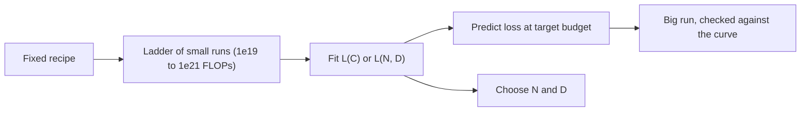

A scaling law is a forecast. Like a weather forecast, it is extremely useful when it is built from good data and used for the question it answers, and misleading when stretched beyond that. This topic is about the workflow teams actually use, and about the questions a loss curve does not answer.

## The workflow: fit small, predict big

1. Fix the recipe: data mixture, tokenizer, architecture, optimiser, schedule. Scaling laws describe one recipe; change the recipe and you must refit.
2. Train a ladder of small models across one to three orders of magnitude of compute, each near its compute-optimal size, and record final loss.
3. Fit a power law in compute (or the full $L(N, D)$ formula) to those points.
4. Extrapolate to the target budget, and use the fit to choose $N$ and $D$.

With a floor $E$ estimated, the compute law is $L(C) = E + K C^{-\gamma}$, which is a straight line in log-log space after subtracting $E$:

$$
\log(L - E) = \log K - \gamma \log C
$$

```steps
Extrapolating from a two-point ladder
Suppose $E = 1.8$, and runs at $C_1 = 10^{20}$ and $C_2 = 10^{21}$ reach losses of $2.60$ and $2.40$, so the reducible losses are $0.80$ and $0.60$.
---
The slope per decade is $\log_{10}(0.60/0.80) = \log_{10} 0.75 \approx -0.125$, so $\gamma \approx 0.125$.
---
Each further tenfold increase in compute multiplies the reducible loss by $10^{-0.125} = 0.75$. Predict $C = 10^{23}$ (two more decades): $0.60 \times 0.75^2 = 0.3375$, so $L \approx 1.8 + 0.34 = 2.14$.
---
Sensitivity check: if $E$ were really $1.7$, the reducible losses would be $0.90$ and $0.70$, $\gamma \approx 0.109$, and the prediction $1.7 + 0.70 \times 0.778^2 \approx 2.12$. Close here, but the uncertainty in $E$ grows the further you extrapolate, which is why real ladders use many more points.
```



During the big run, the predicted curve becomes a health check. If the loss drifts above the forecast, something is wrong (a data bug, a bad learning rate, a numerical problem) long before the run finishes.

## What the loss does not tell you

| Question | Why the loss law is not enough |
|---|---|
| Will the model be good at task X? | Downstream accuracy is a noisy, sometimes abrupt function of loss. Some benchmark scores look flat and then rise sharply with scale. |
| Is this a better dataset? | Different data shifts the constants. Compare recipes by their whole fitted curves, not one point. |
| What about after fine-tuning? | Instruction tuning and preference tuning change behaviour far more than their tiny compute suggests (later lessons). |
| Does it hold at 100 times the budget? | Only if nothing in the recipe breaks: data running out, instabilities, or precision problems. |

The "sharp rise" in some benchmarks is partly an artefact of measurement. A metric like exact-match accuracy gives zero credit until every token of an answer is right, so a smooth improvement in per-token probability can look like a sudden jump. Measuring the same task with a continuous metric (such as the log-probability of the correct answer) often shows a smooth trend that can be forecast.

## In practice

Use scaling laws for three decisions: how to split a budget, whether a recipe change is a real improvement (does it shift the whole curve?), and whether a running job is on track. Do not use them to promise a specific benchmark score. The lab puts the whole lesson together: a budget, a GPU type, a deadline, and a choice of model size and token count.

```lab
plan-a-training-run
```

```quiz
{"q": "Two small runs give reducible losses of 1.0 and 0.8, at $10^{19}$ and $10^{20}$ FLOPs. Assuming a power law, what reducible loss do you predict at $10^{21}$?", "options": ["0.60", "0.64", "0.70", "0.80"], "answer": 1, "explain": "Each decade multiplies the reducible loss by $0.8/1.0 = 0.8$, so the next decade gives $0.8 \\times 0.8 = 0.64$. Subtracting a constant 0.2 per decade (giving 0.60) treats it as a straight line on linear axes, which a power law is not."}
```

```quiz
{"q": "A data change lowers loss at $10^{19}$ FLOPs, but its advantage shrinks steadily as the ladder reaches $10^{21}$. What should the team conclude?", "options": ["Adopt it: lower loss is always better", "Be sceptical: the curves are converging, so the gain may vanish at the target scale", "The scaling law is broken", "The change only affects the irreducible loss"], "answer": 1, "explain": "What matters is the loss at the target budget. A gain that shrinks with scale (different slope, converging lines) may disappear or reverse at the big run. A constant-factor shift of the whole curve is the kind of improvement that survives."}
```
