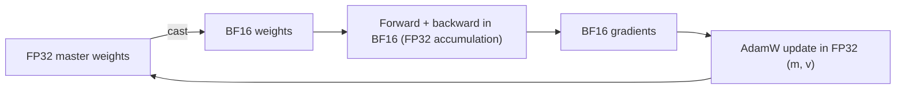

A floating-point number is like a measurement written in scientific notation with a fixed number of digits: a sign, an exponent that sets the scale, and a **mantissa** (significand) that sets the precision. More exponent bits let you write very large and very small numbers; more mantissa bits let you tell close numbers apart. Every 16-bit format has to split its bits between the two, and the split decides what goes wrong in training.

**Mixed-precision training** does the heavy matrix multiplications in a 16-bit format, which is two to many times faster on modern GPUs and halves the memory traffic, while keeping the numerically sensitive parts (the master weights, optimizer states and some reductions) in 32-bit.

## The three formats

A normal floating-point number with $e$ exponent bits and $f$ fraction bits represents

$$
x = (-1)^{s} \times \left(1 + \frac{F}{2^{f}}\right) \times 2^{\,X - \text{bias}}
$$

where $s$ is the sign bit, $F$ the integer stored in the fraction bits, $X$ the stored exponent and $\text{bias} = 2^{e-1} - 1$. The gap between 1 and the next representable number is $2^{-f}$, which measures precision.

| Format | Sign / exponent / fraction bits | Largest value | Gap after 1.0 ($2^{-f}$) |
|---|---|---|---|
| FP32 | 1 / 8 / 23 | $\approx 3.4 \times 10^{38}$ | $\approx 1.2 \times 10^{-7}$ |
| FP16 | 1 / 5 / 10 | 65,504 | $\approx 9.8 \times 10^{-4}$ |
| BF16 | 1 / 8 / 7 | $\approx 3.4 \times 10^{38}$ | $\approx 7.8 \times 10^{-3}$ |

**BF16** keeps FP32's 8 exponent bits, so it has the same enormous range, and pays for it with only 7 fraction bits (2 to 3 significant decimal digits). **FP16** has more precision but a tiny range: anything above 65,504 overflows to infinity and normal numbers stop at $2^{-14} \approx 6.1 \times 10^{-5}$.

## Two failure modes, worked

```steps
Why updates vanish in 16-bit
A weight is $w = 1.0$, the learning rate is $\eta = 10^{-4}$ and the normalised Adam step is about $1$, so the update is $10^{-4}$.
---
In BF16 the representable numbers near 1.0 are spaced $2^{-7} = 0.0078$ apart. $1.0 + 0.0001$ is far closer to $1.0$ than to $1.0078$, so it rounds back to exactly $1.0$. The update is lost.
---
In FP16 the spacing is $2^{-10} \approx 0.00098$. Still too coarse: $1.0001$ rounds to $1.0$.
---
In FP32 the spacing is $2^{-23} \approx 1.2\times10^{-7}$, so $1.0001$ is stored almost exactly. Thousands of tiny updates accumulate correctly. This is the job of the FP32 **master weights**.
```

The second failure is FP16-specific: **gradient underflow**. Many gradient values are smaller than $6 \times 10^{-5}$ and, below the subnormal limit of about $6 \times 10^{-8}$, they flush to zero. The fix is **loss scaling**: multiply the loss by a factor $S$ (say $2^{16} = 65{,}536$) before the backward pass, so every gradient is $S$ times larger and representable, then divide by $S$ before the optimizer step. **Dynamic loss scaling** lowers $S$ whenever an overflow (infinity) appears and raises it slowly otherwise. BF16, with its FP32-sized range, usually needs no loss scaling at all, which is the main reason it became the default for LLM training on hardware that supports it.



## Lower still: FP8

Recent GPUs add 8-bit floating-point formats (for example E4M3, with 4 exponent and 3 fraction bits, and E5M2). Training with FP8 matrix multiplies can roughly double throughput again, but precision is so low that each tensor needs its own **scaling factor**, tracked during training, and some operations stay in higher precision. It is used in some large production runs; it demands careful engineering and validation against a BF16 baseline.

## In practice

The standard recipe today: BF16 for weights, activations and gradients in matrix multiplies, FP32 accumulation inside those multiplies, FP32 master weights and Adam states, and FP32 for sensitive operations such as softmax normalisers, layer-norm statistics and the final loss. If you see a run's loss suddenly become `NaN`, check for FP16 overflow (if you use FP16), an unscaled loss, or a learning rate spike, in that order.

The training-memory simulation has a precision switch:

```sim
training-memory
{"model": "llama2-7b", "precision": "fp32"}
```

With full FP32, the state bytes per parameter are $4 + 4 + 8 = 16$ too (FP32 weights, FP32 gradients, two FP32 moments, no separate master copy), but activations double in size and the matrix multiplies run several times slower. Switch to BF16 mixed and compare the activation memory.

```quiz
{"q": "Which statement about BF16 versus FP16 is correct?", "options": ["BF16 has more precision but less range", "BF16 has the same range as FP32 but less precision than FP16", "They are identical except for the name", "FP16 has the same range as FP32"], "answer": 1, "explain": "BF16 uses 8 exponent bits (FP32's range) and 7 fraction bits, versus FP16's 5 and 10. So BF16 rarely overflows or underflows but distinguishes fewer nearby values. FP16 overflows at 65,504."}
```

```quiz
{"q": "A team trains in FP16 and sees many gradients become exactly zero in early layers. What is the standard fix?", "options": ["Lower the learning rate", "Use loss scaling: multiply the loss by a large factor before backward and divide the gradients by it before the update", "Store the master weights in FP16", "Switch the optimizer to SGD"], "answer": 1, "explain": "Small gradients underflow FP16's range. Scaling the loss shifts all gradients up into the representable range; unscaling before the update keeps the maths unchanged. Lowering the learning rate does nothing for values that are already zero."}
```
