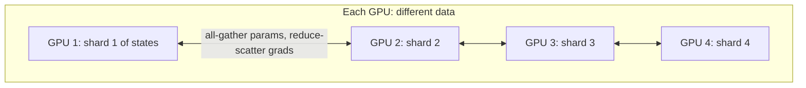

The simplest way to use many GPUs is to give each one a full copy of the model and a different slice of the batch. Every GPU runs forward and backward on its own examples, then they average their gradients so all copies take the identical update. This is **data parallelism** (DP). It is like a team of accountants each checking a different pile of receipts and then pooling their totals: perfectly parallel, as long as everyone holds the full rulebook.

The catch is that last phrase. Plain data parallelism keeps **every** byte of model state on **every** GPU. With 64 GPUs training a 7.5B model you hold 64 identical copies of the optimizer states. **ZeRO** (Zero Redundancy Optimizer) removes that redundancy by splitting, or **sharding**, the states so each GPU stores only its share.

## The cost of averaging gradients

After the backward pass, GPUs combine gradients with an **all-reduce**. The bandwidth-optimal ring all-reduce makes each GPU send (and receive) about

$$
V_{\text{send}} = 2 \cdot \frac{G - 1}{G} \cdot S
$$

bytes per step, where $G$ is the number of data-parallel GPUs and $S$ the size of the gradients. For large $G$ that is about $2S$, independent of $G$, which is why data parallelism scales so well. For a 7B model with BF16 gradients, $S \approx 13.5$ GB, so each GPU moves about 27 GB per step. At an effective 50 GB/s per GPU that is roughly 0.5 seconds, usually overlapped with the backward pass by sending each layer's gradients as soon as they are ready.

The **global batch** is the sum over all GPUs and accumulation steps:

$$
B_{\text{global}} = b_{\text{micro}} \times k_{\text{accum}} \times G
$$

With micro-batch 1, 16 accumulation steps, 64 GPUs and 4,096-token sequences: $1 \times 16 \times 64 = 1{,}024$ sequences, or about 4.2M tokens per optimizer step, a typical size for large-model pretraining.

## ZeRO's three stages

Write $\Psi$ for the parameter count, $N_d$ for the number of data-parallel GPUs, and $K = 12$ for the FP32 optimizer-side bytes (master weights, $m$, $v$). Per-GPU model-state memory:

| Stage | What is sharded | Bytes per GPU |
|---|---|---|
| Plain DP | nothing | $(2 + 2 + K)\Psi$ |
| ZeRO-1 | optimizer states | $2\Psi + 2\Psi + K\Psi / N_d$ |
| ZeRO-2 | + gradients | $2\Psi + (2 + K)\Psi / N_d$ |
| ZeRO-3 | + parameters | $(2 + 2 + K)\Psi / N_d$ |

```steps
A 7.5B model on 64 GPUs
Plain DP: $16 \times 7.5\times10^9 = 120$ GB per GPU. Does not fit on an 80 GB GPU.
---
ZeRO-1: $4 \times 7.5 = 30$ GB, plus $12 \times 7.5 / 64 \approx 1.41$ GB, giving about **31.4 GB**.
---
ZeRO-2: $2 \times 7.5 = 15$ GB, plus $14 \times 7.5/64 \approx 1.64$ GB, giving about **16.6 GB**.
---
ZeRO-3: $120 / 64 \approx$ **1.9 GB** per GPU. The model states have almost disappeared from each GPU, leaving room for activations and larger micro-batches.
```

How does ZeRO-3 compute anything if no GPU holds the full weights? Just before each layer runs, the GPUs **all-gather** that layer's parameter shards, compute, and discard the gathered copy. Gradients are **reduce-scattered** so each GPU ends up with only the gradient shard it owns, and it updates only its shard of the optimizer state. ZeRO-1 and ZeRO-2 add essentially no communication over plain DP; ZeRO-3 adds about 50% (an extra all-gather of parameters in the backward pass). PyTorch's **FSDP** (Fully Sharded Data Parallel) implements the same idea as ZeRO-3.

```sim
training-memory
{"model": "llama2-7b", "zero": 0, "gpus": 64}
```

Step the ZeRO stage from 0 to 3 and watch the bar chart of per-GPU totals by stage. Then, at ZeRO-3, drop the GPU count from 64 to 8 and see the model states grow eightfold while activations do not change: sharding divides states, never activations.



## In practice

ZeRO-1 or ZeRO-2 is a nearly free win whenever you use data parallelism. ZeRO-3/FSDP is the standard way to fine-tune models up to tens of billions of parameters on a single node or a few nodes. Its weakness is communication: on slow interconnects the all-gathers dominate the step time. At the largest scales, teams combine it with tensor and pipeline parallelism, which split each forward pass itself and are the subject of the next topic.

```quiz
{"q": "A 20B model is trained with ZeRO-3 across 32 GPUs. How much model-state memory does each GPU hold (16 bytes per parameter)?", "options": ["320 GB", "10 GB", "20 GB", "40 GB"], "answer": 1, "explain": "Total states are $16 \\times 20\\times10^9 = 320$ GB; ZeRO-3 shards all of them, so $320/32 = 10$ GB per GPU. 320 GB is plain data parallelism."}
```

```quiz
{"q": "Micro-batch 2, gradient accumulation 8, 128 data-parallel GPUs, 2,048-token sequences. How many tokens are in each optimizer step?", "options": ["About 0.52M", "About 2.1M", "About 4.2M", "About 33M"], "answer": 2, "explain": "Sequences per step $= 2 \\times 8 \\times 128 = 2{,}048$; times 2,048 tokens $\\approx 4.19$M tokens. Forgetting accumulation gives 0.52M; forgetting the micro-batch size gives about 2.1M."}
```
