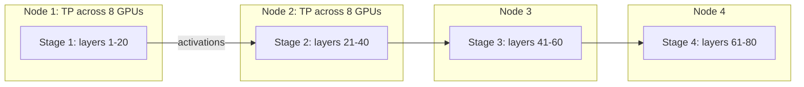

Data parallelism and ZeRO split the **batch** and the **stored state**, but every GPU still runs every layer of the forward pass on its own examples. At some size that stops working: a single layer's matrices and activations are too large, or the step takes too long, or there are more GPUs than useful batch slices. Then you split the **model's computation itself**, in two different directions.

- **Tensor parallelism** (TP) splits each layer's matrices across GPUs, so several GPUs cooperate on every single matrix multiply. Picture several cooks each chopping a share of the same onion at the same time.
- **Pipeline parallelism** (PP) splits the stack of layers into consecutive **stages** on different GPUs, so a batch flows through them like cars along an assembly line.

## Tensor parallelism inside a layer

Take the MLP $Y = \text{GeLU}(XW_1)W_2$. Split $W_1$ by **columns** across $t$ GPUs: each GPU computes its own slice of the hidden layer, $\text{GeLU}(XW_1^{(i)})$, with no communication, because the activation acts element-wise. Then split $W_2$ by **rows**: each GPU multiplies its hidden slice by its row block, producing a partial sum, and one **all-reduce** adds the partial sums:

$$
Y = \sum_{i=1}^{t} \text{GeLU}\!\left(X W_1^{(i)}\right) W_2^{(i)}
$$

Attention splits naturally by heads in the same way. The result (the Megatron-LM layout) is two all-reduces per layer in the forward pass and two in the backward pass. Each GPU holds $1/t$ of the layer's weights and computes $1/t$ of its FLOPs. Because those all-reduces happen inside every layer, many times per step, TP needs the fastest links available and is almost always kept **within one node** (for example $t = 8$ over NVLink).

## Pipeline parallelism and the bubble

With $p$ stages, stage 1 holds layers 1 to $L/p$, stage 2 the next block, and so on. A naive pipeline is wasteful: while stage 1 processes the batch, stages 2 to $p$ wait. The fix is to cut the batch into $m$ **micro-batches** and stream them, so stages work on different micro-batches at the same time. Some idle time remains at the start (filling the pipe) and end (draining it). This idle time is the **pipeline bubble**:

$$
\text{bubble fraction} = \frac{p - 1}{m + p - 1}
$$

```steps
How many micro-batches does a pipeline need?
With $p = 4$ stages and $m = 4$ micro-batches: $(4-1)/(4+4-1) = 3/7 \approx 43\%$ of GPU time is idle.
---
With $m = 16$: $3/(16 + 3) = 3/19 \approx 16\%$.
---
With $m = 64$: $3/67 \approx 4.5\%$. The bubble shrinks as micro-batches grow relative to stages.
---
The cost: more micro-batches in flight means more activations stored at once (schedules such as "one forward, one backward" limit this), and $m$ cannot exceed what the global batch allows.
```



Pipeline stages only exchange activations at stage boundaries, a small amount of point-to-point traffic, so PP works across nodes on slower links.

## 3D parallelism

Large runs combine all three. The GPU count factorises as

$$
G = t \times p \times d
$$

with $t$ the tensor-parallel size, $p$ the pipeline stages and $d$ the data-parallel replicas. For example, 1,024 GPUs as $t = 8$, $p = 4$, $d = 32$.

| | Splits | Communication | Where it lives |
|---|---|---|---|
| Data (+ZeRO) | batch (and states) | gradient all-reduce once per step | across nodes |
| Tensor | each matrix | all-reduce inside every layer | inside a node |
| Pipeline | layers into stages | activations between stages | across nodes |

A 70B model has $16 \times 70\times10^9 = 1.12$ TB of model states. With $t \times p = 32$ each GPU holds $1.12\text{ TB}/32 = 35$ GB of states before any ZeRO sharding across the 32 data-parallel replicas, leaving room in 80 GB for activations. Mixture-of-experts models add a fourth axis, **expert parallelism**, placing different experts on different GPUs.

## In practice

A common recipe: set $t$ to the number of GPUs in a node (or fewer if the model is small enough), use the fewest pipeline stages that make the model fit, and spend the rest on data parallelism, which is the most efficient axis. Then tune micro-batches until the bubble is below about 10%. For fine-tuning on one node, FSDP/ZeRO-3 alone is usually simpler and fast enough.

```quiz
{"q": "A pipeline has 8 stages and 24 micro-batches. What fraction of time is the bubble?", "options": ["$7/31 \\approx 23\\%$", "$8/24 \\approx 33\\%$", "$7/24 \\approx 29\\%$", "$1/8 = 12.5\\%$"], "answer": 0, "explain": "$(p-1)/(m+p-1) = 7/(24+7) = 7/31 \\approx 22.6\\%$. Dividing stages by micro-batches (33%) ignores the fill-and-drain structure."}
```

```quiz
{"q": "Why is tensor parallelism usually kept within a single node, while data parallelism spans many nodes?", "options": ["Tensor parallelism needs all-reduces inside every layer, so it needs the fastest interconnect", "Data parallelism does not communicate at all", "Tensor parallelism cannot use more than 2 GPUs", "Nodes cannot share activations"], "answer": 0, "explain": "TP communicates several times per layer, on the critical path of every forward and backward pass. Data parallelism communicates gradients once per step and can overlap it with computation, so slower inter-node links are acceptable."}
```
