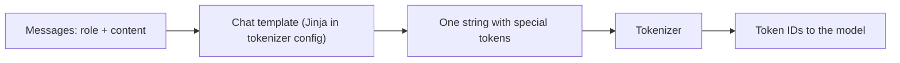

A transformer sees one flat sequence of token IDs. It has no built-in idea of "the user said this, the assistant said that". A conversation therefore has to be **serialised** into a single string with markers that say where each message begins and ends and who wrote it. That convention is the model's **chat template**.

Think of a play script. The text of the lines matters, but so does the format: `HAMLET:` before each speech, stage directions in brackets. An actor trained on scripts in one format will stumble if handed a different one. A model fine-tuned with one chat template behaves best, and sometimes only works properly, when prompted with exactly that template.

## Anatomy of a template

A typical template wraps each message in **special tokens**: reserved token IDs that never appear in normal text, such as a start-of-message marker, a role name, and an end-of-message marker. A widely used style (often called ChatML) looks like this:

```text
<|im_start|>system
You are a concise assistant.<|im_end|>
<|im_start|>user
What is 7 x 8?<|im_end|>
<|im_start|>assistant
56<|im_end|>
```

During SFT the model learns three things from this layout: the **roles** (system, user, assistant, and often tool), that it should write only the assistant part, and that it must emit the **end-of-turn** token when done. That last point is easy to overlook: the end token is what lets the serving code stop generation. If it is not trained, the model rambles on and starts writing the user's next turn itself.

## The overhead, counted

Templates cost tokens. Suppose each message adds $k$ template tokens (start marker, role, newline, end marker) and a conversation has $n_m$ messages with $T_c$ content tokens in total. Then

$$
T_{\text{total}} = T_c + k \cdot n_m, \qquad \text{overhead} = \frac{k \cdot n_m}{T_{\text{total}}}
$$

```steps
Template overhead for a chatty conversation
A support chat has 20 messages (10 user, 10 assistant) of about 25 content tokens each: $T_c = 500$.
---
With $k = 5$ template tokens per message: $5 \times 20 = 100$ extra tokens, so $T_{\text{total}} = 600$.
---
Overhead: $100 / 600 \approx 17\%$. For long documents in a single message it would be well under 1%; for many short turns it is significant in both context budget and cost.
---
Add a 300-token system prompt sent with every request and the fixed per-request cost grows further, which is why prompt caching (in the inference module) matters for chat products.
```



## Mistakes that silently hurt quality

| Mistake | Symptom |
|---|---|
| Prompting an instruct model without its template | Weaker answers, odd formatting, ignores system prompt |
| Fine-tuning with a different template from the base instruct model | Model mixes styles; may stop following instructions |
| Special tokens tokenized as plain text | `<\|im_end\|>` becomes several ordinary tokens; the model never learns to stop |
| End-of-turn token masked out of the loss | Model never learns to end its answer |
| Missing generation prompt | Inference string ends after the user turn, without the opening assistant marker, so the model may write another user message |

Most libraries store the template with the tokenizer (for Hugging Face models, as a Jinja template in the tokenizer config) and provide a function that applies it. Use that function for both training and inference rather than formatting strings by hand.

## In practice

When you fine-tune an existing instruct model, reuse its template exactly, including the system-prompt handling and the end token. When you fine-tune a base model from scratch, you choose a template; pick one, add its special tokens to the tokenizer (and resize the embedding matrix), and use it everywhere. Before any training run, decode one tokenized training example back to text and read it. A surprising share of fine-tuning bugs are visible in that one printout.

```quiz
{"q": "A fine-tuned model answers correctly but then continues by writing 'User: thanks!' and another answer. What is the most likely cause?", "options": ["The learning rate was too high", "The end-of-turn token was not trained (masked out or tokenized as plain text), so the model never learned to stop", "The model is too small", "The system prompt is too long"], "answer": 1, "explain": "Stopping is a learned behaviour: the model must emit the end-of-turn special token. If that token was excluded from the loss or split into ordinary tokens, generation runs on into an invented next turn."}
```

```quiz
{"q": "A conversation has 8 messages with 400 content tokens in total, and the template adds 6 tokens per message. What fraction of the sequence is template overhead?", "options": ["6%", "10.7%", "12%", "48%"], "answer": 1, "explain": "Overhead $= 6 \\times 8 = 48$ tokens; total $= 448$; $48/448 \\approx 10.7\\%$. Dividing by the content tokens only (48/400) gives 12%."}
```
